# GEARAWAI — Database Design (PostgreSQL / Supabase)

> | รายการ | รายละเอียด |
> |---|---|
> | เอกสาร | 2 / 6 — GEARAWAI_DATABASE_DESIGN.md |
> | Revision | **Rev.1 (11 พ.ย. 2026)** — แก้ตาม GEARAWAI_REVIEW_REPORT.md (R-01–R-07, R-09–R-12, R-14, R-20–R-23, R-25, R-28) และการตัดสินใจ D-01–D-10 |
> | สถานะ | Draft — **SQL ทดสอบแล้วบน PostgreSQL 16 + Supabase shim (ผ่าน 80/80)** · ยังไม่ได้รันบน Supabase จริง |
> | ไฟล์ประกอบ | `GEARAWAI_DB_SCHEMA_DRAFT.sql` (Schema ทั้งหมด) · `GEARAWAI_DB_TESTS.sql` (TC-DB-01–50) · `00_supabase_shim.sql`, `01_seed_test.sql`, `02_audit.sql` (ใช้ทดสอบเท่านั้น) |
> | อ้างอิง | SPEC ระบบที่ 18 · SYSTEM_ANALYSIS หัวข้อ 5–6 |
> | ข้อควรระวัง | ยังไม่ได้ตรวจว่ามีตารางใน Supabase Project เดิมแล้วหรือไม่ (M19) — ต้องเทียบก่อนสร้าง Migration |

---

## สารบัญ

1. [หลักการออกแบบ](#1-หลักการออกแบบ)
2. [Enum Types](#2-enum-types)
3. [รายการตารางทั้งหมด](#3-รายการตารางทั้งหมด)
4. [รายละเอียดตาราง](#4-รายละเอียดตาราง)
5. [ความปลอดภัย: GRANT + RLS + RPC](#5-ความปลอดภัย-grant--rls--rpc)
6. [Functions และ Triggers](#6-functions-และ-triggers)
7. [Views และสูตรราคา](#7-views-และสูตรราคา)
8. [Supabase Storage](#8-supabase-storage)
9. [Indexes](#9-indexes)
10. [ER Diagram (Mermaid)](#10-er-diagram-mermaid)
11. [ตัวอย่าง SQL สำคัญ](#11-ตัวอย่าง-sql-สำคัญ)
12. [ลำดับการสร้าง Migration](#12-ลำดับการสร้าง-migration)
13. [ผลการทดสอบ SQL](#13-ผลการทดสอบ-sql)

---

## 1. หลักการออกแบบ

| หลักการ | รายละเอียด |
|---|---|
| Primary Key | `uuid` (`gen_random_uuid()`) สำหรับตารางหลัก · `bigint generated always as identity` สำหรับตาราง Log (`stock_movements`, `points_transactions`) |
| **เขตเวลา (R-06)** | เก็บเวลาเป็น `timestamptz` (UTC) แต่ **ทุกกฎที่ใช้ "วันที่" ใช้เวลาไทย** ผ่าน `public.th_today()` / `public.th_now()` (`Asia/Bangkok`) — ห้ามใช้ `current_date` ในกฎธุรกิจ · รายงานจัดกลุ่มด้วยวันที่ไทย · Frontend ส่งวันเวลาแบบมี Offset `+07:00` |
| เงิน | `numeric(10,2)` หน่วยบาท — ห้ามใช้ `float` |
| ผู้ใช้ | `profiles.id` = `auth.users.id` (1:1) — ไม่เก็บรหัสผ่านในตารางของเรา |
| Snapshot | `order_items` เก็บชื่อ/SKU/ราคา/ภาพ ณ เวลาสั่งซื้อ |
| ลบข้อมูล | สินค้าที่เคยขายแล้ว **ลบไม่ได้ที่ระดับฐานข้อมูล** (`order_items.product_id ON DELETE RESTRICT`) → ใช้ปิดการขายแทน (R-10) |
| Demo Data | คอลัมน์ `is_demo` ในตารางที่มีข้อมูลตัวอย่าง |
| **ความปลอดภัย 3 ชั้นที่ฐานข้อมูล** | ① **GRANT ระดับตาราง/คอลัมน์** (ใครเขียนคอลัมน์ไหนได้) ② **RLS** (เขียน/อ่านแถวไหนได้) ③ **RPC `SECURITY DEFINER`** สำหรับงานที่แตะเงิน/สต็อก/คะแนน/การจอง/คูปอง — รายละเอียดหัวข้อ 5 |
| **ไม่มี Trigger เขียนทับค่าตามตัวตนผู้เรียก (R-01)** | การป้องกันคอลัมน์สำคัญใช้ GRANT ระดับคอลัมน์ ไม่ใช่ Trigger ที่ตรวจ `is_admin()`/`current_user` |
| Keys | แอปใช้เฉพาะ `NEXT_PUBLIC_SUPABASE_URL` + Anon/Publishable Key · **ไม่ต้องใช้ Service Role Key ในแอปเลย** (ทุกฟังก์ชันทำได้ด้วย RLS + RPC) · Seed ข้อมูลผ่าน SQL Editor/CLI · ห้ามเก็บ Secret ใน Repository |

---

## 2. Enum Types

| Enum | ค่า | ใช้ใน |
|---|---|---|
| `user_role` | `member`, `admin` | `profiles.role` |
| `account_status` | `active`, `suspended` | `profiles.account_status` |
| `product_status` | `active`, `inactive` | `products.status` |
| `order_status` | `pending_payment`, `payment_submitted`, `paid`, `shipped`, `completed`, `cancelled` | `orders.status` |
| `payment_method` | `promptpay_demo`, `bank_transfer_demo` | `payments.method` |
| `payment_status` | `pending`, `submitted`, `verified`, `rejected`, **`voided`** *(Rev.1 — R-20)* | `payments.status` |
| `booking_status` | `pending`, `confirmed`, `completed`, `cancelled` | `bookings.status` |
| `points_txn_type` | `earn`, `redeem`, `adjust`, `reverse` | `points_transactions.type` |
| `redemption_status` | `requested`, `fulfilled`, `cancelled` | `reward_redemptions.status` |
| `discount_type` | `percentage`, `fixed_amount` | `coupons`, `promotions` |
| `coupon_type` | `general`, `birthday` | `coupons.coupon_type` |
| `message_status` | `new`, `read`, `replied`, `archived` | `contact_messages.status` |
| `stock_movement_type` | `initial`, `restock`, `order`, `cancel_return`, `adjustment` | `stock_movements.movement_type` |
| `media_category` | `product`, `banner`, `promotion`, `category`, `gallery`, `team`, `service`, `reward`, `other` | `media_files.category` |

---

## 3. รายการตารางทั้งหมด

ตาราง 1–22 ตาม SPEC ระบบที่ 18 · ตาราง 23–26 เพิ่มเติม (SPEC อนุญาต "ปรับโครงสร้างตามความเหมาะสม") · Sequence 2 ตัว: `order_number_seq`, `booking_number_seq` (R-11)

| # | ตาราง | หน้าที่ | ระบบที่ใช้ | ที่มา |
|---|---|---|---|---|
| 1 | `profiles` | ข้อมูลสมาชิก/บทบาท/คะแนนคงเหลือ | S05, S10, S11, S14, S15 | SPEC |
| 2 | `products` | ข้อมูลสินค้า | S01, S03, S04, S07, S15 | SPEC |
| 3 | `categories` | หมวดหมู่สินค้า | S01, S03, S04, S17 | SPEC |
| 4 | `brands` | แบรนด์สินค้า | S03, S04 | SPEC |
| 5 | `product_images` | รูปภาพสินค้า | S03, S16 | SPEC |
| 6 | `wishlists` | หัวรายการโปรด (1/ผู้ใช้) | S06 | SPEC |
| 7 | `wishlist_items` | สินค้าในรายการโปรด | S06, S14 | SPEC |
| 8 | `carts` | หัวตะกร้า (1/ผู้ใช้) | S07 | SPEC |
| 9 | `cart_items` | สินค้าในตะกร้า | S07, S09 | SPEC |
| 10 | `orders` | คำสั่งซื้อ | S09, S14, S15, S17 | SPEC |
| 11 | `order_items` | รายการสินค้าในคำสั่งซื้อ | S09, S14, S17 | SPEC |
| 12 | `payments` | ข้อมูลแจ้งชำระเงิน (Demo) | S09, S15 | SPEC |
| 13 | `bookings` | การจองบริการ | S08, S14, S15 | SPEC |
| 14 | `services` | บริการของร้าน | S08, S15 | SPEC |
| 15 | `points_transactions` | ประวัติคะแนน | S10, S12, S14 | SPEC |
| 16 | `rewards` | ของรางวัล | S12 | SPEC |
| 17 | `reward_redemptions` | ประวัติการแลกรางวัล | S12, S14 | SPEC |
| 18 | `coupons` | คูปอง (ทั่วไป/แม่แบบวันเกิด) | S09, S11 | SPEC |
| 19 | `promotions` | โปรโมชั่น | S01, S19 | SPEC |
| 20 | `contact_messages` | ข้อความติดต่อ | S20, S15 | SPEC |
| 21 | `team_members` | ทีมงาน | S02 | SPEC |
| 22 | `site_settings` | การตั้งค่าเว็บไซต์ (Key-Value) | ทุกระบบ | SPEC |
| 23 | `media_files` | คลังรูปภาพ | S16, S02 (Gallery) | เพิ่ม |
| 24 | `stock_movements` | ประวัติการเปลี่ยนสต็อก | S15 | เพิ่ม |
| 25 | `member_coupons` | คูปองที่สมาชิกได้รับ/ใช้ | S11 | เพิ่ม |
| 26 | `promotion_products` | สินค้าที่เข้าร่วมโปรโมชั่น | S19 | เพิ่ม |

---

## 4. รายละเอียดตาราง

> สัญลักษณ์: **PK** · **FK** · **UQ** Unique · **NN** Not Null · **DF** Default · **CK** Check · 🔒 = เปลี่ยนได้ผ่าน RPC เท่านั้น (ไม่มี GRANT UPDATE ให้ผู้ใช้)

### 4.1 `profiles`

| Column | Type | Constraint | คำอธิบาย |
|---|---|---|---|
| `id` | `uuid` | **PK**, **FK** → `auth.users(id)` ON DELETE CASCADE | |
| `full_name` | `text` | NN, CK length 1–100 | สมาชิกแก้เองได้ |
| `email` | `text` | NN, UQ | 🔒 สำเนาจาก Auth (อ่านอย่างเดียว) |
| `phone` | `text` | CK `~ '^[0-9+ -]{9,15}$'` | สมาชิกแก้เองได้ |
| `birth_date` | `date` | CK `> '1900-01-01'` · **ไม่บังคับ (D-08)** | 🔒 ผ่าน `set_my_birth_date()` / `admin_set_member_birth_date()` |
| `birth_date_change_count` | `smallint` | NN, DF 0 | 🔒 ตั้งครั้งแรกไม่นับ · แก้ได้อีก 1 ครั้ง |
| `address` | `text` | CK length ≤ 500 | สมาชิกแก้เองได้ |
| `avatar_url` | `text` | | สมาชิกแก้เองได้ |
| `role` | `user_role` | NN, DF `'member'` | 🔒 ตั้ง Admin ด้วย SQL เท่านั้น |
| `account_status` | `account_status` | NN, DF `'active'` | 🔒 `admin_set_account_status()` |
| `points_balance` | `integer` | NN, DF 0, CK `>= 0` | 🔒 เปลี่ยนผ่าน RPC คะแนนเท่านั้น |
| `is_demo` | `boolean` | NN, DF false | |
| `created_at`, `updated_at` | `timestamptz` | NN, DF now() | `updated_at` อัปเดตด้วย Trigger |

> **Rev.1 (R-01):** ยกเลิก Trigger `protect_profile_columns` — ใช้ `GRANT UPDATE (full_name, phone, address, avatar_url)` แทน (เหตุผลในหัวข้อ 5.2)

### 4.2 `categories` · 4.3 `brands`

| Column | Type | Constraint |
|---|---|---|
| `id` | `uuid` | **PK** |
| `name` | `text` | NN, UQ (categories: length 1–80) |
| `slug` | `text` | NN, UQ, CK `~ '^[a-z0-9-]+$'` |
| `description`, `image_url` (categories) / `logo_url` (brands) | `text` | |
| `sort_order` (categories) | `integer` | NN, DF 0 |
| `is_active` | `boolean` | NN, DF true — **ปิดหมวด/แบรนด์ = สินค้าในนั้นถูกซ่อนจากหน้าร้านด้วย** (เพราะ View join แบบ inner) |
| `is_demo` | `boolean` | NN, DF false |
| `created_at`, `updated_at` | `timestamptz` | NN, DF now() |

### 4.4 `products`

| Column | Type | Constraint | คำอธิบาย |
|---|---|---|---|
| `id` | `uuid` | **PK** | |
| `sku` | `text` | NN, UQ, CK `~ '^GA-[A-Z]{2}-[0-9]{3}$'` | "Product ID" ตาม SPEC |
| `name` | `text` | NN, CK length 1–150 | |
| `slug` | `text` | NN, UQ, CK `~ '^[a-z0-9-]+$'` | `/shop/[slug]` |
| `brand_id` | `uuid` | NN, **FK** → `brands` RESTRICT | |
| `category_id` | `uuid` | NN, **FK** → `categories` RESTRICT | |
| `short_description` | `text` | CK length ≤ 200 | |
| `description` | `text` | | |
| `specifications` | `jsonb` | NN, DF `'{}'` | |
| `price` | `numeric(10,2)` | NN, CK `> 0` | |
| `sale_price` | `numeric(10,2)` | CK `NULL` หรือ `0 < sale_price < price` | |
| `stock_quantity` | `integer` | NN, DF 0, CK `>= 0` | 🔒 หลังสร้างแล้วเปลี่ยนผ่าน `admin_adjust_stock()` / `place_order()` / `cancel_order()` |
| `low_stock_threshold` | `integer` | NN, DF 5, CK `>= 0` | |
| `sold_count` | `integer` | NN, DF 0, CK `>= 0` | 🔒 **เพิ่มเมื่อ Order ถูกยืนยันว่าชำระแล้ว (D-07)** · ลดเมื่อยกเลิก Order ที่ชำระแล้ว |
| `status` | `product_status` | NN, DF `'active'` | |
| `is_featured`, `is_demo` | `boolean` | NN, DF false | |
| `created_by` | `uuid` | **FK** → `profiles` SET NULL, DF `auth.uid()` | |
| `created_at`, `updated_at` | `timestamptz` | NN, DF now() | |

Trigger `products_initial_stock` บันทึก `stock_movements('initial')` อัตโนมัติเมื่อสร้างสินค้าที่มีสต็อก > 0

### 4.5 `product_images`

| Column | Type | Constraint |
|---|---|---|
| `id` | `uuid` | **PK** |
| `product_id` | `uuid` | NN, **FK** → `products` CASCADE |
| `media_id` | `uuid` | **FK** → `media_files` SET NULL |
| `image_url` | `text` | NN |
| `alt_text` | `text` | |
| `sort_order` | `integer` | NN, DF 0 |
| `is_primary` | `boolean` | NN, DF false — Partial UQ (`product_id`) WHERE `is_primary` + Trigger ยกเลิกภาพหลักเดิมอัตโนมัติ |
| `created_at` | `timestamptz` | NN, DF now() |

### 4.6–4.9 `wishlists`, `wishlist_items`, `carts`, `cart_items`

| ตาราง | Column สำคัญ | Constraint |
|---|---|---|
| `wishlists` / `carts` | `user_id` | NN, UQ, **FK** → `profiles` CASCADE (สร้างอัตโนมัติตอนสมัคร) |
| `wishlist_items` | `wishlist_id`, `product_id` | **FK** CASCADE · **UQ** (`wishlist_id`, `product_id`) |
| `cart_items` | `cart_id`, `product_id`, `quantity` | **FK** CASCADE · **UQ** (`cart_id`, `product_id`) · `quantity` CK 1–99 |

> ตะกร้าไม่เก็บราคา — คำนวณจาก `calc_effective_price()` ทุกครั้ง · หน้า `/cart` และ `/wishlist` อ่านผ่าน `get_my_cart()` / `get_my_wishlist()` เพื่อแสดงสินค้าที่ถูกปิดขายได้ (R-04)

### 4.10 `orders`

| Column | Type | Constraint | คำอธิบาย |
|---|---|---|---|
| `id` | `uuid` | **PK** | |
| `order_number` | `text` | NN, UQ | `GA-YYYYMMDD-NNNN` — วันที่ไทย + Sequence (R-11) |
| `user_id` | `uuid` | NN, **FK** → `profiles` RESTRICT | |
| `status` | `order_status` | NN, DF `'pending_payment'` | |
| `subtotal` | `numeric(10,2)` | NN, CK `>= 0` | ผลรวม `effective_price × qty` |
| `discount_amount` | `numeric(10,2)` | NN, DF 0, CK `0 ≤ x ≤ subtotal` | ส่วนลดคูปอง |
| `shipping_fee` | `numeric(10,2)` | NN, DF 0, CK `>= 0` | **ส่งฟรีเมื่อ `subtotal` (ก่อนหักคูปอง) ≥ เกณฑ์ (D-04)** |
| `total_amount` | `numeric(10,2)` | NN, CK `= subtotal − discount_amount + shipping_fee` | |
| `coupon_id` | `uuid` | **FK** → `coupons` SET NULL | คูปองทั่วไป หรือแม่แบบวันเกิด |
| `coupon_code` | `text` | | Snapshot รหัสที่ใช้ |
| `recipient_name` | `text` | NN, CK length 1–100 | |
| `recipient_phone` | `text` | NN, CK รูปแบบเบอร์ | |
| `shipping_address` | `text` | NN, CK length 10–500 | |
| `note` | `text` | CK length ≤ 500 | |
| `tracking_number`, `cancelled_reason` | `text` | | |
| `paid_at`, `shipped_at`, `completed_at`, `cancelled_at` | `timestamptz` | | |
| `is_demo` | `boolean` | NN, DF false | |
| `created_at`, `updated_at` | `timestamptz` | NN, DF now() | |

> **Rev.1 (R-22):** ตัดคอลัมน์ `member_coupon_id` ออก — ความสัมพันธ์คูปองวันเกิด ↔ Order เก็บที่ `member_coupons.order_id` แห่งเดียว

### 4.11 `order_items`

| Column | Type | Constraint |
|---|---|---|
| `id` | `uuid` | **PK** |
| `order_id` | `uuid` | NN, **FK** → `orders` CASCADE |
| `product_id` | `uuid` | **NN, FK → `products` ON DELETE RESTRICT** *(Rev.1 — R-10)* |
| `product_sku`, `product_name` | `text` | NN (Snapshot) |
| `product_image_url` | `text` | Snapshot |
| `unit_price` | `numeric(10,2)` | NN, CK `>= 0` |
| `quantity` | `integer` | NN, CK `> 0` |
| `line_total` | `numeric(10,2)` | NN, CK `= unit_price × quantity` |
| `created_at` | `timestamptz` | NN, DF now() |

### 4.12 `payments`

| Column | Type | Constraint | คำอธิบาย |
|---|---|---|---|
| `id` | `uuid` | **PK** | |
| `order_id` | `uuid` | NN, **FK** → `orders` CASCADE | 1 Order มีหลายครั้งได้ (ถูกปฏิเสธแล้วแจ้งใหม่) |
| `method` | `payment_method` | NN | |
| `amount` | `numeric(10,2)` | NN, CK `>= 0` | ใส่จาก `orders.total_amount` ใน RPC (ผู้ใช้ส่งยอดเองไม่ได้) |
| `status` | `payment_status` | NN, DF `'pending'` | `voided` = Order ถูกยกเลิกหลังแจ้ง/ยืนยันชำระ (Demo — ไม่มีการคืนเงินจริง) |
| `slip_path` | `text` | | ต้องขึ้นต้นด้วย `{user_id}/{order_id}/` (ตรวจใน RPC) |
| `payer_note` | `text` | CK length ≤ 300 | |
| `is_demo` | `boolean` | NN, DF **true** | |
| `submitted_at`, `verified_at` | `timestamptz` | | |
| `verified_by` | `uuid` | **FK** → `profiles` SET NULL | |
| `reject_reason` | `text` | | |
| `created_at` | `timestamptz` | NN, DF now() | |

### 4.13 `services` · 4.14 `bookings`

| ตาราง | Column | Type | Constraint / คำอธิบาย |
|---|---|---|---|
| `services` | `id`, `name`, `slug` (UQ), `description`, `image_url` | | |
| | `price` | `numeric(10,2)` | NN, DF 0, CK `>= 0` (ชำระที่ร้าน — ไม่ผ่าน S09) |
| | `duration_minutes` | `integer` | NN, CK `> 0` |
| | `sort_order`, `is_active`, `is_demo`, `created_at`, `updated_at` | | |
| `bookings` | `booking_number` | `text` | NN, UQ — `BK-YYYYMMDD-NNNN` สร้างใน `create_booking()` (R-11) |
| | `user_id` | `uuid` | NN, **FK** → `profiles` RESTRICT |
| | `service_id` | `uuid` | NN, **FK** → `services` RESTRICT |
| | `booking_date` | `date` | NN — ตรวจใน RPC: ≥ วันนี้ (เวลาไทย), ≤ `max_days_ahead`, ไม่ใช่วันปิด |
| | `time_slot` | `time` | NN — ต้องอยู่ใน `site_settings.booking_rule.time_slots` · ถ้าเป็นวันนี้ต้องยังไม่เลยเวลา |
| | `contact_name`, `contact_phone`, `contact_email` | `text` | NN, CK รูปแบบ |
| | `note` | `text` | CK length ≤ 500 |
| | `price_snapshot` | `numeric(10,2)` | NN — คัดลอกจาก `services.price` ใน RPC |
| | `status` | `booking_status` | NN, DF `'pending'` · 🔒 เปลี่ยนผ่าน `cancel_booking()` / `admin_update_booking()` |
| | `admin_note`, `is_demo`, `created_at`, `updated_at` | | |

**กันจองซ้ำ:** Partial UQ (`service_id`, `booking_date`, `time_slot`) WHERE `status IN ('pending','confirmed')` → ช่องที่ถูกยกเลิกกลับมาว่าง

### 4.15 `points_transactions`

| Column | Type | Constraint |
|---|---|---|
| `id` | `bigint` | **PK** identity |
| `user_id` | `uuid` | NN, **FK** → `profiles` CASCADE |
| `type` | `points_txn_type` | NN |
| `points` | `integer` | NN, CK `<> 0` (บวก = ได้, ลบ = ใช้) |
| `balance_after` | `integer` | NN, CK `>= 0` |
| `order_id` | `uuid` | **FK** → `orders` SET NULL — **Partial UQ WHERE `type = 'earn'`** (กันให้คะแนนซ้ำ) |
| `redemption_id` | `uuid` | **FK** → `reward_redemptions` SET NULL |
| `note` | `text` | บังคับเมื่อ `adjust` |
| `created_by` | `uuid` | **FK** → `profiles` SET NULL |
| `created_at` | `timestamptz` | NN, DF now() |

**สูตรคะแนน (D-04):** `floor((subtotal − discount_amount) / baht_per_point)` — **ไม่รวมค่าจัดส่ง** · ได้เมื่อ Order = `completed` · ถ้าผลเป็น 0 ไม่บันทึกแถว

### 4.16 `rewards` · 4.17 `reward_redemptions`

| ตาราง | Column | Constraint |
|---|---|---|
| `rewards` | `name`, `description`, `image_url` | |
| | `points_required` | NN, CK `> 0` |
| | `stock_quantity` | NN, DF 0, CK `>= 0` |
| | `sort_order`, `is_active`, `is_demo`, timestamps | |
| `reward_redemptions` | `user_id` (FK CASCADE), `reward_id` (FK RESTRICT) | NN |
| | `reward_name` | NN (Snapshot) |
| | `points_used` | NN, CK `> 0` |
| | `status` | `redemption_status`, DF `'requested'` |
| | `admin_note`, `fulfilled_at`, `cancelled_at`, `created_at` | |

> ของรางวัลทั้งหมดเป็นของที่จับต้องได้ (D-06) — ไม่มีของรางวัลประเภทคูปอง

### 4.18 `coupons`

| Column | Type | Constraint |
|---|---|---|
| `id` | `uuid` | **PK** |
| `code` | `text` | UQ, CK `= upper(code)` · NULL ได้สำหรับแม่แบบวันเกิด · CK `coupon_type <> 'general' OR code IS NOT NULL` |
| `name`, `description` | `text` | `name` NN |
| `coupon_type` | `coupon_type` | NN, DF `'general'` |
| `discount_type` | `discount_type` | NN |
| `discount_value` | `numeric(10,2)` | NN, CK `> 0` และ `<= 100` เมื่อเป็น % |
| `max_discount_amount` | `numeric(10,2)` | CK `> 0` |
| `min_order_amount` | `numeric(10,2)` | NN, DF 0 (เทียบกับ `subtotal`) |
| `usage_limit` | `integer` | CK `> 0` (NULL = ไม่จำกัด) |
| `used_count` | `integer` | NN, DF 0 · 🔒 เพิ่มใน `place_order()` / ลดใน `cancel_order()` |
| `per_user_limit` | `integer` | NN, DF 1 — **นับเฉพาะ Order ที่ `status <> 'cancelled'` (R-23)** |
| `valid_days_after_claim` | `integer` | CK `> 0` (แม่แบบวันเกิด: ถ้าว่าง = หมดอายุต้นเดือนถัดไป) |
| `start_at`, `end_at` | `timestamptz` | CK `end_at > start_at` |
| `is_active`, `is_demo`, timestamps | | |

### 4.19 `member_coupons`

| Column | Type | Constraint |
|---|---|---|
| `id` | `uuid` | **PK** |
| `user_id` | `uuid` | NN, **FK** → `profiles` CASCADE |
| `coupon_id` | `uuid` | NN, **FK** → `coupons` RESTRICT |
| `code` | `text` | NN, UQ (`BDAYyy-XXXXXX`) |
| `cycle_year` | `integer` | NN (ปีตามเวลาไทย) |
| `claimed_at` | `timestamptz` | NN, DF now() |
| `expires_at` | `timestamptz` | NN — เริ่มต้นเดือนถัดไป 00:00 น. เวลาไทย |
| `used_at` | `timestamptz` | |
| `order_id` | `uuid` | **UQ**, **FK** → `orders` SET NULL — แหล่งความจริงเดียว (R-22) |
| — | — | **UQ** (`user_id`, `coupon_id`, `cycle_year`) — รับได้ 1 ครั้ง/ปี |

### 4.20 `promotions` · 4.21 `promotion_products`

| ตาราง | Column | Constraint |
|---|---|---|
| `promotions` | `name` NN, `slug` UQ, `description` | |
| | `discount_type`, `discount_value` | NN, CK `> 0`, `<= 100` เมื่อ % |
| | `start_at`, `end_at` | NN, CK `end_at > start_at` |
| | `is_active`, `show_on_homepage`, `sort_order`, `is_demo` | |
| | `banner_desktop_url`, `banner_mobile_url` | 1200×600 / 750×1000 |
| | `created_by` (DF `auth.uid()`), timestamps | |
| `promotion_products` | (`promotion_id`, `product_id`) | **PK** คู่ · FK CASCADE ทั้งคู่ |

### 4.22 `contact_messages`

| Column | Type | Constraint |
|---|---|---|
| `id` | `uuid` | **PK** |
| `user_id` | `uuid` | **FK** → `profiles` SET NULL (NULL = Guest) — ใส่จาก `auth.uid()` ใน RPC |
| `name` | `text` | NN, CK 1–100 |
| `email` | `text` | NN, CK รูปแบบอีเมล |
| `subject` | `text` | NN, CK 1–150 |
| `message` | `text` | NN, CK 10–2000 |
| `status` | `message_status` | NN, DF `'new'` |
| `admin_note`, `read_at`, `replied_at`, `created_at` | | |

**จำกัดความถี่ (R-14):** `submit_contact_message()` ปฏิเสธเมื่ออีเมลเดียวกันส่ง ≥ 3 ครั้งใน 10 นาที หรือทั้งระบบ ≥ 20 ข้อความใน 1 นาที (+ Honeypot ที่ Server Action) — *ข้อจำกัด:* ผู้ไม่หวังดีเปลี่ยนอีเมลเพื่อเลี่ยงได้ จึงมีเพดานรวมทั้งระบบอีกชั้น

### 4.23 `team_members`

`id`, `full_name` NN, `position` NN, `description`, `image_url`, `sort_order`, `is_active`, `is_demo`, timestamps

### 4.24 `site_settings`

| Column | Type | Constraint |
|---|---|---|
| `key` | `text` | **PK**, CK `~ '^[a-z_]+$'` |
| `value` | `jsonb` | NN |
| `description` | `text` | |
| `is_public` | `boolean` | NN, DF true |
| `updated_by` | `uuid` | FK, DF `auth.uid()` |
| `updated_at` | `timestamptz` | NN |

**Keys (ค่าตัวอย่างที่อนุมัติแล้ว — D-05)**

| key | value | is_public | ระบบ |
|---|---|:---:|---|
| `store_info` | `{"name":"GEARAWAI","slogan":"LEVEL UP YOUR GEAR","tagline":"Upgrade your setup with premium gaming gear and IT accessories."}` | ✅ | S01 |
| `hero_banner` | `{"desktop_url":"","tablet_url":"","mobile_url":"","cta_label":"SHOP NOW","cta_href":"/shop"}` | ✅ | S01 |
| `store_contact` | `{"phone":"000-000-0000","email":"contact@example.com","address":null,"map_embed_url":null,"is_sample":true}` | ✅ | S13 |
| `social_links` | `{"facebook":null,"instagram":null,"tiktok":null,"youtube":null}` | ✅ | S13 |
| `about_content` | `{"history":"…","highlights":["…5 ข้อ…"]}` | ✅ | S02 |
| `points_rule` | `{"baht_per_point":100,"earn_on_status":"completed","base":"subtotal_minus_discount"}` | ✅ | S10 |
| `shipping_rule` | `{"flat_fee":50,"free_shipping_min":1000}` — เทียบกับ `subtotal` ก่อนหักคูปอง | ✅ | S09 |
| `birthday_rule` | `{"coupon_id":"<uuid แม่แบบ>","window":"birth_month"}` | ✅ | S11 |
| `payment_mode` | `{"mode":"demo","qr_image_url":"","bank_sample":{"bank":"ธนาคารตัวอย่าง","account_name":"GEARAWAI (DEMO)","account_no":"XXX-X-XXXXX-X"}}` | ✅ | S09 |
| `booking_rule` | `{"time_slots":["10:00","13:00","15:00"],"max_days_ahead":30,"closed_weekdays":[]}` (`closed_weekdays` ใช้ ISO 1=จันทร์…7=อาทิตย์) | ✅ | S08 |
| `upload_rule` | `{"max_bytes":2097152,"mime":["image/jpeg","image/png","image/webp"]}` | ❌ | S16 |

### 4.25 `media_files`

| Column | Type | Constraint |
|---|---|---|
| `id` | `uuid` | **PK** |
| `bucket` | `text` | NN, CK `IN ('product-images','site-media')` |
| `storage_path` | `text` | NN · **UQ** (`bucket`, `storage_path`) |
| `public_url`, `file_name` | `text` | NN |
| `mime_type` | `text` | NN, CK jpeg/png/webp |
| `size_bytes` | `integer` | NN, CK `0 < x ≤ 2097152` |
| `width`, `height` | `integer` | CK `> 0` |
| `category` | `media_category` | NN, DF `'other'` |
| `alt_text` | `text` | |
| `uploaded_by` | `uuid` | FK SET NULL, DF `auth.uid()` — **ไม่เปิดเผยต่อสาธารณะ** (Gallery อ่านผ่าน `get_public_gallery()`) |
| `is_demo`, `created_at` | | |

### 4.26 `stock_movements`

| Column | Type | Constraint |
|---|---|---|
| `id` | `bigint` | **PK** identity |
| `product_id` | `uuid` | NN, FK CASCADE |
| `movement_type` | `stock_movement_type` | NN |
| `quantity_change` | `integer` | NN, CK `<> 0` |
| `quantity_after` | `integer` | NN, CK `>= 0` |
| `order_id` | `uuid` | FK SET NULL |
| `note` | `text` | บังคับเมื่อ `adjustment` |
| `created_by` | `uuid` | FK SET NULL |
| `created_at` | `timestamptz` | NN |

---

## 5. ความปลอดภัย: GRANT + RLS + RPC

### 5.1 บริบทการทำงานจริงบน Supabase

| คำขอจาก | Postgres Role | `auth.uid()` | ผลต่อการออกแบบ |
|---|---|---|---|
| Guest (ไม่ Login) | `anon` | NULL | ได้เฉพาะสิทธิ์ที่ GRANT ให้ `anon` + RLS |
| สมาชิก/Admin ผ่าน Supabase JS | `authenticated` | UUID ผู้ใช้ | Admin และ Member ใช้ role เดียวกัน — แยกกันด้วย `is_admin()` ใน RLS/RPC |
| ภายใน RPC `SECURITY DEFINER` | สิทธิ์ของเจ้าของฟังก์ชัน (`postgres`) | **ยังเป็น UUID ของผู้เรียกเดิม** | ข้าม RLS ได้ (เจ้าของตาราง) จึงต้องตรวจ `auth.uid()` / `is_admin()` เองในฟังก์ชัน |
| Supabase Auth สร้างผู้ใช้ | `supabase_auth_admin` | — | Trigger `handle_new_user` (definer) สร้าง profile/cart/wishlist |

### 5.2 การวิเคราะห์ R-01 และเหตุผลที่เลือกวิธีแก้

**ต้นเหตุ:** Trigger เดิมตัดสินว่า "ใครกำลังแก้" จาก `is_admin()` ซึ่งอ่าน `auth.uid()` — แต่ `auth.uid()` คือ **ผู้เรียกต้นทาง** เสมอ ไม่ว่าการแก้จะมาจาก API ตรงหรือจาก RPC ที่เชื่อถือได้ Trigger จึงแยก "สมาชิกแก้คะแนนเอง" กับ "RPC แลกรางวัลหักคะแนนให้สมาชิก" ไม่ออก และเขียนทับค่ากลับ

| ทางเลือก | ข้อดี | ข้อเสีย | ผล |
|---|---|---|---|
| ตรวจ `current_user` ใน Trigger | แก้ได้เร็ว | พึ่งพา "ใครเป็นเจ้าของฟังก์ชัน" โดยนัย — ถ้าฟังก์ชันถูกสร้างโดย role อื่น หรือเปลี่ยนเป็น `SECURITY INVOKER` การป้องกันจะพัง/เปิดช่องโดยไม่มีใครรู้ · ทดสอบในเครื่อง (superuser) ให้ผลต่างจาก Supabase | ❌ ไม่ใช้ |
| ตั้งค่า GUC ชั่วคราวใน RPC (`set_config('app.trusted',…)`) | ชัดกว่า | ต้องเชื่อว่าผู้ใช้ตั้งค่า GUC เองไม่ได้ · ลืมตั้งใน RPC ใหม่ = บั๊กเดิม | ❌ ไม่ใช้ |
| **GRANT ระดับคอลัมน์ + RPC เฉพาะงาน** | PostgreSQL บังคับเองตั้งแต่ขั้นตรวจสิทธิ์ ไม่ขึ้นกับตัวตนผู้เรียก · RPC (เจ้าของ = `postgres`) แก้คอลัมน์ได้ตามปกติ · ตรวจสอบง่ายด้วย `has_column_privilege` | Admin ก็แก้คอลัมน์ 🔒 ตรงไม่ได้ ต้องใช้ RPC (ซึ่งดีกว่าเพราะมี Validation + Log) | ✅ **เลือก** |

ผลทดสอบยืนยัน: TC-DB-06/07 (สมาชิกแก้ role/คะแนน → permission denied) · TC-DB-24 (แลกรางวัล → คะแนนลดจริง) · TC-DB-26 (ผลรวมประวัติ = คะแนนคงเหลือ)

### 5.3 ชั้นที่ 1 — GRANT (ตาราง/คอลัมน์)

ขั้นตอน: `REVOKE ALL` จาก `anon`, `authenticated` ทุกตาราง/Sequence/ฟังก์ชัน แล้ว GRANT ตามตาราง (Supabase ให้สิทธิ์ทั้งหมดแก่ Object ใหม่อัตโนมัติ — **ต้องรันส่วน GRANT ใหม่ทุกครั้งที่เพิ่มตาราง/ฟังก์ชัน**)

| ตาราง | `anon` | `authenticated` |
|---|---|---|
| `categories`, `brands`, `product_images`, `promotions`, `promotion_products`, `services`, `rewards`, `team_members`, `site_settings` | SELECT | SELECT, INSERT, UPDATE, DELETE *(RLS: เขียนได้เฉพาะ Admin)* |
| `products` | SELECT | SELECT · INSERT (ทุกคอลัมน์ยกเว้น `sold_count`) · UPDATE (ยกเว้น `stock_quantity`, `sold_count`) · DELETE *(RLS: Admin)* |
| `v_product_catalog`, `v_active_promotions` | SELECT | SELECT |
| `profiles` | — | SELECT · **UPDATE (`full_name`, `phone`, `address`, `avatar_url`) เท่านั้น** |
| `cart_items` | — | SELECT · INSERT (`cart_id`, `product_id`, `quantity`) · UPDATE (`quantity`) · DELETE |
| `wishlist_items` | — | SELECT · INSERT (`wishlist_id`, `product_id`) · DELETE |
| `coupons` | — | SELECT · INSERT/UPDATE (ยกเว้น `used_count`) · DELETE *(RLS: Admin; สมาชิกอ่านเฉพาะแม่แบบของตน)* |
| `contact_messages` | — | SELECT · UPDATE (`status`, `admin_note`, `read_at`, `replied_at`) · DELETE *(RLS: Admin)* |
| `media_files` | — | SELECT, INSERT, UPDATE, DELETE *(RLS: Admin)* |
| `wishlists`, `carts`, `orders`, `order_items`, `payments`, `bookings`, `points_transactions`, `reward_redemptions`, `member_coupons`, `stock_movements` | — | **SELECT เท่านั้น** (เขียนผ่าน RPC/Trigger) |

### 5.4 ชั้นที่ 2 — RLS

`own` = แถวของ `auth.uid()` · `admin` = `is_admin()` · `active` = สถานะเปิดใช้งาน

| ตาราง | SELECT | INSERT / UPDATE / DELETE (เท่าที่ GRANT อนุญาต) |
|---|---|---|
| `profiles` | own, admin | UPDATE: own, admin |
| `categories`, `brands`, `services`, `rewards`, `team_members` | `is_active` หรือ admin | admin |
| `products` | `status = 'active'` หรือ admin | admin |
| `product_images` | สินค้า active หรือ admin | admin |
| `promotions` | `is_active` และ `now()` อยู่ในช่วง หรือ admin | admin |
| `promotion_products` | ทุกคน | admin |
| `site_settings` | `is_public` หรือ admin | admin |
| `coupons` | admin · **สมาชิก: เฉพาะแม่แบบที่อยู่ใน `member_coupons` ของตน (R-05)** | admin |
| `member_coupons` | own, admin | — (RPC) |
| `wishlists`, `carts` | own | — (Trigger) |
| `wishlist_items` | own | INSERT: ของตนเอง + สินค้า active · DELETE: own |
| `cart_items` | own | INSERT: ของตนเอง + สินค้า active · UPDATE/DELETE: own |
| `orders`, `bookings`, `points_transactions`, `reward_redemptions` | own, admin | — (RPC) |
| `order_items`, `payments` | เจ้าของ Order, admin | — (RPC) |
| `contact_messages` | admin | UPDATE/DELETE: admin · INSERT ผ่าน RPC |
| `media_files` | admin (สาธารณะอ่าน Gallery ผ่าน RPC) | admin |
| `stock_movements` | admin | — (RPC/Trigger) |

### 5.5 ชั้นที่ 3 — สิทธิ์เรียกฟังก์ชัน (EXECUTE)

| กลุ่ม | ฟังก์ชัน |
|---|---|
| `anon` + `authenticated` | `is_admin`, `th_today`, `th_now`, `calc_effective_price`, `get_booked_slots`, `get_public_gallery`, `submit_contact_message` |
| `authenticated` (สมาชิก) | `get_my_cart`, `get_my_wishlist`, `set_my_birth_date`, `validate_coupon`, `place_order`, `submit_payment`, `cancel_order`, `redeem_reward`, `claim_birthday_coupon`, `create_booking`, `cancel_booking` |
| `authenticated` (ภายในตรวจ `is_admin()` → `FORBIDDEN`) | `admin_verify_payment`, `admin_update_order_status`, `admin_update_redemption`, `admin_adjust_points`, `admin_adjust_stock`, `admin_set_account_status`, `admin_set_member_birth_date`, `admin_update_booking`, `media_usage`, `admin_dashboard_stats`, `report_sales`, `report_best_sellers`, `report_category_sales`, `report_order_status`, `report_customers` |
| **ไม่ GRANT ให้ใคร** (ภายใน) | `_evaluate_coupon`, `_award_order_points`, `_cart_subtotal`, `_assert_admin`, `get_setting`, `next_order_number`, `next_booking_number`, `handle_new_user`, Trigger functions |

### 5.6 กฎสำหรับ `SECURITY DEFINER` ทุกตัว

1. `set search_path = ''` และอ้างชื่อเต็ม `public.xxx` (ตรวจแล้วด้วย Audit A1)
2. บรรทัดแรกตรวจ `auth.uid()` (สมาชิก) หรือ `_assert_admin()` (Admin)
3. ค่าที่เกี่ยวกับเงิน/คะแนน/ราคา **คำนวณในฟังก์ชันเสมอ** — ไม่รับยอดจากผู้ใช้
4. ล็อกแถวที่แก้ (`FOR UPDATE`) ก่อนตรวจเงื่อนไข
5. **ไม่คืนข้อมูลส่วนบุคคล** ของผู้อื่น — `get_booked_slots` คืนแค่เวลา, `get_public_gallery` ไม่คืน `uploaded_by`, `_evaluate_coupon` ตอบ `INVALID_CODE` เมื่อใช้รหัสของคนอื่น (ไม่ยืนยันว่ารหัสมีอยู่) · ข้อมูลชื่อ/อีเมลคืนเฉพาะใน `report_customers` ซึ่งเป็น Admin เท่านั้น
6. Error ใช้รหัสข้อความคงที่ (เช่น `OUT_OF_STOCK:<sku>`, `RATE_LIMITED`) ให้ Frontend แปลเป็นข้อความไทย — ไม่ส่ง Error ดิบให้ผู้ใช้

### 5.7 Admin คนแรก

สมัครผ่านหน้าเว็บตามปกติ แล้วรันใน SQL Editor ด้วยบัญชีเจ้าของโปรเจกต์: `update public.profiles set role = 'admin' where email = '...';` — ไม่มีหน้าเว็บหรือ RPC ใดเปลี่ยน `role`

---

## 6. Functions และ Triggers

### 6.1 Triggers

| Trigger | ตาราง | เวลา | หน้าที่ |
|---|---|---|---|
| `on_auth_user_created` → `handle_new_user()` | `auth.users` | AFTER INSERT | สร้าง `profiles` + `wishlists` + `carts` · **ไม่ล้มเพราะ metadata (R-07):** ชื่อว่าง → ใช้ส่วนหน้าอีเมล · วันเกิดรับเฉพาะ `YYYY-MM-DD` ที่ถูกต้องและไม่เป็นอนาคต (นอกนั้นเป็น NULL) · **ไม่อ่าน role จาก metadata** |
| `set_updated_at()` | ทุกตารางที่มี `updated_at` | BEFORE UPDATE | |
| `ensure_single_primary_image()` | `product_images` | BEFORE INSERT/UPDATE OF `is_primary` | ยกเลิกภาพหลักเดิม |
| `products_initial_stock()` | `products` | AFTER INSERT | บันทึก `stock_movements('initial')` |

> **ยกเลิกใน Rev.1:** `protect_profile_columns()` (แทนด้วย GRANT ระดับคอลัมน์ — R-01) · `validate_booking()` (ย้ายไปอยู่ใน `create_booking()` — R-02)

### 6.2 RPC — สมาชิก / Guest

| Function | ผู้เรียก | สิ่งที่ทำ | ระบบ |
|---|---|---|---|
| `get_my_cart()` | Member | คืนรายการตะกร้าของตนเอง + ชื่อ/ภาพ/ราคา/`product_status`/`is_purchasable` **รวมสินค้าที่ถูกปิดขาย** (R-04) | S07 |
| `get_my_wishlist()` | Member | เหมือนกันสำหรับ Wishlist | S06 |
| `set_my_birth_date(date)` | Member | ตั้งครั้งแรกได้เสมอ · แก้ได้อีก 1 ครั้ง · ไม่เป็นอนาคต (`BIRTH_DATE_LOCKED`, `INVALID_BIRTH_DATE`) | S11, S14 |
| `validate_coupon(code)` | Member | คืน `{valid, reason, code, subtotal, discount}` จากตะกร้าปัจจุบัน (ไม่บันทึก) | S09, S11 |
| `place_order(name, phone, address, note, coupon_code)` | Member | ตรวจบัญชี → ล็อกสินค้า → ตรวจ active/สต็อก → `subtotal` จาก `calc_effective_price` → ค่าส่ง (เทียบ `subtotal`) → คูปอง → สร้าง Order (`next_order_number`) + Items (Snapshot) → ตัดสต็อก + `stock_movements` → ผูกคูปอง → ล้างตะกร้า | S07, S09 |
| `submit_payment(order_id, method, slip_path, note)` | Member (เจ้าของ) | `pending_payment` → บันทึก `payments(submitted, is_demo)` ยอดจาก Order · ตรวจ path สลิป | S09 |
| `cancel_order(order_id, reason)` | Member (`pending_payment`) / Admin (ก่อน `shipped`) | คืนสต็อก + `stock_movements` · ลด `sold_count` ถ้าเคย `paid` · คืนคูปอง · `payments` → `voided` | S09, S14, S15 |
| `redeem_reward(reward_id)` | Member | ล็อก profile + reward → ตรวจ → บันทึก redemption → หักคะแนน → `points_transactions(redeem)` → ลดจำนวนรางวัล | S12 |
| `claim_birthday_coupon()` | Member | ต้องมีวันเกิดและอยู่ในเดือนเกิด (เวลาไทย) → สร้าง `member_coupons` 1 ครั้ง/ปี | S11 |
| `get_booked_slots(service_id, date)` | Guest, Member | คืน **เฉพาะเวลา** ที่ถูกจอง (R-03) | S08 |
| `create_booking(service, date, time, name, phone, email, note)` | Member | ตรวจบัญชี/บริการ/วัน/เวลา/วันปิด → สร้าง `BK-…` · ชนกัน → `SLOT_TAKEN` | S08 |
| `cancel_booking(booking_id)` | Member (เจ้าของ, `pending`) | → `cancelled` | S08, S14 |
| `submit_contact_message(name, email, subject, message)` | Guest, Member | ตรวจความถี่ → บันทึก (R-14) | S20 |
| `get_public_gallery()` | Guest, Member | คืน `id, public_url, alt_text, width, height` ของภาพหมวด `gallery` (R-09) | S02 |

### 6.3 RPC — Admin

| Function | สิ่งที่ทำ | ระบบ |
|---|---|---|
| `admin_verify_payment(payment_id, approve, reason)` | อนุมัติ: `verified` + Order `paid` + **`sold_count` เพิ่ม (D-07)** · ปฏิเสธ (ต้องมีเหตุผล): `rejected` + Order กลับ `pending_payment` | S09, S15 |
| `admin_update_order_status(order_id, status, tracking)` | `paid → shipped` · `shipped → completed` (+ `_award_order_points`) · อื่น ๆ → `INVALID_TRANSITION` (ยกเลิกใช้ `cancel_order`) | S15, S10 |
| `admin_update_redemption(id, status, note)` | `requested → fulfilled` / `cancelled` (คืนคะแนน `reverse` + คืนรางวัล) | S12 |
| `admin_adjust_points(user_id, points, note)` | ปรับคะแนน (`adjust`) ต้องมีเหตุผล · ห้ามติดลบ | S10 |
| `admin_adjust_stock(product_id, change, type, note)` | `restock` (+) / `adjustment` (± ต้องมีเหตุผล) · ห้ามติดลบ · บันทึก `stock_movements` | S15 |
| `admin_set_account_status(user_id, status)` | ระงับ/เปิดบัญชี · **ห้ามทำกับตนเอง · ห้ามระงับ Admin คนสุดท้าย (R-25)** | S15 |
| `admin_set_member_birth_date(user_id, date)` | แก้วันเกิดกรณีเกินสิทธิ์ | S11, S15 |
| `admin_update_booking(id, status, note)` | `pending → confirmed/cancelled` · `confirmed → completed/cancelled` · แก้ Admin Note | S08 |
| `media_usage(media_id)` | คืนรายการที่ใช้ภาพ (product_images, categories, brands, promotions, services, rewards, team_members, site_settings) — R-28 | S16 |
| `admin_dashboard_stats(from, to)` | ยอดขายสำเร็จ, จำนวน Order, ลูกค้า, สินค้า, งานค้าง, สินค้าสต็อกต่ำ | S15 |
| `report_sales(from, to, 'day'/'month')`, `report_best_sellers`, `report_category_sales`, `report_order_status`, `report_customers` | ช่วงวันที่ตามเวลาไทย (รวมวันสุดท้าย) · ยอดขายสำเร็จ = `paid`, `shipped`, `completed` | S17 |

---

## 7. Views และสูตรราคา

### 7.1 `calc_effective_price(price, sale_price, product_id, at := now())` — สูตรเดียวของทั้งระบบ (R-12)

```sql
least(
  price,
  coalesce(sale_price, price),
  coalesce(<ราคาโปรโมชั่นที่ต่ำที่สุดที่ active ณ เวลา at>, price)
)
-- percentage  : round(price × (1 − value/100), 2)
-- fixed_amount: greatest(price − value, 0)
```

ใช้โดย `v_product_catalog`, `get_my_cart()`, `get_my_wishlist()`, `_cart_subtotal()`, `place_order()` — **ห้ามเขียนสูตรซ้ำที่อื่น (รวมถึงฝั่ง Frontend)** · Frontend แสดงราคาจาก View/RPC เท่านั้น

### 7.2 Views (`security_invoker = true` — ใช้ RLS ของผู้เรียก)

| View | คอลัมน์หลัก | ใช้ใน |
|---|---|---|
| `v_product_catalog` | ข้อมูลสินค้า + `effective_price` + `in_stock` + `is_low_stock` + `sold_count` + แบรนด์/หมวดหมู่ + `primary_image_url` | S01, S03, S04 |
| `v_active_promotions` | โปรโมชั่นที่ active ในช่วงเวลา + `product_count` | S01, `/deals` |

---

## 8. Supabase Storage

| Bucket | Public | Path | อ่าน | เขียน/ลบ |
|---|:---:|---|---|---|
| `product-images` | ✅ | `products/{product_id}/{uuid}.webp` | ทุกคน | Admin |
| `site-media` | ✅ | `{category}/{uuid}.webp` | ทุกคน | Admin |
| `avatars` | ✅ | `{user_id}/avatar.webp` | ทุกคน | เจ้าของโฟลเดอร์ |
| `payment-slips` | ❌ Private | `{user_id}/{order_id}/{uuid}.jpg` | เจ้าของ + Admin (Signed URL) | เจ้าของ INSERT เท่านั้น และ `order_id` ต้องเป็นของตนเอง |

**ข้อจำกัด Bucket:** `allowed_mime_types = image/jpeg, image/png, image/webp` · `file_size_limit = 2MB`

**Storage Policies (แนวทาง — ⚠️ ยังไม่ได้ทดสอบ เพราะเครื่องทดสอบไม่มี schema `storage` ของ Supabase):**

```sql
create policy "media admin write" on storage.objects for all to authenticated
  using (bucket_id in ('product-images','site-media') and public.is_admin())
  with check (bucket_id in ('product-images','site-media') and public.is_admin());

create policy "avatar own write" on storage.objects for insert to authenticated
  with check (bucket_id = 'avatars' and (storage.foldername(name))[1] = auth.uid()::text);
create policy "avatar own update" on storage.objects for update to authenticated
  using (bucket_id = 'avatars' and (storage.foldername(name))[1] = auth.uid()::text);
create policy "avatar own delete" on storage.objects for delete to authenticated
  using (bucket_id = 'avatars' and (storage.foldername(name))[1] = auth.uid()::text);

create policy "slip own insert" on storage.objects for insert to authenticated
  with check (bucket_id = 'payment-slips'
              and (storage.foldername(name))[1] = auth.uid()::text
              and exists (select 1 from public.orders o
                           where o.id::text = (storage.foldername(name))[2] and o.user_id = auth.uid()));
create policy "slip own or admin read" on storage.objects for select to authenticated
  using (bucket_id = 'payment-slips'
         and ((storage.foldername(name))[1] = auth.uid()::text or public.is_admin()));
```

---

## 9. Indexes

| ตาราง | Index | เหตุผล |
|---|---|---|
| `products` | `category_id`, `brand_id`, `status`, `created_at desc`, `sold_count desc` | Filter/Sort |
| `product_images` | `product_id` · Partial UQ ภาพหลัก | |
| `promotion_products` | `product_id` | สูตรราคา |
| `promotions` | `(is_active, start_at, end_at)` | |
| `orders` | `(user_id, created_at desc)`, `status`, `created_at`, `coupon_id` | ประวัติ, รายงาน, นับสิทธิ์คูปอง |
| `order_items` | `order_id`, `product_id` | |
| `payments` | `order_id`, `status` | |
| `bookings` | `user_id` · Partial UQ ช่องเวลา | |
| `points_transactions` | `(user_id, created_at desc)` · Partial UQ `order_id` WHERE `earn` | |
| `contact_messages` | `(status, created_at desc)`, `(lower(email), created_at desc)` | จำกัดความถี่ |
| `stock_movements` | `(product_id, created_at desc)` | |
| `products.name` | `gin (name gin_trgm_ops)` *(ไม่บังคับ — ต้องเปิด `pg_trgm`)* | ค้นหาเมื่อสินค้ามากขึ้น |

---

## 10. ER Diagram (Mermaid)

```mermaid
erDiagram
    auth_users ||--|| profiles : "has profile"
    profiles ||--|| wishlists : owns
    wishlists ||--o{ wishlist_items : contains
    products ||--o{ wishlist_items : "saved in"
    profiles ||--|| carts : owns
    carts ||--o{ cart_items : contains
    products ||--o{ cart_items : "added to"
    categories ||--o{ products : groups
    brands ||--o{ products : makes
    products ||--o{ product_images : has
    media_files |o--o{ product_images : "source of"
    products ||--o{ stock_movements : logs
    orders |o--o{ stock_movements : causes
    profiles ||--o{ orders : places
    orders ||--|{ order_items : contains
    products ||--o{ order_items : "sold as"
    orders ||--o{ payments : "paid by"
    coupons |o--o{ orders : "applied to"
    orders |o--o| member_coupons : "uses"
    coupons ||--o{ member_coupons : issues
    profiles ||--o{ member_coupons : receives
    services ||--o{ bookings : "booked as"
    profiles ||--o{ bookings : makes
    profiles ||--o{ points_transactions : has
    orders |o--o{ points_transactions : generates
    reward_redemptions |o--o{ points_transactions : generates
    profiles ||--o{ reward_redemptions : redeems
    rewards ||--o{ reward_redemptions : "redeemed as"
    promotions ||--o{ promotion_products : includes
    products ||--o{ promotion_products : "joins"
    profiles |o--o{ contact_messages : sends
    profiles |o--o{ media_files : uploads
    profiles |o--o{ site_settings : updates

    auth_users {
        uuid id PK
        text email
    }
    profiles {
        uuid id PK "FK auth.users"
        text full_name
        text email UK
        date birth_date
        user_role role
        account_status account_status
        int points_balance
    }
    categories {
        uuid id PK
        text slug UK
        bool is_active
    }
    brands {
        uuid id PK
        text slug UK
        bool is_active
    }
    products {
        uuid id PK
        text sku UK
        text slug UK
        uuid brand_id FK
        uuid category_id FK
        numeric price
        numeric sale_price
        int stock_quantity
        int sold_count
        product_status status
    }
    product_images {
        uuid id PK
        uuid product_id FK
        uuid media_id FK
        bool is_primary
    }
    media_files {
        uuid id PK
        text public_url
        media_category category
        uuid uploaded_by FK
    }
    stock_movements {
        bigint id PK
        uuid product_id FK
        stock_movement_type movement_type
        int quantity_change
        uuid order_id FK
    }
    wishlists {
        uuid id PK
        uuid user_id FK "UK"
    }
    wishlist_items {
        uuid id PK
        uuid wishlist_id FK
        uuid product_id FK
    }
    carts {
        uuid id PK
        uuid user_id FK "UK"
    }
    cart_items {
        uuid id PK
        uuid cart_id FK
        uuid product_id FK
        int quantity
    }
    orders {
        uuid id PK
        text order_number UK
        uuid user_id FK
        order_status status
        numeric subtotal
        numeric discount_amount
        numeric shipping_fee
        numeric total_amount
        uuid coupon_id FK
    }
    order_items {
        uuid id PK
        uuid order_id FK
        uuid product_id FK "RESTRICT"
        numeric unit_price
        int quantity
    }
    payments {
        uuid id PK
        uuid order_id FK
        payment_status status
        numeric amount
        bool is_demo
    }
    services {
        uuid id PK
        text slug UK
        numeric price
    }
    bookings {
        uuid id PK
        text booking_number UK
        uuid user_id FK
        uuid service_id FK
        date booking_date
        time time_slot
        booking_status status
    }
    points_transactions {
        bigint id PK
        uuid user_id FK
        points_txn_type type
        int points
        int balance_after
        uuid order_id FK
        uuid redemption_id FK
    }
    rewards {
        uuid id PK
        int points_required
        int stock_quantity
    }
    reward_redemptions {
        uuid id PK
        uuid user_id FK
        uuid reward_id FK
        redemption_status status
    }
    coupons {
        uuid id PK
        text code UK
        coupon_type coupon_type
        numeric discount_value
        int used_count
    }
    member_coupons {
        uuid id PK
        uuid user_id FK
        uuid coupon_id FK
        text code UK
        int cycle_year
        uuid order_id FK "UK"
    }
    promotions {
        uuid id PK
        text slug UK
        timestamptz start_at
        timestamptz end_at
        bool is_active
    }
    promotion_products {
        uuid promotion_id PK "FK"
        uuid product_id PK "FK"
    }
    contact_messages {
        uuid id PK
        uuid user_id FK
        message_status status
    }
    team_members {
        uuid id PK
        text full_name
        bool is_demo
    }
    site_settings {
        text key PK
        jsonb value
        bool is_public
    }
```



---

## 11. ตัวอย่าง SQL สำคัญ

> SQL ฉบับเต็มอยู่ใน `GEARAWAI_DB_SCHEMA_DRAFT.sql` — ด้านล่างเป็นส่วนที่เกี่ยวกับความปลอดภัยโดยตรง

### 11.1 สิทธิ์ระดับคอลัมน์ของ `profiles` (R-01)

```sql
revoke all on all tables in schema public from anon, authenticated;
grant select on public.profiles to authenticated;
grant update (full_name, phone, address, avatar_url) on public.profiles to authenticated;

create policy profiles_select on public.profiles for select using (id = auth.uid() or public.is_admin());
create policy profiles_update on public.profiles for update
  using (id = auth.uid() or public.is_admin()) with check (id = auth.uid() or public.is_admin());
-- role / points_balance / account_status / birth_date → เปลี่ยนผ่าน RPC เท่านั้น
```

### 11.2 `handle_new_user()` แบบไม่ล้ม (R-07)

```sql
v_name := left(coalesce(nullif(btrim(new.raw_user_meta_data ->> 'full_name'), ''),
                        nullif(split_part(coalesce(new.email, ''), '@', 1), ''), 'Member'), 100);
v_raw := new.raw_user_meta_data ->> 'birth_date';
if v_raw ~ '^\d{4}-\d{2}-\d{2}$' then
  begin v_bd := v_raw::date; exception when others then v_bd := null; end;
  if v_bd is not null and (v_bd > public.th_today() or v_bd <= date '1900-01-01') then v_bd := null; end if;
end if;
insert into public.profiles (id, email, full_name, birth_date) values (new.id, …, v_name, v_bd);  -- ไม่อ่าน role
```

### 11.3 การจองผ่าน RPC + ดูช่องว่างโดยไม่เปิดเผยผู้จอง (R-02, R-03)

```sql
-- สมาชิกไม่มี GRANT INSERT/UPDATE บน bookings
create function public.get_booked_slots(p_service_id uuid, p_date date)
returns table (time_slot time) language sql stable security definer set search_path = '' as $$
  select b.time_slot from public.bookings b
   where b.service_id = p_service_id and b.booking_date = p_date and b.status in ('pending','confirmed')
$$;
-- create_booking(): ตรวจวัน (th_today), เวลา, วันปิด, บัญชี → insert; unique_violation → 'SLOT_TAKEN'
-- cancel_booking(): update ... where user_id = auth.uid() and status = 'pending'
```

### 11.4 เวลาไทย (R-06)

```sql
create function public.th_today() returns date language sql stable set search_path = '' as $$
  select (now() at time zone 'Asia/Bangkok')::date $$;
-- ช่วงรายงาน: created_at >= p_from::timestamp at time zone 'Asia/Bangkok'
--            and created_at < (p_to + 1)::timestamp at time zone 'Asia/Bangkok'
```

---

## 12. ลำดับการสร้าง Migration

ส่วนในไฟล์ `GEARAWAI_DB_SCHEMA_DRAFT.sql` แบ่งตามหมายเลขด้านล่าง — เมื่อย้ายไปโปรเจกต์จริงให้แยกเป็นไฟล์ใน `supabase/migrations/`

| ลำดับ | ส่วน | เนื้อหา |
|---|---|---|
| 0001 | Enums | Enum ทั้งหมด |
| 0002 | Helpers | `th_now`, `th_today`, `set_updated_at` |
| 0003 | Profiles | `profiles`, `is_admin`, `_assert_admin` |
| 0004 | Catalog | `categories`, `brands`, `media_files`, `products`, `product_images` + Trigger ภาพหลัก |
| 0005 | Wishlist/Cart | 4 ตาราง |
| 0006 | Promotions/Coupons | `promotions`, `promotion_products`, `coupons` |
| 0007 | Orders | `order_number_seq`, `orders`, `order_items`, `member_coupons`, `payments`, `stock_movements` |
| 0008 | Services/Bookings | `services`, `booking_number_seq`, `bookings` |
| 0009 | Points/Rewards | `rewards`, `reward_redemptions`, `points_transactions` |
| 0010 | Content | `contact_messages`, `team_members`, `site_settings`, `get_setting` |
| 0011 | Sign-up Trigger | `handle_new_user` + `on_auth_user_created` |
| 0012 | Price/Views | `calc_effective_price`, `v_product_catalog`, `v_active_promotions` |
| 0013 | Internal helpers | เลขเอกสาร, initial stock, `_cart_subtotal`, `_evaluate_coupon`, `_award_order_points` |
| 0014 | Member RPC | 14 ฟังก์ชัน |
| 0015 | Admin RPC | 15 ฟังก์ชัน |
| 0016 | RLS | เปิด RLS + Policy |
| 0017 | **GRANTS** | REVOKE ALL → GRANT ตามหัวข้อ 5.3/5.5 (**รันซ้ำทุกครั้งที่เพิ่ม Object**) |
| 0018 | Storage | Buckets + Policies (หัวข้อ 8 — ยังไม่ได้ทดสอบ) |
| seed | `seed_demo.sql` | Demo Data จาก PRODUCT_DATA (`is_demo = true`) — แยกจาก Migration |

---

## 13. ผลการทดสอบ SQL

### 13.1 สภาพแวดล้อม

| รายการ | ค่า |
|---|---|
| วันที่ทดสอบ | 11 พฤศจิกายน 2026 |
| ฐานข้อมูล | PostgreSQL 16.15 (เครื่องทดสอบของ Claude) |
| จำลอง Supabase | `00_supabase_shim.sql`: role `anon`/`authenticated`, `auth.users`, `auth.uid()` แบบเดียวกับ Supabase, Default Privileges แบบ Supabase (ให้สิทธิ์ทุก Object ใหม่) |
| วิธีจำลองผู้ใช้ | `SET ROLE authenticated/anon` + `request.jwt.claim.sub` |
| **สิ่งที่ยังไม่ได้ทดสอบ** | Supabase จริง (PostgREST, Auth, Storage policies) · ความเร็วเมื่อมีผู้ใช้พร้อมกันจริง |

### 13.2 ผลลัพธ์

| ชุด | ผล |
|---|---|
| Schema โหลดสำเร็จ | 26 ตาราง · 44 ฟังก์ชัน · 45 Policy · RLS เปิดทุกตาราง |
| `GEARAWAI_DB_TESTS.sql` (TC-DB-01–50, 80 Assertion) | **ผ่าน 80 / 80** |
| `02_audit.sql` | A1 Definer ที่ไม่มี search_path: **0** · A2 ตารางไม่มี RLS: **0** · A3 ฟังก์ชันที่ Guest เรียกได้: 7 (ตามที่ออกแบบ) · A4 ฟังก์ชันภายในที่สมาชิกเรียกได้: **0** · A5 คอลัมน์ profiles ที่สมาชิกแก้ได้: 4 (`full_name`, `phone`, `address`, `avatar_url`) |

> หมายเหตุความโปร่งใส: รอบแรกมี 1 กรณีไม่ผ่าน (TC-DB-42b) — ตรวจแล้วข้อมูลถูกต้อง สาเหตุคือสคริปต์ทดสอบตรวจผลในคำสั่งเดียวกับที่เรียกฟังก์ชัน (มองไม่เห็นแถวใหม่) จึงแก้สคริปต์และรันใหม่ทั้งชุด

รายละเอียดกรณีทดสอบแต่ละข้อ: **GEARAWAI_TEST_CASES.md หัวข้อ 19**
