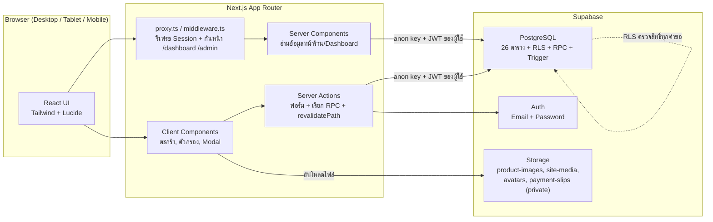
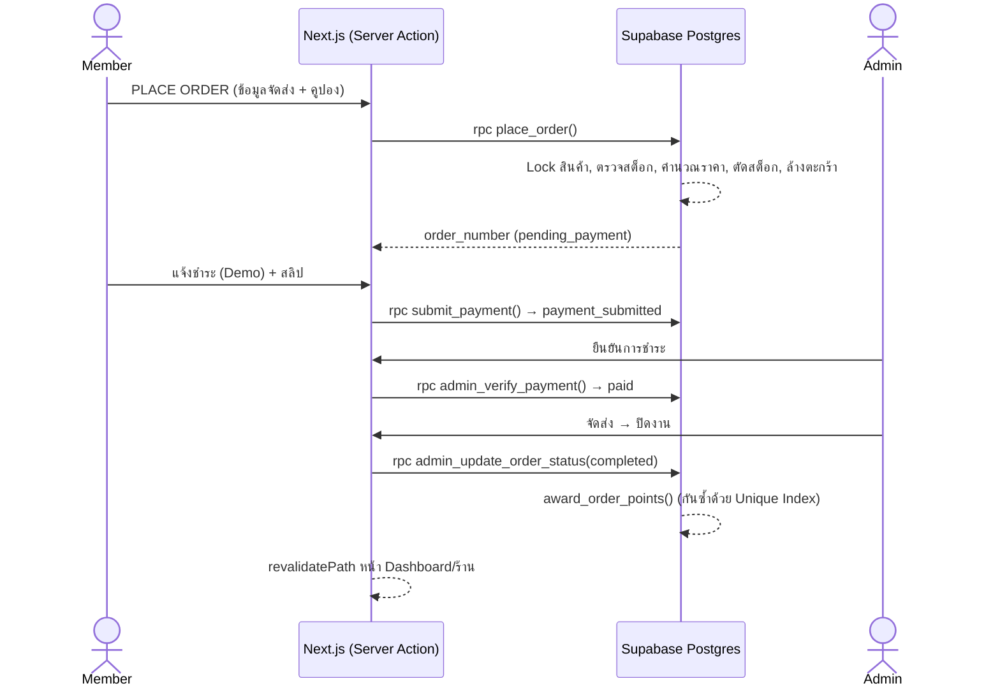

# GEARAWAI — รายงานผลการตรวจสอบเอกสารก่อนเริ่มพัฒนา (Pre-Development Review)

> | รายการ | รายละเอียด |
> |---|---|
> | เอกสาร | GEARAWAI_REVIEW_REPORT.md |
> | วันที่ตรวจ | 11 พฤศจิกายน 2026 |
> | เอกสารที่ตรวจ | `GEARAWAI_SPECIFICATION.md`, `GEARAWAI_CONTEXT.md`, Project Instructions, `GEARAWAI_SYSTEM_ANALYSIS.md`, `GEARAWAI_DATABASE_DESIGN.md`, `GEARAWAI_UI_UX_DESIGN.md`, `GEARAWAI_PRODUCT_DATA.md`, `GEARAWAI_ADMIN_DESIGN.md`, `GEARAWAI_TEST_CASES.md` (รวม 8 ไฟล์ .md + Project Instructions) |
> | สิ่งที่ยังไม่ได้ตรวจ | Source Code ในคอมพิวเตอร์หลัก · ตาราง/ข้อมูลใน Supabase จริง · SQL ในเอกสารยังไม่ได้รันจริง |
> | สถานะ | **Rev.1 (11 พ.ย. 2026): แก้ไขเอกสารตามการตัดสินใจ D-01–D-10 แล้ว** — ดูสถานะรายประเด็นในหัวข้อ 11 |

> ⚠️ **ข้อจำกัดของการตรวจ:** เอกสารออกแบบ 6 ไฟล์ (SYSTEM_ANALYSIS ถึง TEST_CASES) จัดทำโดย Claude ในขั้นเตรียมงานก่อนหน้า การตรวจครั้งนี้ไล่ตรวจแบบละเอียดทีละตาราง/หน้า/สิทธิ์ แต่ไม่ใช่การตรวจโดยบุคคลที่สามที่เป็นอิสระ — แนะนำให้ครูที่ปรึกษาหรือเพื่อนร่วมทีมตรวจทานอีกรอบ โดยเฉพาะหัวข้อ 4 (สิทธิ์การเข้าถึงข้อมูล)

---

## สารบัญ

1. [สรุปผลการตรวจ (Executive Summary)](#1-สรุปผลการตรวจ)
2. [ความครบถ้วนของ 20 ระบบ (Traceability)](#2-ความครบถ้วนของ-20-ระบบ)
3. [ความสอดคล้องระหว่างเอกสาร](#3-ความสอดคล้องระหว่างเอกสาร)
4. [ความสอดคล้อง Frontend ↔ Backend](#4-ความสอดคล้อง-frontend--backend)
5. [รายการประเด็นที่พบ (R-01 – R-31)](#5-รายการประเด็นที่พบ)
6. [ฟังก์ชันตกหล่นและรายละเอียดที่ยังไม่ชัดเจน](#6-ฟังก์ชันตกหล่นและรายละเอียดที่ยังไม่ชัดเจน)
7. [ความเป็นไปได้ในการพัฒนาจริง (Feasibility)](#7-ความเป็นไปได้ในการพัฒนาจริง)
8. [สถาปัตยกรรมและโครงสร้างระบบที่แนะนำ](#8-สถาปัตยกรรมและโครงสร้างระบบที่แนะนำ)
9. [สิ่งที่ต้องแก้ไข/ตัดสินใจก่อนเริ่มพัฒนา](#9-สิ่งที่ต้องแก้ไขตัดสินใจก่อนเริ่มพัฒนา)
10. [แหล่งอ้างอิงภายนอก](#10-แหล่งอ้างอิงภายนอก)
11. [สถานะการแก้ไข Revision 1](#11-สถานะการแก้ไข-revision-1)

---

## 1. สรุปผลการตรวจ

> **อัปเดต Rev.1:** แก้ไขแล้ว 27 ประเด็น · แก้ในเอกสารแล้วแต่ต้องยืนยันตอนพัฒนา 3 ประเด็น (R-06 ช่วงเวลาจริง, R-15, R-31) · รอการดำเนินงาน 1 ประเด็น (R-29) · ประเด็นใหม่รอตัดสินใจ 1 ประเด็น (R-32) — ตารางเต็มในหัวข้อ 11 · เนื้อหาหัวข้อ 1–10 ด้านล่างคงไว้ตามผลตรวจเดิมเพื่อการอ้างอิง

### 1.1 ภาพรวม

| ด้าน | ผล | หมายเหตุ |
|---|:---:|---|
| ความครบถ้วนของ 20 ระบบ | ✅ ครบ | ทุกระบบมีครบทั้งการวิเคราะห์ ตาราง หน้าจอ และเมนู Admin · ไม่มีระบบใดถูกตัดออก |
| ความสอดคล้องของชื่อ (ตาราง/RPC/Route/Setting key) | ✅ ผ่าน | ตรวจข้ามทั้ง 6 ไฟล์แล้วตรงกัน |
| ความถูกต้องของตัวเลขตัวอย่าง (ราคา/ยอด/คะแนน) | ✅ ผ่าน | คำนวณซ้ำทุกค่าใน TEST_CASES แล้วตรงกับ PRODUCT_DATA |
| ความสอดคล้อง Frontend ↔ Backend (สิทธิ์อ่าน/เขียนข้อมูล) | ⚠️ **พบช่องโหว่** | มี 6 จุดที่หน้าจอต้องใช้ข้อมูลที่ RLS ไม่อนุญาตให้อ่าน หรืออนุญาตให้เขียนมากเกินไป |
| ความถูกต้องของตรรกะฐานข้อมูล | ❌ **พบข้อบกพร่องร้ายแรง 1 จุด** | Trigger ป้องกันคอลัมน์ทำให้ **การหักคะแนนตอนแลกรางวัลไม่เกิดขึ้นจริง** (R-01) |
| ความเป็นไปได้ในการพัฒนา | ✅ ทำได้ (มีเงื่อนไข) | ขอบเขตใหญ่สำหรับโครงงานนักเรียน (~52 หน้า, 26 ตาราง, 18+ RPC) · มีข้อจำกัดของ Supabase Free Plan และ Next.js 16 ที่ต้องรู้ก่อน |
| Test Case | ⚠️ ยังไม่ครอบคลุมบางระบบ | ไม่มีกรณีทดสอบของ Homepage, About Us, แก้ไขโปรไฟล์ ฯลฯ (R-18) |

### 1.2 จำนวนประเด็นตามระดับความรุนแรง

| ระดับ | ความหมาย | จำนวน |
|---|---|---:|
| 🔴 Critical | ทำให้ฟังก์ชันหลักทำงานผิดหรือเกิดช่องโหว่ด้านข้อมูล ต้องแก้ก่อนเขียน SQL | **1** |
| 🟠 High | ฟังก์ชันตามเอกสารทำงานไม่ได้ หรือมีความเสี่ยงด้านความปลอดภัย/ความถูกต้อง | **7** |
| 🟡 Medium | ทำงานได้แต่มีข้อขัดแย้ง/ความเสี่ยงที่ควรแก้ก่อนลงมือ | **11** |
| 🟢 Low | ปรับปรุงความชัดเจน หรือกรณีขอบ | **12** |
| **รวม** | | **31** |

### 1.3 ข้อสรุปสำคัญ

1. **เอกสารพร้อมใช้งานประมาณ 85–90%** — โครงสร้างระบบ ตาราง หน้าจอ และ Flow หลักสอดคล้องกัน ไม่มีการตัดฟังก์ชันจาก SPEC
2. **ต้องแก้ DATABASE_DESIGN ก่อนเริ่ม Phase 1** — โดยเฉพาะ R-01 ถึง R-07 ซึ่งกระทบ RLS/Trigger/RPC ที่จะเขียนเป็น Migration
3. **ต้องตัดสินใจ 10 เรื่อง** (หัวข้อ 9.1) — 4 เรื่องเป็นเรื่องสำคัญที่เอกสารยังใช้ "ค่าที่เสนอ" อยู่ และอีก 2 เรื่องเป็นข้อจำกัดของ Supabase/Next.js ที่เพิ่งพบ
4. **ต้องตรวจเครื่องหลักก่อนเขียนโค้ด** — เวอร์ชัน Next.js (middleware vs proxy), Tailwind (v3 vs v4) และตารางที่อาจมีอยู่แล้วใน Supabase

---

## 2. ความครบถ้วนของ 20 ระบบ

ตารางติดตาม (Traceability Matrix): ระบบตาม SPEC → เอกสารแต่ละไฟล์ครอบคลุมหรือไม่

| ระบบ | SYSTEM_ANALYSIS | DATABASE (ตารางหลัก) | UI_UX (หน้า) | ADMIN (เมนู) | TEST_CASES | ผล |
|---|:---:|---|---|---|---|:---:|
| S01 Homepage | ✅ | `site_settings`, `categories`, `products`, `promotions` | §4 | Settings, Promotions | ⚠️ ไม่มี TC เฉพาะ (มีเพียง PRM-01) | ⚠️ |
| S02 About Us | ✅ | `team_members`, `site_settings`, `media_files` | §5 | Settings → About | ❌ ไม่มี TC | ⚠️ |
| S03 Product Catalog | ✅ | `products`, `v_product_catalog` | §6, §7 | Products | SRC, CRT, ADM | ✅ |
| S04 Search & Filter | ✅ | `v_product_catalog` | §6 | — | SRC-01–18 | ✅ |
| S05 Register & Login | ✅ | `auth.users`, `profiles` | §10 | Customers | REG, LOG, AUT | ✅ |
| S06 Wishlist | ✅ | `wishlists`, `wishlist_items` | §9 | — | WSH-01–04 | ✅ |
| S07 Shopping Cart | ✅ | `carts`, `cart_items` | §8 | — | CRT-01–16 | ✅ |
| S08 Booking | ✅ | `services`, `bookings` | §14.4 | Services, Bookings | BKG-01–05 | ✅ (มี R-02, R-03) |
| S09 Payment | ✅ | `orders`, `order_items`, `payments` | §14.1–14.3 | Orders, Payments | ORD, PAY | ✅ |
| S10 Points | ✅ | `points_transactions` | §11 | Points | PTS-01–07 | ✅ (มี R-01) |
| S11 Birthday | ✅ | `coupons`, `member_coupons` | §11 | Coupons | BDY-01–05 | ✅ (มี R-05, R-06) |
| S12 Rewards | ✅ | `rewards`, `reward_redemptions` | §11 | Rewards | PTS-04–06 | ✅ (มี R-01, R-17) |
| S13 Contact Us | ✅ | `site_settings` | §13 | Settings → Contact | CNT-04, 05 | ✅ |
| S14 User Dashboard | ✅ | หลายตาราง | §11 | Customers | ORD-09, AUT-04 | ⚠️ ไม่มี TC แก้โปรไฟล์ |
| S15 Admin Dashboard | ✅ | ทุกตาราง | §12 | ทั้ง 18 เมนู | AUT, RPT-02 | ✅ |
| S16 Image Management | ✅ | `media_files`, Storage | §12 | Images | ADM-10, 11 | ⚠️ ไม่มี TC ลบภาพที่ใช้อยู่ |
| S17 Reports | ✅ | RPC `report_*` | §12 | Reports | RPT-01–05 | ✅ (มี R-13) |
| S18 Database | ✅ | 26 ตาราง | — | — | AUT-04–11 | ✅ |
| S19 Promotion Mgmt | ✅ | `promotions`, `promotion_products` | §14.5 | Promotions | PRM-01–05 | ✅ |
| S20 Contact Form | ✅ | `contact_messages` | §13 | Contact Messages | CNT-01–03 | ✅ |

**ผล:** ครบทั้ง 20 ระบบ ✅ — ช่องว่างอยู่ที่ Test Case ของ S01, S02, S14, S16 (รวมไว้ใน R-18)

---

## 3. ความสอดคล้องระหว่างเอกสาร

### 3.1 รายการที่ตรวจแล้วสอดคล้องกัน ✅

| หัวข้อที่ตรวจ | เอกสารที่เทียบ | ผล |
|---|---|:---:|
| ชื่อตาราง 26 ตาราง | DATABASE ↔ SYSTEM_ANALYSIS ↔ ADMIN ↔ UI_UX ↔ TEST_CASES | ✅ |
| ชื่อ RPC 18 ตัว | DATABASE §6.2 ↔ ADMIN ↔ UI_UX ↔ TEST_CASES | ✅ |
| Route ทั้งหมด | UI_UX §3 ↔ SYSTEM_ANALYSIS ↔ ADMIN ↔ TEST_CASES | ✅ |
| Key ของ `site_settings` | DATABASE §4.24 ↔ SYSTEM_ANALYSIS ↔ ADMIN §4.18 | ✅ |
| Order Status Flow | SYSTEM_ANALYSIS §6.1 ↔ Enum `order_status` ↔ ปุ่ม Admin §4.7 ↔ Badge UI §11.2 | ✅ |
| ตาราง 22 ตารางตาม SPEC ระบบที่ 18 | SPEC ↔ DATABASE §3 | ✅ ครบ + 4 ตารางเสริมมีเหตุผลประกอบ |
| ฟิลด์สินค้าตาม SPEC (Product ID, Name, Brand, Category, Price, Sale Price, Description, Specifications, Stock, Image, Status) | SPEC ระบบที่ 3 ↔ `products` ↔ PRODUCT_DATA | ✅ |
| เมนู Admin 17 รายการตาม SPEC หัวข้อ 6 | SPEC ↔ ADMIN §2 (+ Stock) | ✅ |
| สินค้า 20 รายการ / แบรนด์ / หมวดหมู่ | SPEC ↔ PRODUCT_DATA | ✅ |
| ตัวเลขที่คาดหวังใน Test Case | TEST_CASES ↔ PRODUCT_DATA ↔ Business Rules 6.2 | ✅ (คำนวณซ้ำแล้ว) |
| ข้อความ Demo Payment (ห้ามใช้ "ชำระเงินสำเร็จ") | SPEC ระบบที่ 9 ↔ SYSTEM_ANALYSIS ↔ UI_UX ↔ ADMIN ↔ TEST_CASES | ✅ |
| สีแบรนด์ 4 สี | SPEC ↔ Project Instructions ↔ UI_UX | ✅ |
| ขนาด UI ตาม SPEC (Search 400×44, Sidebar 240, Card ฯลฯ) | SPEC ↔ UI_UX ↔ ADMIN | ✅ (ยกเว้น R-26) |
| Mermaid Diagram | ทุกไฟล์ | ✅ Render ได้ทั้งหมด |

### 3.2 ข้อขัดแย้งระหว่างเอกสารต้นทาง (ยังค้างจากรอบก่อน)

| รหัส | ข้อขัดแย้ง | สถานะ |
|---|---|---|
| C1 / M01 | Project Instructions: "ระบบจอง**สินค้า**" ↔ SPEC ระบบที่ 8: "ระบบจอง**บริการ**" | ⏳ **รอผู้ใช้ตัดสินใจ** — เอกสารทุกไฟล์ยึด SPEC |
| C2 | CONTEXT ไม่มี Payment / Birthday / Image Management | ✅ ยึด SPEC — ไม่ตัดระบบ |
| C5 / M15 | SPEC อ้างภาพ Mockup ที่ไม่มีใน Project | ⏳ รอแนบภาพ |

### 3.3 ข้อขัดแย้งภายในเอกสารออกแบบ (พบใหม่)

| รหัส | จุดที่ขัดกัน | รายละเอียด | ดูประเด็น |
|---|---|---|---|
| X1 | DATABASE §4.11 ↔ ADMIN §4.2 | FK `order_items.product_id` เป็น `ON DELETE SET NULL` (ฐานข้อมูล **ยอมให้ลบ**) แต่ Admin กำหนดว่า **ห้ามลบ** สินค้าที่เคยขาย | R-10 |
| X2 | DATABASE §5.2 ↔ UI_UX §8.2 / TEST TC-CRT-15 | RLS ซ่อนสินค้า `inactive` จากสมาชิก แต่หน้าตะกร้าต้องแสดงสินค้านั้นพร้อมป้าย "ไม่พร้อมจำหน่าย" | R-04 |
| X3 | DATABASE §5.2 ↔ UI_UX §11.2 (Coupons) | `coupons` อ่านได้เฉพาะ Admin แต่หน้า `/dashboard/coupons` ต้องแสดงชื่อและมูลค่าส่วนลด | R-05 |
| X4 | DATABASE §5.2 ↔ UI_UX §5 (Gallery) | `media_files` อ่านได้เฉพาะ Admin แต่หน้า About ต้องดึงภาพ Gallery จากตารางนี้ | R-09 |
| X5 | DATABASE §5.2 ↔ UI_UX §14.4 | สมาชิกอ่านได้เฉพาะการจองของตัวเอง แต่หน้าจองต้อง Disable ช่องเวลาที่ "คนอื่น" จองแล้ว | R-03 |
| X6 | UI_UX §6.6 (Grid 5 คอลัมน์) ↔ UI_UX §1.6 (Card ~240px) | ที่ 1440px เมื่อมี Sidebar 240px การ์ดจะกว้างได้เพียง ~197px | R-26 |
| X7 | SYSTEM_ANALYSIS §1.1 ↔ ADMIN §1 | SA เขียนว่าตรวจสิทธิ์ "2 ชั้น" แต่ ADMIN เขียน "3 ชั้น" (Middleware + Layout + RLS) — ความหมายเดียวกันแต่ตัวเลขต่างกัน | R-30 |
| X8 | PRODUCT_DATA §6.2 ↔ DATABASE `rewards` | ของรางวัลตัวอย่าง "คูปองส่วนลด 100 บาท" ต้องออกคูปองให้สมาชิก แต่ `redeem_reward()` ไม่มีขั้นตอนสร้างคูปอง | R-17 |
| X9 | `sold_count` (ADMIN "ขายแล้ว") ↔ Best Sellers (Reports) | `sold_count` นับตั้งแต่สั่งซื้อ (ยังไม่ชำระ) แต่ Best Sellers นับเฉพาะที่ชำระแล้ว → ตัวเลข "ขายแล้ว" 2 จุดไม่ตรงกัน | R-21 |

---

## 4. ความสอดคล้อง Frontend ↔ Backend

ตรวจทีละหน้า: หน้าจอต้องการข้อมูล/การกระทำอะไร → ฐานข้อมูล (RLS/RPC) รองรับหรือไม่

| หน้า (UI_UX) | ข้อมูลที่อ่าน | การเขียน/การกระทำ | รองรับโดย RLS/RPC | ผล |
|---|---|---|---|:---:|
| Homepage `/` | settings, categories, featured, promotions, cart badge | Add to Cart, Wishlist | ✅ public read + own cart | ✅ |
| About `/about` | about_content, team, **gallery (`media_files`)** | — | ❌ `media_files` = admin only | ⚠️ R-09 |
| Shop `/shop` | `v_product_catalog`, categories, brands | Add to Cart, Wishlist | ✅ | ✅ |
| Product Detail | product, images, related | Add to Cart, Buy Now | ✅ (inactive → 404 ตรงกับ RLS) | ✅ |
| Cart `/cart` | cart_items + ข้อมูลสินค้า **รวมสินค้าที่ถูกปิดขาย** | qty, remove, checkout | ⚠️ อ่านสินค้า inactive ไม่ได้ | ⚠️ R-04 |
| Wishlist | wishlist_items + สินค้า (รวม inactive) | remove, move to cart | ⚠️ เหมือน Cart | ⚠️ R-04 |
| Register / Login | — | signUp → Trigger | ⚠️ Trigger ล้มถ้าชื่อว่าง/วันเกิดผิดรูปแบบ · อีเมลยืนยันติดข้อจำกัด 2 ฉบับ/ชม. | ⚠️ R-07, R-08 |
| Checkout / Payment | cart, settings | `validate_coupon`, `place_order`, `submit_payment` | ✅ | ✅ (มี R-12, R-19) |
| Dashboard – Orders | orders, items, payments | cancel_order | ✅ | ✅ |
| Dashboard – Points | points_transactions, balance | — | ✅ | ✅ |
| Dashboard – Rewards | rewards, redemptions | `redeem_reward` | ⚠️ หักคะแนนไม่สำเร็จเพราะ Trigger | 🔴 R-01 |
| Dashboard – Coupons | member_coupons **+ รายละเอียดคูปอง** | `claim_birthday_coupon` | ❌ อ่าน `coupons` ไม่ได้ | ⚠️ R-05 |
| Dashboard – Bookings | bookings (own) | **ยกเลิกเมื่อ pending** | ⚠️ Policy UPDATE เปิดกว้างเกินไป | ⚠️ R-02 |
| Dashboard – Profile | profile | update, avatar | ✅ (คอลัมน์สำคัญถูกป้องกัน) | ✅ |
| Booking `/booking` | services, **ช่วงเวลาที่ถูกจองแล้ว** | insert booking | ❌ อ่านการจองของคนอื่นไม่ได้ · ไม่มีตัวสร้าง `booking_number` | ⚠️ R-03, R-11 |
| Contact `/contact` | settings | insert message | ✅ แต่จำกัดความถี่ไม่ได้ | ⚠️ R-14 |
| Admin ทุกเมนู | ทุกตาราง | CRUD + RPC `admin_*` | ✅ `is_admin()` | ✅ |
| Admin – Images (ลบภาพที่ใช้อยู่) | การใช้งานภาพในตารางอื่น | delete | ⚠️ ตรวจได้เฉพาะ `product_images` | ⚠️ R-28 |
| Admin – Reports Export PDF | report RPC | สร้าง PDF ภาษาไทย | ⚠️ ฟอนต์ไทย | ⚠️ R-13 |
| ทุกหน้าที่ Admin แก้แล้วหน้าร้านต้องเปลี่ยน | — | — | ⚠️ ยังไม่ได้กำหนดกลยุทธ์ Cache ของ Next.js | ⚠️ R-16 |

**สรุป:** Flow หลัก (ดูสินค้า → ตะกร้า → สั่งซื้อ → แจ้งชำระ → Admin ยืนยัน) **สอดคล้องกันครบ** ✅ — ปัญหาอยู่ที่หน้ารอง 6 หน้า ซึ่งแก้ได้ด้วยการเพิ่ม Policy หรือ RPC โดยไม่ต้องตัดฟังก์ชันใด

---

## 5. รายการประเด็นที่พบ

> รูปแบบ: **ปัญหา** → **ผลกระทบ** → **แนวทางแก้ไขที่เสนอ** · ยังไม่ได้แก้ไขเอกสารใด ๆ

### 🔴 Critical

#### R-01 Trigger `protect_profile_columns` ทำให้การหักคะแนนตอนแลกรางวัลไม่เกิดขึ้นจริง

| | |
|---|---|
| ตำแหน่ง | DATABASE_DESIGN §4.1, §6.1, §11.2 · RPC `redeem_reward()` |
| ปัญหา | Trigger ตรวจด้วย `is_admin()` ซึ่งอ่านจาก `auth.uid()` ของ **ผู้เรียก** — เมื่อสมาชิกเรียก `redeem_reward()` (แม้ Function จะเป็น `security definer`) `auth.uid()` ยังเป็นสมาชิก → Trigger มองว่า "ไม่ใช่ Admin" → **คืนค่า `points_balance` กลับเป็นค่าเดิมอย่างเงียบ ๆ** |
| ผลกระทบ | แลกรางวัลได้ไม่จำกัด (คะแนนไม่ลด) แต่มีแถว `points_transactions(redeem)` ถูกบันทึก → ยอดคะแนนกับประวัติไม่ตรงกัน · ขัดกับ Business Rule 6.4 ข้อ 5 · TC-PTS-04 จะไม่ผ่าน |
| แนวทางแก้ | ให้ Trigger บังคับใช้เฉพาะเมื่อแก้ตรงจาก API ไม่ใช่จาก RPC — เลือก 1 วิธี: **(ก) แนะนำ:** ตรวจ `current_user` ภายใน Trigger (`if current_user in ('authenticated','anon') and not is_admin() then …`) เพราะเมื่ออยู่ใน Function `security definer`, `current_user` จะเป็นเจ้าของ Function ไม่ใช่ `authenticated` · (ข) ใช้ Column Privileges: `revoke update on profiles from authenticated; grant update (full_name, phone, address, avatar_url, birth_date) on profiles to authenticated;` แล้วให้ Trigger ดูแลเฉพาะกฎวันเกิด |
| Test ที่ต้องเพิ่ม | ยืนยันว่า TC-PTS-04 ลดคะแนนจริง และ TC-AUT-05/06 ยังถูกบล็อก |

### 🟠 High

#### R-02 Policy UPDATE ของ `bookings` เปิดกว้างเกินไป

| | |
|---|---|
| ตำแหน่ง | DATABASE_DESIGN §5.2 แถว `bookings` |
| ปัญหา | Policy "own: ยกเลิกได้เมื่อ pending" ทำด้วย RLS ไม่ได้ละเอียดพอ — RLS ไม่จำกัดว่า **คอลัมน์ไหน** ถูกแก้ สมาชิกจึงแก้ `status = 'confirmed'`, เปลี่ยนวัน/เวลา หรือแก้ `price_snapshot` เองผ่าน Console ได้ |
| แนวทางแก้ | ไม่ให้สมาชิก UPDATE ตรง · เพิ่ม RPC `cancel_booking(p_booking_id)` (ตรวจเจ้าของ + สถานะ `pending`) · และควรย้ายการจองไปที่ RPC `create_booking(...)` ด้วย (ดู R-11) |

#### R-03 หน้าจองไม่สามารถรู้ว่าช่วงเวลาไหนถูกจองแล้ว

| | |
|---|---|
| ตำแหน่ง | UI_UX §14.4 ("ช่องที่เต็มแล้ว Disabled") ↔ DATABASE §5.2 (`bookings` อ่านได้เฉพาะของตนเอง) |
| ผลกระทบ | ทำ S08-F04 "เลือกเวลาที่ยังว่าง" ไม่ได้ ผู้ใช้จะรู้ว่าช่องเต็มก็ต่อเมื่อกดยืนยันแล้วถูก Unique Index ปฏิเสธ |
| แนวทางแก้ | เพิ่ม RPC `get_booked_slots(p_service_id, p_date)` แบบ `security definer` ที่คืน **เฉพาะเวลา** ที่ถูกจอง (ไม่คืนข้อมูลผู้จอง) |

#### R-04 ตะกร้า/Wishlist แสดงสินค้าที่ถูกปิดขายไม่ได้

| | |
|---|---|
| ตำแหน่ง | DATABASE §5.2 (`products`, `product_images` อ่านได้เฉพาะ active) ↔ UI_UX §8.2 States, SYSTEM_ANALYSIS S07-F08, TC-CRT-15 |
| ผลกระทบ | เมื่อ Admin ปิดการขาย แถวในตะกร้าจะกลายเป็นข้อมูลว่าง (ไม่มีชื่อ/ภาพ/ราคา) แทนที่จะแสดง "ไม่พร้อมจำหน่าย" · ประวัติคำสั่งซื้อที่ลิงก์ไปสินค้านั้นจะได้ 404 |
| แนวทางแก้ | เลือก 1 วิธี: **(ก) แนะนำ:** RPC `get_my_cart()` / `get_my_wishlist()` แบบ `security definer` คืนข้อมูลสินค้าขั้นต่ำ (ชื่อ, ภาพหลัก, ราคา, `status`, `stock_quantity`) เฉพาะสินค้าที่อยู่ในตะกร้า/Wishlist ของผู้เรียก · (ข) เพิ่ม Policy อ่าน `products` ที่อยู่ใน `cart_items`/`wishlist_items` ของตนเอง (ซับซ้อนกว่าและกระทบ View) · หน้าประวัติคำสั่งซื้อใช้ Snapshot ใน `order_items` และไม่ทำลิงก์เมื่อสินค้าไม่ active |

#### R-05 หน้า "คูปองของฉัน" อ่านรายละเอียดคูปองไม่ได้

| | |
|---|---|
| ตำแหน่ง | DATABASE §5.2 (`coupons` = admin เท่านั้น) ↔ UI_UX §11.2 Coupons, SYSTEM_ANALYSIS S11-F04 |
| ผลกระทบ | การ์ดสิทธิพิเศษวันเกิดแสดงได้แค่รหัสและวันหมดอายุ ไม่รู้ว่าลดเท่าไร |
| แนวทางแก้ | **(ก) แนะนำ:** เพิ่ม Policy: สมาชิกอ่าน `coupons` ได้เฉพาะแถวที่ `id in (select coupon_id from member_coupons where user_id = auth.uid())` · (ข) หรือเก็บ Snapshot `discount_type`, `discount_value`, `max_discount_amount` ใน `member_coupons` ตอนรับสิทธิ์ |

#### R-06 ยังไม่ได้กำหนดเขตเวลา (Timezone) ของระบบ

| | |
|---|---|
| ตำแหน่ง | DATABASE §1 (ระบุแค่ "แสดงผลเป็นเวลาไทยฝั่ง Frontend") · ใช้ `current_date`/`now()` ใน Trigger/RPC หลายจุด |
| ปัญหา | ฐานข้อมูล Supabase ทำงานเป็น UTC (ช้ากว่าไทย 7 ชั่วโมง) แต่กฎธุรกิจหลายข้อขึ้นกับ **วันที่ในประเทศไทย** |
| ผลกระทบ | (1) สมาชิกเกิด 1 ธ.ค. กดรับสิทธิ์ตอน 01:00 น. 1 ธ.ค. → DB ยังเป็น 30 พ.ย. → รับไม่ได้ · (2) เลข Order `GA-YYYYMMDD` ผิดวันช่วง 00:00–07:00 · (3) จองบริการ "วันนี้" ถูกมองเป็นวันในอดีต/อนาคตผิด · (4) รายงานรายวันนับยอดข้ามวัน · (5) โปรโมชั่นเริ่ม/จบคลาดเคลื่อนถ้า Frontend ส่งเวลาไม่ระบุโซน |
| แนวทางแก้ | กำหนดเป็นหลักการกลาง: **ทุกกฎที่ใช้ "วันที่" ใช้เวลา `Asia/Bangkok`** — ใน SQL ใช้ `(now() at time zone 'Asia/Bangkok')::date` แทน `current_date` · รายงาน Group By ด้วยวันที่ไทย · ฟอร์มวันเวลาฝั่ง Frontend ส่งค่าแบบมี Offset `+07:00` · เพิ่ม Test กรณีเวลา 00:30 น. |

#### R-07 Trigger `handle_new_user()` อาจทำให้การสมัครสมาชิกล้มทั้งหมด

| | |
|---|---|
| ตำแหน่ง | DATABASE §4.1 (CK `full_name` length 1–100), §11.1 |
| ปัญหา | (1) ถ้า `full_name` ไม่ถูกส่งมา Trigger ใส่ `''` → ผิด CHECK → **Insert ล้ม → การสมัครทั้งหมดล้ม** (Supabase คืน Error ทั่วไป ผู้ใช้ไม่รู้สาเหตุ) · (2) `birth_date::date` ล้มถ้ารูปแบบไม่ใช่ `YYYY-MM-DD` (เช่น `15/05/2008` จากช่องกรอก) · (3) ไม่มีการตรวจ "วันเกิดไม่เป็นอนาคต" ตอน Insert (Trigger ป้องกันมีแค่ BEFORE UPDATE) |
| แนวทางแก้ | ตรวจและแปลงข้อมูลที่ Server (Server Action) ก่อนเรียก `signUp` เสมอ · ใน Trigger ใช้การแปลงแบบปลอดภัย (ถ้าแปลงไม่ได้ให้เป็น `NULL`) และตรวจวันในอนาคต · กำหนดว่า Frontend ส่งวันเกิดเป็น ISO `YYYY-MM-DD` เท่านั้น |

#### R-08 ข้อจำกัดอีเมลของ Supabase กระทบการสมัครสมาชิกและการทดสอบ

| | |
|---|---|
| ตำแหน่ง | UI_UX §10.3 ("หรือหน้าแจ้งให้ยืนยันอีเมล ถ้าเปิด Email Confirmation") · TEST TC-REG · M11 (ลืมรหัสผ่าน) |
| ข้อเท็จจริง | บริการอีเมลในตัวของ Supabase จำกัด **2 ฉบับต่อชั่วโมงทั้งโปรเจกต์** และส่งได้เฉพาะอีเมลที่อยู่ในทีมของโปรเจกต์ — ต้องตั้งค่า Custom SMTP เพื่อส่งถึงผู้ใช้ทั่วไป (ดูหัวข้อ 10) |
| ผลกระทบ | ถ้าเปิด "Confirm email" ไว้ (ค่าเริ่มต้น) การทดสอบสมัครสมาชิกหลายบัญชีจะติด Rate Limit และอีเมลยืนยันจะไม่ถึงบัญชีทดสอบ `@example.com` · ฟังก์ชันลืมรหัสผ่าน (ถ้าเพิ่ม) ใช้ไม่ได้จริง |
| แนวทางแก้ | **ต้องตัดสินใจ (D-02):** (ก) **แนะนำสำหรับโครงงาน:** ปิด "Confirm email" ใน Supabase Auth และระบุในรายงานว่าเป็นการตั้งค่าเพื่อการสาธิต · (ข) ตั้ง Custom SMTP (เช่น บริการอีเมลที่มี Free Tier) ถ้าต้องการสาธิตการยืนยันอีเมล/ลืมรหัสผ่าน |

### 🟡 Medium

#### R-09 หน้า About อ่านภาพ Gallery จาก `media_files` ไม่ได้

RLS ของ `media_files` เป็น admin เท่านั้น แต่ S02-F05 ดึง `media_files(category='gallery')` → **แก้:** เพิ่ม Policy ให้อ่านแถวที่ `category = 'gallery'` ได้ทุกคน หรือเก็บรายการ URL Gallery ไว้ใน `site_settings.about_content.gallery`

#### R-10 กฎ "ห้ามลบสินค้าที่เคยขาย" ไม่ถูกบังคับที่ฐานข้อมูล (X1)

`order_items.product_id ON DELETE SET NULL` ทำให้ Admin ลบผ่าน API ได้ → **แก้:** เปลี่ยนเป็น `ON DELETE RESTRICT` (ประวัติยังปลอดภัยเพราะมี Snapshot) แล้ว UI จับ Error มาแสดง "แนะนำให้ปิดการขายแทน" — สอดคล้องกับ TC-ADM-05

#### R-11 ยังไม่ได้ออกแบบการสร้างเลขที่เอกสาร

`order_number` (`GA-YYYYMMDD-NNNN`) และ `booking_number` (`BK-…`) ไม่มีวิธีสร้างที่ปลอดภัยเมื่อมีผู้ใช้พร้อมกัน และ `booking_number` เป็น NOT NULL แต่การจองเป็น Insert ตรง (ไม่มีใครสร้างเลขให้) → **แก้:** ใช้ Sequence + Function `next_doc_number(prefix)` (ตามวันที่ไทยตาม R-06) และย้ายการจองไปที่ RPC `create_booking()`

#### R-12 สูตร `effective_price` ถูกเขียนซ้ำ 2 ที่

View `v_product_catalog` และ RPC `place_order()` ต้องคำนวณราคาเหมือนกัน ถ้าแก้ที่หนึ่งแล้วลืมอีกที่ ราคาในตะกร้ากับราคาในคำสั่งซื้อจะไม่ตรงกัน → **แก้:** สร้าง SQL Function เดียว `calc_effective_price(product_id, at_time)` ให้ทั้ง View และ RPC เรียกใช้

#### R-13 Export PDF ภาษาไทย

ฟอนต์มาตรฐานของ `jsPDF` (ที่เสนอใน M13) ไม่มีอักษรไทย → PDF จะแสดงตัวอักษรเพี้ยน → **แก้ (เลือก 1):** (ก) **แนะนำ:** ทำหน้า Report แบบ Print-friendly แล้วใช้ "พิมพ์ → บันทึกเป็น PDF" ของเบราว์เซอร์ (ไม่ต้องติดตั้ง Library) · (ข) ฝังฟอนต์ไทย (เช่น Sarabun / Noto Sans Thai) ลงใน jsPDF · Excel (.xlsx) ไม่มีปัญหานี้

#### R-14 Contact Form ไม่มีการจำกัดความถี่จริง

S20-F06 ต้องการ "จำกัดความถี่" แต่ Guest Insert ตรงเข้าตารางผ่าน RLS ซึ่งนับความถี่ไม่ได้ → **แก้:** ส่งผ่าน Server Action ที่มี Honeypot field + ตรวจว่าอีเมลเดียวกันส่งเกิน N ครั้งใน 10 นาทีหรือไม่ (ผ่าน RPC `submit_contact_message`)

#### R-15 Next.js 16 เปลี่ยนชื่อ `middleware.ts` เป็น `proxy.ts`

ADMIN §1 และ SYSTEM_ANALYSIS อ้าง `middleware.ts` · ใน Next.js 16 ไฟล์นี้ถูกเปลี่ยนชื่อเป็น `proxy.ts` (ชื่อเดิมยังใช้ได้แต่ Deprecated) → **แก้:** ตรวจเวอร์ชันใน `package.json` ที่เครื่องหลัก (M19) แล้วใช้ชื่อไฟล์ตามเวอร์ชัน — เอกสารควรเขียนเป็น "`proxy.ts` (Next.js 16+) หรือ `middleware.ts` (≤ 15)"

#### R-16 ยังไม่ได้กำหนดกลยุทธ์ Cache ให้ "Admin แก้แล้วหน้าร้านเปลี่ยนทันที"

SPEC หัวข้อ 9 ข้อ 1–3 และ ADMIN §5 ต้องการให้หน้าร้านเปลี่ยนทันที แต่ Next.js App Router อาจ Cache หน้าที่ Render บน Server → **แก้:** กำหนดหลักว่า (1) หน้าร้านที่แสดงราคา/สต็อกเป็น Dynamic Rendering หรือ (2) ทุก Server Action ของ Admin เรียก `revalidatePath()` ของหน้าที่เกี่ยวข้อง — ระบุไว้ในหัวข้อ 8.4

#### R-17 ของรางวัลประเภท "คูปอง" ไม่มีกลไกรองรับ (X8)

ของรางวัลตัวอย่าง "คูปองส่วนลด 100 บาท (Demo)" ต้องออกคูปองให้ผู้แลก แต่ `redeem_reward()` บันทึกแค่ `reward_redemptions` → **แก้ (เลือก 1):** (ก) **แนะนำ (ง่ายสุด):** เปลี่ยนข้อมูลตัวอย่างนี้เป็นของรางวัลที่จับต้องได้ (เป็นแค่ Demo Data จึงไม่ใช่การตัดฟังก์ชัน) · (ข) เพิ่ม `rewards.reward_type ('item','coupon')` + `coupon_id` แล้วให้ RPC สร้าง `member_coupons` เมื่อแลก

#### R-18 Test Case ยังไม่ครอบคลุมบางฟังก์ชัน

ไม่มีกรณีทดสอบสำหรับ: S01 Homepage (Featured/Categories/Hero แสดงจากฐานข้อมูล) · S02 About (Team/Gallery) · `/categories` · `/deals` เมื่อไม่มีโปรโมชั่น · S14-F02 แก้ไขโปรไฟล์และอัปโหลดรูป · สมาชิกยกเลิกการจอง · Admin: จัดการบริการ, ส่งมอบรางวัล, CRUD คูปอง, Settings แท็บอื่น, ลบภาพที่ถูกใช้อยู่, ระงับบัญชีตนเอง · และ Test สำหรับประเด็นใหม่ R-01–R-07 → **แก้:** เพิ่มประมาณ 18–20 กรณี (หัวข้อ 9.2)

#### R-19 ฐานคำนวณค่าส่งฟรีและคะแนนยังไม่ชัด

(1) เกณฑ์ส่งฟรี 1,000 บาท เทียบกับยอด **ก่อน** หรือ **หลัง** หักคูปอง? · (2) คะแนนคิดจาก `total_amount` ซึ่ง **รวมค่าส่ง** — ปกติร้านค้าไม่ให้คะแนนจากค่าส่ง → **เสนอ:** ส่งฟรีเทียบยอดก่อนหักคูปอง · คะแนนคิดจาก `subtotal − discount_amount` (ไม่รวมค่าส่ง) — ตัวเลขใน TC-PTS-01 ไม่เปลี่ยน (8,180 → 81 คะแนน เพราะค่าส่ง = 0) แต่ต้องแก้สูตรในเอกสาร **(ต้องยืนยัน D-04)**

### 🟢 Low

| รหัส | ประเด็น | แนวทางที่เสนอ |
|---|---|---|
| R-20 | ยกเลิก Order หลัง `paid` แล้ว `payments.status` ยังเป็น `verified` (ไม่มีสถานะคืนเงิน) | เพิ่มค่า `voided` ใน `payment_status` หรือแสดงหมายเหตุใน Admin ว่า "ยกเลิกหลังชำระ (Demo — ไม่มีการคืนเงินจริง)" |
| R-21 | `sold_count` นับตั้งแต่สั่งซื้อ แต่ Best Sellers นับเฉพาะที่ชำระแล้ว (X9) | เลือก: เพิ่ม `sold_count` ตอน `paid` แทนตอนสั่งซื้อ หรือเปลี่ยนป้ายใน Admin เป็น "ถูกสั่งซื้อ" |
| R-22 | อ้างอิงคูปองวันเกิดซ้ำ 2 ทาง (`orders.member_coupon_id` และ `member_coupons.order_id`) — FK วนกันและเสี่ยงไม่ตรงกัน | เก็บแหล่งความจริงที่เดียว (เสนอ `member_coupons.order_id` + `used_at`) หรือกำหนดว่าเขียนทั้งสองที่ใน `place_order()` เท่านั้น |
| R-23 | การนับ "ใช้คูปองครบสิทธิ์ต่อคน" ยังไม่ระบุว่ารวม Order ที่ยกเลิกหรือไม่ | นับเฉพาะ Order ที่ `status <> 'cancelled'` (สอดคล้องกับการคืนคูปองตอนยกเลิก) |
| R-24 | ช่องวันเกิดตอนสมัคร **บังคับหรือไม่** ไม่ได้ระบุ (DB เป็น nullable) | เสนอ: ไม่บังคับ แต่แสดงข้อความว่า "ต้องกรอกเพื่อรับสิทธิ์วันเกิด" |
| R-25 | Admin ระงับบัญชีตัวเอง / ระงับ Admin คนสุดท้าย — ป้องกันแค่ที่ UI | เพิ่มการตรวจใน Trigger/RPC |
| R-26 | Grid 5 คอลัมน์ + Sidebar ที่ 1440px ทำให้การ์ดกว้าง ~197px ไม่ใช่ ~240px (X6) | ยอมรับการ์ด ~200px บนหน้า Shop (SPEC ระบุ "5 คอลัมน์เมื่อพื้นที่เพียงพอ") หรือใช้ 5 คอลัมน์เฉพาะ ≥ 1600px — ภาพสินค้า 160×160 ยังพอดี |
| R-27 | หน้า `/deals` ควรแสดงสินค้าที่มี `sale_price` (ไม่อยู่ในโปรโมชั่น) ด้วยหรือไม่ | เสนอ: มี 2 ส่วน "โปรโมชั่น" และ "สินค้าลดราคา" |
| R-28 | ตรวจ "ภาพถูกใช้อยู่ก่อนลบ" ได้เฉพาะ `product_images` (ตารางอื่นเก็บ URL เป็นข้อความ) | RPC `media_usage(media_id)` ค้นด้วย URL ในคอลัมน์ภาพที่รู้จัก หรือเพิ่ม `media_id` ในตารางที่ใช้ภาพ |
| R-29 | Supabase Free Plan: โปรเจกต์ถูกพักหลังไม่มีการใช้งาน 1 สัปดาห์ · พื้นที่ไฟล์ 1 GB · DB 500 MB · ไม่มี Backup อัตโนมัติ | ก่อนวันนำเสนอ ให้เข้า Dashboard ตรวจว่าโปรเจกต์ไม่ถูกพัก · บีบอัดภาพเป็น WebP · Export SQL เก็บไว้เองเป็นระยะ |
| R-30 | ถ้อยคำไม่ตรงกัน: "ตรวจสิทธิ์ 2 ชั้น" (SA) vs "3 ชั้น" (ADMIN) (X7) · แผนภาพ Sitemap ขาด `/dashboard/wishlist`, `/dashboard/orders/[orderNumber]`, `/forgot-password` (มีในตารางแล้ว) | ปรับถ้อยคำและแผนภาพให้ตรงกัน |
| R-31 | Deliverables ตาม SPEC หัวข้อ 13 ที่ยังไม่มีแผน: `.env.example`, README, คู่มือ Admin, รายงานผลการทดสอบ, ไฟล์ SQL Migration | เพิ่มในแผน Phase 6 (ไม่ใช่ข้อบกพร่องของการออกแบบ) |

---

## 6. ฟังก์ชันตกหล่นและรายละเอียดที่ยังไม่ชัดเจน

### 6.1 ฟังก์ชันที่ต้อง "เพิ่ม" เพื่อให้ฟังก์ชันเดิมทำงานได้ (ไม่ใช่ฟีเจอร์ใหม่)

| ส่วนที่เพิ่ม | เพื่อให้ฟังก์ชันใดทำงาน | ประเด็น |
|---|---|---|
| RPC `get_booked_slots()` | S08-F04 เลือกเวลาที่ยังว่าง | R-03 |
| RPC `create_booking()`, `cancel_booking()` | S08-F06, S08-F07 (ยกเลิก) | R-02, R-11 |
| RPC `get_my_cart()`, `get_my_wishlist()` (หรือ Policy เพิ่ม) | S07-F08 แจ้งสินค้าปิดขาย | R-04 |
| Policy อ่าน `coupons` ของตนเอง | S11-F04 การ์ดสิทธิพิเศษ | R-05 |
| Policy อ่าน Gallery | S02-F05 | R-09 |
| Function `calc_effective_price()` | S03, S07, S09 ราคาตรงกัน | R-12 |
| Function `next_doc_number()` | เลข Order / Booking | R-11 |
| RPC `submit_contact_message()` (หรือ Server Action) | S20-F06 จำกัดความถี่ | R-14 |

### 6.2 รายละเอียดที่ยังไม่ชัดเจน (ค้างจากรอบก่อน + พบใหม่)

| รหัส | เรื่อง | ค่าที่เอกสารใช้อยู่ตอนนี้ | สถานะ |
|---|---|---|---|
| M01 | จองบริการ vs จองสินค้า | จองบริการ | ⏳ รอยืนยัน |
| M02 | รายการบริการ เวลา ความจุ | Demo 3 บริการ, 10:00/13:00/15:00, 1 คิว | ⏳ |
| M03 | อัตราคะแนน | 100 บาท = 1 คะแนน, ได้เมื่อ completed | ⏳ |
| M04 | มูลค่าคูปองวันเกิด | 10% สูงสุด 500 บาท, ทั้งเดือนเกิด | ⏳ |
| M05 | ค่าส่ง | 50 บาท, ส่งฟรี ≥ 1,000 | ⏳ (+ R-19) |
| M06 | การซ้อนส่วนลด | ราคาต่ำสุด + คูปอง 1 ใบ | ⏳ |
| M09 | การยกเลิก Order | Member ยกเลิกได้เมื่อ pending_payment | ⏳ |
| M11 | ลืมรหัสผ่าน / ยืนยันอีเมล | ฟังก์ชันเสริม | ⏳ (+ R-08) |
| M13 | Library Export | xlsx + jsPDF | ⏳ (+ R-13) |
| M15 | ภาพ Mockup | ไม่มี | ⏳ |
| M19 | โค้ดเดิมในเครื่องหลัก | ยังไม่ได้ตรวจ | ⏳ |
| U-01 | **Hosting / Deploy** ที่ใด (ไม่มีในเอกสารใดเลย) | — | 🆕 ต้องตัดสินใจ (เสนอ Vercel Hobby หรือรันบน localhost วันนำเสนอ) |
| U-02 | เขตเวลาของระบบ | — | 🆕 R-06 |
| U-03 | วันเกิดบังคับหรือไม่ | — | 🆕 R-24 |
| U-04 | ฐานคำนวณคะแนน/ส่งฟรี | — | 🆕 R-19 |
| U-05 | ของรางวัลประเภทคูปอง | — | 🆕 R-17 |

---

## 7. ความเป็นไปได้ในการพัฒนาจริง

### 7.1 ขนาดงาน (นับจากเอกสาร)

| รายการ | จำนวน |
|---|---:|
| ตารางฐานข้อมูล | 26 (+ 2 View) |
| RPC / Trigger Function | 18 RPC + 5 Trigger (+ ~8 ที่เสนอเพิ่มในหัวข้อ 6.1) |
| หน้าเว็บ (Route) ฝั่งร้าน + สมาชิก | ~26 |
| หน้าเว็บ Admin (รวมหน้าเพิ่ม/แก้ไข/รายละเอียด) | ~26 |
| Test Case | 134 (+ ~20 ที่เสนอเพิ่ม) |

### 7.2 ประเมินความยากรายส่วน

| ส่วน | ความยาก | เหตุผล / ความเสี่ยง |
|---|:---:|---|
| Design System + Layout (Header/Footer/Responsive) | 🟢 ง่าย | Tailwind + Lucide ครอบคลุม |
| Catalog / Search / Filter | 🟢–🟡 | Query ผ่าน View + Query String ใน URL |
| Auth + แยกสิทธิ์ | 🟡 กลาง | ต้องเข้าใจ `@supabase/ssr` + Cookie + Route Guard (R-15) |
| Cart / Wishlist | 🟡 กลาง | Optimistic UI + R-04 |
| **Checkout + `place_order()` (Transaction)** | 🔴 ยาก | PL/pgSQL, Lock, คูปอง, สต็อก — จุดที่เกิดบั๊กง่ายที่สุด |
| **RLS ทั้ง 26 ตาราง** | 🔴 ยาก | ต้องทดสอบผ่าน Console ทุก Policy (TC-AUT) — R-01, R-02 แสดงว่าพลาดได้ง่าย |
| Payment Demo + อัปโหลดสลิป | 🟡 กลาง | Storage Private + Signed URL |
| Points / Rewards / Birthday | 🟡 กลาง | อาศัย RPC + R-01, R-06 |
| Booking | 🟡 กลาง | R-02, R-03, R-11 |
| Admin CRUD 18 เมนู | 🟡 กลาง (งานเยอะ) | ทำ `DataTable`/`FormPanel` กลางก่อนจะลดงานมาก |
| Image Management | 🟡 กลาง | Storage + การตรวจขนาดภาพฝั่ง Client |
| Reports + Export | 🟡 กลาง | SQL Aggregate + Timezone (R-06) + PDF ไทย (R-13) |

### 7.3 ข้อจำกัดของแพลตฟอร์มที่ตรวจแล้ว (ข้อมูล ณ พฤศจิกายน 2026)

| แพลตฟอร์ม | ข้อจำกัด | ผลต่อโครงงาน |
|---|---|---|
| Supabase Free | พักโปรเจกต์หลังไม่มีการใช้งาน 1 สัปดาห์ · จำกัด 2 โปรเจกต์ที่ใช้งานอยู่ · DB 500 MB · File Storage 1 GB · ไม่มี Backup อัตโนมัติ | เพียงพอสำหรับโครงงาน · ต้องเปิดใช้ก่อนวันนำเสนอ · บีบอัดภาพ (R-29) |
| Supabase Auth (อีเมลในตัว) | 2 ฉบับ/ชั่วโมง/โปรเจกต์ และส่งได้เฉพาะสมาชิกทีม · Custom SMTP เริ่มที่ 30 ฉบับ/ชั่วโมง (ปรับได้) | R-08 — ต้องตัดสินใจเปิด/ปิดการยืนยันอีเมล |
| Next.js 16 | `middleware.ts` → `proxy.ts` (ชื่อเดิมยัง Deprecated ใช้ได้) · Proxy รันบน Node.js Runtime | R-15 — ต้องตรวจเวอร์ชันในโปรเจกต์ |

### 7.4 สรุปความเป็นไปได้

**ทำได้จริงด้วยเทคโนโลยีที่กำหนด** — ไม่มีฟังก์ชันใดที่ต้องใช้บริการเสียเงินหรือเทคโนโลยีนอกเหนือจากที่ระบุ (Payment เป็น Demo, Email เลือกปิดการยืนยันได้, PDF ใช้การพิมพ์จากเบราว์เซอร์ได้)

**ความเสี่ยงหลักคือเวลาและความซับซ้อนของ SQL/RLS** ไม่ใช่ข้อจำกัดทางเทคนิค → แนะนำ:

1. พัฒนาแบบ **Vertical Slice** ตาม Phase ใน SPEC — ทำให้ Flow หลัก (S03 → S07 → S09 → S15) ทำงานครบตั้งแต่ฐานข้อมูลถึงหน้าจอก่อน แล้วค่อยเพิ่มระบบรอง
2. เขียน SQL เป็น Migration ทีละไฟล์ และรัน TC-AUT ที่เกี่ยวข้อง **ทันที** หลังเพิ่ม Policy แต่ละตาราง
3. สร้าง Component กลางของ Admin (`DataTable`, `FormPanel`, `ImagePicker`) ก่อน เพื่อให้ 18 เมนูใช้ซ้ำได้

---

## 8. สถาปัตยกรรมและโครงสร้างระบบที่แนะนำ

> ยึดเทคโนโลยีตาม Project Instructions — **ต้องเทียบกับโครงสร้างเดิมในเครื่องหลักก่อน** ถ้ามีการตั้งค่าไว้แล้วให้ใช้ตามเดิม

### 8.1 ภาพรวมสถาปัตยกรรม



### 8.2 หลักการออกแบบ

| หลักการ | รายละเอียด |
|---|---|
| ฐานข้อมูลเป็นผู้บังคับสิทธิ์ | ทุกคำขอใช้ **anon key + Session ของผู้ใช้** → RLS/RPC ตัดสินสิทธิ์ · Frontend ตรวจซ้ำเพื่อ UX เท่านั้น |
| ไม่ใช้ `service_role` ในแอป | ทุกฟังก์ชันในเอกสารทำได้ด้วย RLS + RPC `security definer` → ไม่จำเป็นต้องมี Secret Key ในโค้ดเลย (Seed ข้อมูลผ่าน SQL Editor/CLI) — ลดความเสี่ยงคีย์รั่วตามข้อกำหนด |
| งานที่แตะเงิน/สต็อก/คะแนน = RPC เท่านั้น | `place_order`, `cancel_order`, `submit_payment`, `redeem_reward`, `claim_birthday_coupon`, `admin_*` |
| อ่านด้วย Server Component, เขียนด้วย Server Action | ลด JavaScript ฝั่ง Client และเก็บ Logic ไว้ฝั่ง Server |
| หน้าร้านสะท้อนการแก้ไขของ Admin ทันที | Server Action ของ Admin เรียก `revalidatePath('/shop')`, `revalidatePath('/')` ฯลฯ หรือทำหน้าที่แสดงราคา/สต็อกเป็น Dynamic (R-16) |
| เวลาไทยเป็นมาตรฐาน | ทุกกฎที่ใช้ "วันที่" อิง `Asia/Bangkok` (R-06) |
| Validation 2 ชั้น | ฝั่ง Client (UX) + ฝั่ง Server Action/CHECK Constraint (บังคับจริง) |
| Demo แยกจากของจริง | `is_demo` + ป้าย Demo Mode บนหน้า Payment |

### 8.3 โครงสร้างโฟลเดอร์ที่แนะนำ (อิง SPEC หัวข้อ 11)

```text
app/
├─ (store)/                     # หน้าร้าน — ใช้ Header/Footer กลาง
│  ├─ page.tsx                  # S01 Homepage
│  ├─ about/                    # S02
│  ├─ shop/ · shop/[slug]/      # S03, S04
│  ├─ categories/ · deals/      # S03, S19
│  ├─ cart/ · wishlist/         # S07, S06
│  ├─ checkout/                 # S09 (+ payment/[orderNumber], success/[orderNumber])
│  ├─ booking/                  # S08
│  └─ contact/                  # S13, S20
├─ (auth)/login/ · register/    # S05
├─ dashboard/                   # S14 (+ orders, points, rewards, coupons, bookings, wishlist, profile)
├─ admin/                       # S15–S17, S19 — layout.tsx ตรวจ role
├─ not-found.tsx · forbidden/   # 404 / 403
components/  layout/ navigation/ products/ cart/ forms/ dashboard/ admin/ shared/
lib/
├─ supabase/  client.ts · server.ts · (proxy/middleware helper)
├─ actions/   # Server Actions แยกตามระบบ
├─ validation/ · utilities/ (format เงิน/วันที่ไทย)
types/        database.types.ts     # สร้างด้วย Supabase CLI
supabase/
├─ migrations/ 0001_… – 0013_…     # ตาม DATABASE_DESIGN §12
└─ seed_demo.sql                   # PRODUCT_DATA (is_demo = true)
proxy.ts หรือ middleware.ts        # ตามเวอร์ชัน Next.js (R-15)
.env.example                       # เฉพาะ NEXT_PUBLIC_SUPABASE_URL / ANON (หรือ PUBLISHABLE) KEY
```

### 8.4 Flow หลักของระบบ (Order → Points)



### 8.5 ตัวแปรสภาพแวดล้อม

| ตัวแปร | ฝั่ง | หมายเหตุ |
|---|---|---|
| `NEXT_PUBLIC_SUPABASE_URL` | Client + Server | เปิดเผยได้ |
| `NEXT_PUBLIC_SUPABASE_ANON_KEY` (หรือ Publishable Key ตามที่โปรเจกต์ Supabase แสดง) | Client + Server | เปิดเผยได้ — ความปลอดภัยมาจาก RLS |
| `SUPABASE_SERVICE_ROLE_KEY` / Secret Key | — | **ไม่ต้องใช้ในแอป** ตามหลัก 8.2 · ถ้าจำเป็นภายหลังต้องอยู่ฝั่ง Server เท่านั้นและห้าม Commit |

---

## 9. สิ่งที่ต้องแก้ไข/ตัดสินใจก่อนเริ่มพัฒนา

### 9.1 ต้องให้คุณตัดสินใจ

> ✅ **อนุมัติตามข้อเสนอทั้งหมดเมื่อ 11 พ.ย. 2026** (D-10 เลื่อนไปขั้นตอน Deploy) — บันทึกไว้ใน SYSTEM_ANALYSIS หัวข้อ 8

| รหัส | เรื่อง | ตัวเลือก | ข้อเสนอ |
|---|---|---|---|
| **D-01** | ระบบจอง (M01) | จองบริการ (SPEC) / จองสินค้า (Project Instructions) | จองบริการ ตาม SPEC ซึ่งละเอียดกว่า — ถ้าเลือกจองสินค้า ต้องออกแบบ S08 ใหม่ทั้งตาราง หน้า และ Test |
| **D-02** | การยืนยันอีเมล (R-08) | ปิด / ตั้ง Custom SMTP | ปิดเพื่อการสาธิต |
| **D-03** | กฎส่วนลด (M06) | ตามที่เสนอ / แบบอื่น | ใช้ราคาต่ำสุด + คูปอง 1 ใบ |
| **D-04** | ฐานคำนวณ (R-19) | ส่งฟรีก่อน/หลังคูปอง · คะแนนรวม/ไม่รวมค่าส่ง | ส่งฟรีเทียบยอดก่อนคูปอง · คะแนนไม่รวมค่าส่ง |
| **D-05** | ค่าตัวอย่าง M02–M05, M09 | ยืนยัน / แก้ตัวเลข | ใช้ค่าตัวอย่างไปก่อน (เก็บใน `site_settings` แก้ภายหลังได้) |
| **D-06** | ของรางวัลประเภทคูปอง (R-17) | เปลี่ยน Demo Data / เพิ่ม `reward_type` | เปลี่ยน Demo Data |
| **D-07** | `sold_count` (R-21) | นับตอนสั่งซื้อ / ตอนชำระแล้ว | นับตอนชำระแล้ว |
| **D-08** | วันเกิดบังคับหรือไม่ (R-24) | บังคับ / ไม่บังคับ | ไม่บังคับ |
| **D-09** | Export PDF (R-13) | พิมพ์จากเบราว์เซอร์ / ฝังฟอนต์ใน jsPDF | พิมพ์จากเบราว์เซอร์ |
| **D-10** | Hosting (U-01) | Vercel / localhost / อื่น ๆ | ตัดสินใจก่อน Phase 6 |

### 9.2 แก้ไขเอกสาร

> ✅ **ดำเนินการแล้วทั้ง 10 ข้อใน Rev.1** — ยกเว้นข้อ 1 ส่วน Trigger: ไม่ได้ใช้ `current_user` ตามที่เสนอไว้เดิม แต่เปลี่ยนเป็นสิทธิ์ระดับคอลัมน์หลังวิเคราะห์บริบท (หัวข้อ 11.2)

| ลำดับ | ไฟล์ | สิ่งที่แก้ | ประเด็น |
|---:|---|---|---|
| 1 | DATABASE_DESIGN | แก้ Trigger `protect_profile_columns` (ตรวจ `current_user`) + ปรับ `handle_new_user` ให้แปลงข้อมูลแบบปลอดภัย | R-01, R-07 |
| 2 | DATABASE_DESIGN | RLS `bookings` (ตัด UPDATE ของสมาชิก) + RPC `create_booking`, `cancel_booking`, `get_booked_slots` + `next_doc_number` | R-02, R-03, R-11 |
| 3 | DATABASE_DESIGN | Policy อ่านคูปองของตนเอง, Gallery · RPC `get_my_cart`/`get_my_wishlist` | R-04, R-05, R-09 |
| 4 | DATABASE_DESIGN | หลักการ Timezone `Asia/Bangkok` + แก้ทุกจุดที่ใช้ `current_date` | R-06 |
| 5 | DATABASE_DESIGN | `order_items.product_id` → `ON DELETE RESTRICT` · `calc_effective_price()` · ตัดการอ้างอิงคูปองซ้ำ · `payment_status` เพิ่ม `voided` | R-10, R-12, R-20, R-22 |
| 6 | SYSTEM_ANALYSIS | Business Rules 6.2/6.4 (ฐานคะแนน/ส่งฟรี), เพิ่มหลัก Timezone, ปรับ "ตรวจสิทธิ์ 3 ชั้น", บันทึกผลการตัดสินใจ D-01–D-10 | R-06, R-19, R-30 |
| 7 | UI_UX_DESIGN | Grid Shop ที่ 1440px, Sitemap ครบ, ส่วนสินค้าลดราคาใน `/deals`, ข้อความวันเกิด, `proxy.ts` | R-15, R-24, R-26, R-27, R-30 |
| 8 | ADMIN_DESIGN | `proxy.ts`/`middleware.ts`, กลยุทธ์ `revalidatePath`, PDF ไทย, ป้าย "ขายแล้ว", กันระงับตัวเอง, ตรวจภาพที่ใช้อยู่ | R-13, R-15, R-16, R-21, R-25, R-28 |
| 9 | PRODUCT_DATA | เปลี่ยนของรางวัล "คูปองส่วนลด 100 บาท" | R-17 |
| 10 | TEST_CASES | เพิ่ม ~20 กรณี: Homepage, About, Profile, Deals, Booking cancel/slots, Admin services/rewards/coupons/settings, Timezone 00:30 น., RLS ใหม่, Trigger คะแนน | R-18 |

### 9.3 ตรวจที่คอมพิวเตอร์หลักก่อนเขียนโค้ด

- [ ] `package.json`: เวอร์ชัน Next.js (≤15 = `middleware.ts`, ≥16 = `proxy.ts`), Tailwind (v3 = `tailwind.config.ts`, v4 = ตั้งค่าใน CSS), มี `@supabase/ssr` หรือยัง
- [ ] โครงสร้าง `app/`, `components/`, `lib/` ที่มีอยู่ — ใช้โครงเดิมเป็นหลัก ปรับหัวข้อ 8.3 ให้เข้ากับของเดิม
- [ ] Supabase Project: มีตารางอยู่แล้วหรือไม่ · ชื่อคอลัมน์ตรงกับ DATABASE_DESIGN หรือไม่ · โปรเจกต์ถูกพักหรือไม่
- [ ] ตั้งค่า Auth: Confirm email (ตาม D-02), ความยาวรหัสผ่านขั้นต่ำ 8 ตัวอักษร (ค่าเริ่มต้นของ Supabase อาจต่ำกว่านี้)
- [ ] `.gitignore` มี `.env.local` แล้ว
- [ ] แนบภาพ Mockup GEARAWAI (M15) เข้า Project

### 9.4 ลำดับที่แนะนำ

1. ตอบการตัดสินใจ **D-01 ถึง D-04** (กระทบโครงสร้างฐานข้อมูล)
2. ให้ผมแก้เอกสารตามหัวข้อ 9.2 (ข้อ 1–5 ก่อน เพราะเป็น DATABASE)
3. เมื่อกลับเครื่องหลัก: ทำ Checklist 9.3 → เริ่ม Phase 1 (Migration 0001–0002 + Auth) → รัน TC-REG/TC-LOG/TC-AUT-05,06,13 ทันที

---

## 10. แหล่งอ้างอิงภายนอก

ข้อมูลข้อจำกัดของแพลตฟอร์มในหัวข้อ 7.3 ตรวจจากแหล่งต่อไปนี้ (พฤศจิกายน 2026):

- [Supabase Pricing](https://supabase.com/pricing) และ [Supabase Docs – Pricing](https://supabase.com/docs/pricing) — Free Plan: พักหลังไม่ใช้งาน 1 สัปดาห์, 2 โปรเจกต์, DB 500 MB, File Storage 1 GB
- [Supabase Docs – Custom SMTP](https://supabase.com/docs/guides/auth/auth-smtp) — Custom SMTP เริ่มที่ 30 ฉบับ/ชั่วโมง ปรับได้ที่ Rate Limits
- [Brevo – Supabase SMTP integration](https://developers.brevo.com/docs/supabase-smtp-integration) — อีเมลในตัวส่งได้เฉพาะสมาชิกทีม และจำกัด 2 ฉบับ/ชั่วโมง
- [Next.js Docs – Proxy](https://nextjs.org/docs/app/getting-started/proxy) — Next.js 16 เปลี่ยนชื่อ Middleware เป็น Proxy
- [Next.js Docs – Middleware (deprecated note)](https://nextjs.org/docs/pages/building-your-application/routing/middleware)


---

## 11. สถานะการแก้ไข Revision 1

### 11.1 ไฟล์ที่แก้ไข/เพิ่ม

| ไฟล์ | การเปลี่ยนแปลง |
|---|---|
| `GEARAWAI_DATABASE_DESIGN.md` | เขียนใหม่ทั้งฉบับ (Rev.1): GRANT 3 ชั้น, RPC ใหม่ 9 ตัว, เวลาไทย, FK RESTRICT, ตัด `orders.member_coupon_id`, `payment_status.voided`, ผลทดสอบ SQL |
| `GEARAWAI_SYSTEM_ANALYSIS.md` | สถานะ M01–M19, บันทึกการตัดสินใจ D-01–D-10, กฎ 6.6 เวลา, 6.7 ความปลอดภัย, Deliverables, ปรับ S02–S20 |
| `GEARAWAI_UI_UX_DESIGN.md` | สมัครแล้วเข้าระบบทันที, วันเกิดไม่บังคับ, ตะกร้า/Wishlist ผ่าน RPC, `/deals` 2 ส่วน, Grid Shop, Sitemap ครบ, ตารางแปลรหัส Error |
| `GEARAWAI_ADMIN_DESIGN.md` | `proxy.ts`/`middleware.ts`, `revalidatePath`, RPC Admin, Print to PDF, กันระงับตนเอง, ตรวจภาพที่ใช้อยู่ |
| `GEARAWAI_PRODUCT_DATA.md` | ของรางวัลจับต้องได้ทั้งหมด, ค่าตั้งต้นที่อนุมัติ |
| `GEARAWAI_TEST_CASES.md` | +33 กรณีระดับเว็บไซต์ (รวม 167) · ผลทดสอบ TC-DB 80/80 |
| `GEARAWAI_REVIEW_REPORT.md` | หัวข้อ 11 (ไฟล์นี้) |
| 🆕 `GEARAWAI_DB_SCHEMA_DRAFT.sql` | Schema ฉบับร่างที่ทดสอบแล้ว |
| 🆕 `GEARAWAI_DB_TESTS.sql` + `00_supabase_shim.sql`, `01_seed_test.sql`, `02_audit.sql` | ชุดทดสอบ (ใช้ทดสอบเท่านั้น — ห้ามรัน shim บน Supabase) |

### 11.2 R-01: เหตุผลที่ไม่ใช้ `current_user`

ข้อเสนอเดิมในข้อ R-01 คือให้ Trigger ตรวจ `current_user` — หลังวิเคราะห์บริบทจริงพบว่าวิธีนั้นอาศัยข้อเท็จจริงโดยนัยว่า "ฟังก์ชันทุกตัวเป็นของ `postgres`" ถ้าวันหนึ่งฟังก์ชันถูกสร้างโดย role อื่นหรือเปลี่ยนเป็น `SECURITY INVOKER` การป้องกันจะพังโดยไม่มีใครรู้ จึงเปลี่ยนเป็น **GRANT UPDATE ระดับคอลัมน์** (สมาชิกแก้ได้แค่ `full_name`, `phone`, `address`, `avatar_url`) และย้ายคอลัมน์สำคัญไปแก้ผ่าน RPC — PostgreSQL บังคับเองโดยไม่ขึ้นกับตัวตนผู้เรียก (รายละเอียด DATABASE_DESIGN §5.2)

### 11.3 สถานะรายประเด็น

✅ แก้แล้ว · 🟡 แก้ในเอกสารแล้ว ต้องยืนยันตอนพัฒนา · ⏳ รอดำเนินการ · 🆕 ประเด็นใหม่

| รหัส | ระดับ | สถานะ | วิธีแก้ | หลักฐาน / ตำแหน่ง |
|---|---|:---:|---|---|
| R-01 | 🔴 | ✅ | GRANT UPDATE ระดับคอลัมน์ + RPC (`set_my_birth_date`, `admin_set_*`) · ยกเลิก Trigger เขียนทับค่า | TC-DB-05–09, 24, 26 · DB §5.2 |
| R-02 | 🟠 | ✅ | สมาชิกไม่มี GRANT INSERT/UPDATE บน `bookings` · `create_booking`, `cancel_booking`, `admin_update_booking` | TC-DB-36–38 · TC-AUT-15 |
| R-03 | 🟠 | ✅ | `get_booked_slots()` คืนเฉพาะเวลา | TC-DB-36b · TC-AUT-17 |
| R-04 | 🟠 | ✅ | `get_my_cart()`, `get_my_wishlist()` | TC-DB-35 · TC-CRT-15 |
| R-05 | 🟠 | ✅ | Policy `coupons_member_read` | TC-DB-32 · TC-AUT-16 |
| R-06 | 🟠 | 🟡 | `th_today()`/`th_now()` ในทุกกฎวันที่ · รายงานตามวันที่ไทย | TC-DB-14a, 31c, 36a, 48 ผ่าน · TC-TZ-01/02 ต้องทดสอบช่วงเวลาจริง |
| R-07 | 🟠 | ✅ | `handle_new_user()` แปลงข้อมูลแบบปลอดภัย ไม่อ่าน role | TC-DB-01–04 · TC-AUT-18 |
| R-08 | 🟠 | ✅ | D-02 ปิด Email Confirmation (ต้องตั้งค่าใน Supabase ตอน Phase 1) | SA §8 · TC-REG-01 |
| R-09 | 🟡 | ✅ | `get_public_gallery()` (ไม่คืน `uploaded_by`) | TC-DB-40 · TC-ABT-02 |
| R-10 | 🟡 | ✅ | `order_items.product_id ON DELETE RESTRICT` | TC-DB-43 · TC-ADM-05 |
| R-11 | 🟡 | ✅ | Sequence + `next_order_number()`, `next_booking_number()` | TC-DB-14a, 36a |
| R-12 | 🟡 | ✅ | `calc_effective_price()` ใช้ร่วมทุกจุด | TC-DB-45 |
| R-13 | 🟡 | ✅ | D-09 Print-friendly + Print to PDF | ADMIN §4.16 · TC-RPT-04 |
| R-14 | 🟡 | ✅ | `submit_contact_message()` จำกัด 3/อีเมล/10 นาที + 20/นาทีทั้งระบบ + Honeypot · *ข้อจำกัด: เปลี่ยนอีเมลเลี่ยงเพดานรายอีเมลได้* | TC-DB-39 · TC-AUT-20 |
| R-15 | 🟡 | 🟡 | เอกสารระบุ `proxy.ts` (16+) / `middleware.ts` (≤15) | ต้องตรวจ `package.json` ที่เครื่องหลัก |
| R-16 | 🟡 | ✅ | ตาราง `revalidatePath` ต่อเมนู | ADMIN §3.1 · TC-HOM-02 |
| R-17 | 🟡 | ✅ | D-06 เปลี่ยนเป็น "แก้วน้ำ GEARAWAI (Demo)" | PRODUCT_DATA §6.2 |
| R-18 | 🟡 | ✅ | +33 กรณีระดับเว็บไซต์ · +80 Assertion ระดับฐานข้อมูล | TEST_CASES §18–19 |
| R-19 | 🟡 | ✅ | D-04 ส่งฟรีเทียบยอดก่อนคูปอง · คะแนนไม่รวมค่าส่ง | TC-DB-14a, 22b |
| R-20 | 🟢 | ✅ | `payment_status.voided` | TC-DB-29b |
| R-21 | 🟢 | ✅ | D-07 `sold_count` เพิ่มตอนยืนยันชำระ ลดตอนยกเลิก | TC-DB-14b, 21, 29b |
| R-22 | 🟢 | ✅ | ตัด `orders.member_coupon_id` · ใช้ `member_coupons.order_id` (UQ) | TC-DB-33a |
| R-23 | 🟢 | ✅ | นับสิทธิ์คูปองเฉพาะ Order ที่ไม่ถูกยกเลิก | TC-DB-17, 30 |
| R-24 | 🟢 | ✅ | D-08 วันเกิดไม่บังคับ | UI §10 · TC-REG-09 |
| R-25 | 🟢 | ✅ | `admin_set_account_status()` กันตนเอง/Admin คนสุดท้าย · *กรณี "Admin คนสุดท้าย" ทดสอบอัตโนมัติไม่ได้ เพราะผู้เรียกต้องเป็น Admin อีกคน — ตรวจด้วยการอ่านโค้ด* | TC-DB-41a · TC-ADM-18 |
| R-26 | 🟢 | ✅ | ยอมรับการ์ด ~197px ที่หน้า Shop 1440px (ขั้นต่ำ 180px) | UI §1.6, §6.6 |
| R-27 | 🟢 | ✅ | `/deals` 2 ส่วน | UI §14.5 · TC-DEA-01/02 |
| R-28 | 🟢 | ✅ | `media_usage()` + บล็อกการลบ | TC-DB-49 · TC-ADM-17 |
| R-29 | 🟢 | ⏳ | งานปฏิบัติการ: ตรวจโปรเจกต์ไม่ถูกพักก่อนนำเสนอ · บีบอัดภาพ · Export SQL สำรอง | ทำก่อนวันนำเสนอ (แก้ด้วยเอกสารไม่ได้) |
| R-30 | 🟢 | ✅ | ถ้อยคำการตรวจสิทธิ์ + Sitemap ครบ | SA §1.1 · UI §3 |
| R-31 | 🟢 | 🟡 | แผน Deliverables | SA §7.1 — ไฟล์ SQL มีฉบับร่างแล้ว ที่เหลือทำใน Phase 6 |
| **R-32** | 🟢 | 🆕 ⏳ | **พบใหม่ระหว่างแก้ไข:** เพราะวันเกิดไม่บังคับ (D-08) ผู้ใช้อาจตั้งวันเกิดครั้งแรกเป็นเดือนปัจจุบันเพื่อรับคูปองทันที · ผลกระทบจำกัด 1 คูปอง/ปี/บัญชี · **ไม่ได้เพิ่มกฎใหม่ เพราะต้องเปลี่ยนข้อกำหนด** | รอตัดสินใจ: (ก) ยอมรับความเสี่ยง (ข) รับสิทธิ์ได้เมื่อตั้งวันเกิดไว้แล้วอย่างน้อย 30 วัน (ค) ให้ Admin ยืนยันวันเกิด |

### 11.4 ฟังก์ชันที่เพิ่มหรือปรับปรุง

| ประเภท | รายการ |
|---|---|
| RPC ใหม่ (สมาชิก/Guest) | `get_my_cart`, `get_my_wishlist`, `set_my_birth_date`, `get_booked_slots`, `create_booking`, `cancel_booking`, `submit_contact_message`, `get_public_gallery` |
| RPC ใหม่ (Admin) | `admin_set_account_status`, `admin_set_member_birth_date`, `admin_update_booking`, `media_usage` |
| ฟังก์ชันภายในใหม่ | `th_today`, `th_now`, `calc_effective_price`, `_cart_subtotal`, `_evaluate_coupon`, `_award_order_points`, `_assert_admin`, `get_setting`, `next_order_number`, `next_booking_number`, `products_initial_stock` |
| ปรับปรุง | `handle_new_user` (R-07) · `place_order` (D-04, คูปองแบบ atomic) · `cancel_order` (voided, sold_count) · `admin_verify_payment` (sold_count) · `admin_dashboard_stats`/`report_*` (เวลาไทย) |
| ยกเลิก | Trigger `protect_profile_columns`, `validate_booking` (ย้ายไปอยู่ใน RPC) |
| ไม่มีการตัดฟังก์ชันใดของ 20 ระบบ | ✅ |

### 11.5 ความพร้อมก่อนเริ่ม Phase 1

| เงื่อนไข | สถานะ |
|---|:---:|
| ตัดสินใจ D-01–D-09 | ✅ |
| DATABASE_DESIGN + SQL ฉบับร่างผ่านการทดสอบบนเครื่องจำลอง | ✅ |
| เอกสารทั้ง 6 ไฟล์สอดคล้องกัน (ชื่อตาราง/RPC/Route/ตัวเลข) | ✅ |
| ตรวจ Source Code และ Supabase เดิมที่เครื่องหลัก (M19, R-15) | ⏳ |
| ตั้งค่า Supabase Auth: ปิด Confirm email, รหัสผ่าน ≥ 8 | ⏳ (ทำตอนเริ่ม Phase 1) |
| รัน Schema + `GEARAWAI_DB_TESTS.sql` บน Supabase จริง | ⏳ (ทำตอนเริ่ม Phase 1 — ไม่รัน `00_supabase_shim.sql`) |
| ตัดสินใจ R-32 | ⏳ (ไม่ขวาง Phase 1 — กระทบเฉพาะ S11 ใน Phase 4) |

**สรุป:** เอกสารพร้อมสำหรับ Phase 1 — ขั้นต่อไปต้องทำที่เครื่องหลัก (ตรวจโครงสร้างเดิม → นำ Schema ไปรันบน Supabase → รันชุดทดสอบ)
