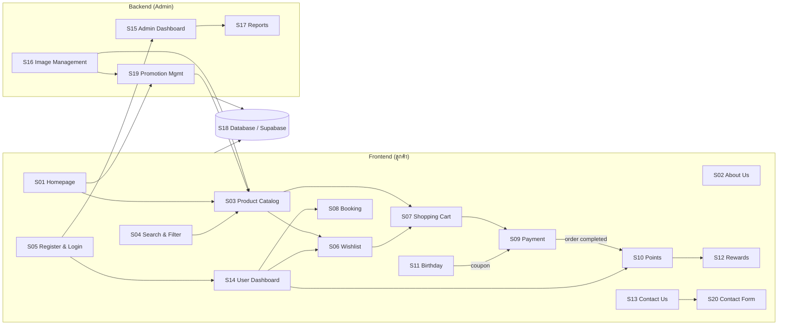
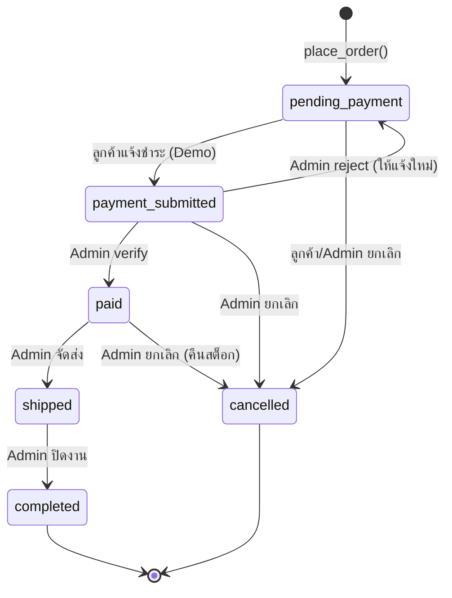

# GEARAWAI — System Analysis (การวิเคราะห์ระบบ 20 หัวข้อ)

> **LEVEL UP YOUR GEAR**
>
> | รายการ | รายละเอียด |
> |---|---|
> | เอกสาร | 1 / 6 — GEARAWAI_SYSTEM_ANALYSIS.md |
> | Revision | **Rev.1 (11 พ.ย. 2026)** — ปรับตามการตัดสินใจ D-01–D-10 และ GEARAWAI_REVIEW_REPORT.md (ดูหัวข้อ 8) |
> | สถานะ | Draft สำหรับเตรียมการพัฒนา (Project Preparation) |
> | วันที่จัดทำ | 11 พฤศจิกายน 2026 |
> | แหล่งอ้างอิง | `GEARAWAI_SPECIFICATION.md`, `GEARAWAI_CONTEXT.md`, Project Instructions |
> | ข้อจำกัด | ยังไม่ได้ตรวจสอบ Source Code ในคอมพิวเตอร์หลัก — เอกสารนี้ไม่ได้อ้างอิงโครงสร้างโค้ดที่มีอยู่จริง |
> | เอกสารที่เกี่ยวข้อง | DATABASE_DESIGN, UI_UX_DESIGN, PRODUCT_DATA, ADMIN_DESIGN, TEST_CASES |

---

## สารบัญ

0. [ผลการตรวจสอบเอกสารต้นทาง](#0-ผลการตรวจสอบเอกสารต้นทาง)
1. [ประเภทผู้ใช้งานและสิทธิ์](#1-ประเภทผู้ใช้งานและสิทธิ์)
2. [ภาพรวมความเชื่อมโยงของระบบ](#2-ภาพรวมความเชื่อมโยงของระบบ)
3. [รายละเอียดระบบ S01–S20](#3-รายละเอียดระบบ-s01s20)
4. [ฟังก์ชันที่ซ้ำซ้อนหรือทับซ้อน](#4-ฟังก์ชันที่ซ้ำซ้อนหรือทับซ้อน)
5. [ข้อมูลและฟังก์ชันที่ขาดหาย](#5-ข้อมูลและฟังก์ชันที่ขาดหาย-ต้องตัดสินใจ)
6. [Business Rules กลาง (ใช้ร่วมกันทุกเอกสาร)](#6-business-rules-กลาง)
7. [การจับคู่ระบบกับ Phase การพัฒนา](#7-การจับคู่ระบบกับ-phase-การพัฒนา)
8. [บันทึกการตัดสินใจ (D-01 – D-10)](#8-บันทึกการตัดสินใจ)

---

## 0. ผลการตรวจสอบเอกสารต้นทาง

### 0.1 ความครบถ้วนของ 20 ระบบ

`GEARAWAI_SPECIFICATION.md` หัวข้อ 4 มีรายละเอียด **ครบทั้ง 20 ระบบ** (องค์ประกอบ ขนาด UI และฟังก์ชัน) จึงไม่มีระบบใดต้องสร้างรายละเอียดขึ้นเองทั้งหมด

| รหัส | ระบบ (ตาม SPEC) | มีใน SPEC | มีใน CONTEXT | มีใน Project Instructions |
|---|---|:---:|:---:|:---:|
| S01 | Homepage | ✅ | ✅ Homepage | ✅ หน้าหลักและแสดงโปรโมชั่น |
| S02 | About Us | ✅ | ✅ About Us | ✅ หน้าเกี่ยวกับร้าน |
| S03 | Product Catalog | ✅ | ✅ Product Catalog, Product Categories, Product Details | ✅ |
| S04 | Search & Filter | ✅ | ✅ Product Search and Filter | ✅ |
| S05 | Register & Login | ✅ | ✅ Register and Login | ✅ |
| S06 | Wishlist | ✅ | ✅ Wishlist | ✅ |
| S07 | Shopping Cart | ✅ | ✅ Shopping Cart | ✅ |
| S08 | Booking (จองบริการ) | ✅ | ✅ Booking System | ⚠️ เขียนว่า "ระบบจอง**สินค้า**" |
| S09 | Payment | ✅ | ⚠️ ไม่มีชื่อโดยตรง (มี Order System) | ⚠️ มี "ระบบสั่งซื้อสินค้า" |
| S10 | Points System | ✅ | ✅ Points and Rewards | ✅ |
| S11 | Birthday Privileges | ✅ | ❌ ไม่มี | ❌ ไม่มี |
| S12 | Rewards Redemption | ✅ | ✅ Points and Rewards | ✅ |
| S13 | Contact Us | ✅ | ✅ Contact Us | ✅ |
| S14 | User Dashboard | ✅ | ✅ Member Dashboard | ✅ ระบบสมาชิกและข้อมูลส่วนตัว |
| S15 | Admin Dashboard | ✅ | ✅ Admin Dashboard + Order/Member Management | ✅ |
| S16 | Image Management | ✅ | ❌ ไม่มี | ❌ ไม่มี |
| S17 | Reports & Analytics | ✅ | ✅ Reports and Analytics | ✅ |
| S18 | Database System | ✅ | ⚠️ อยู่ในข้อกำหนด (ไม่ได้แยกเป็นระบบ) | ⚠️ อยู่ในเทคโนโลยี |
| S19 | Promotion Management | ✅ | ✅ Promotion Management | ✅ |
| S20 | Contact Form | ✅ | ✅ Contact Message Management | ✅ ระบบติดต่อร้านค้า |

**สรุป:** SPEC เป็นเอกสารที่ละเอียดที่สุด เอกสารชุดนี้จึงยึด SPEC เป็นหลัก ส่วน CONTEXT และ Project Instructions ใช้ตรวจความสอดคล้อง

### 0.2 ข้อขัดแย้งระหว่างเอกสาร

| # | ประเด็น | SPEC | เอกสารอื่น | แนวทางที่ใช้ในเอกสารชุดนี้ |
|---|---|---|---|---|
| C1 | ระบบจอง | ระบบที่ 8 = **จองบริการ** (ประกอบคอม ตรวจเช็กอุปกรณ์) | Project Instructions = "ระบบจอง**สินค้า**" | ✅ **อนุมัติ D-01: จองบริการตาม SPEC** |
| C2 | Payment / Birthday / Image Management | มีเป็นระบบแยก | CONTEXT ไม่ได้ระบุ | ยึด SPEC — ไม่ตัดระบบออก |
| C3 | เมนูหน้าบ้าน | SPEC หัวข้อ 1 ระบุเมนู Home, Shop, Categories, Deals, About Us แต่หัวข้อ 6 เพิ่ม Contact Us | — | ใช้เมนูหลัก 6 รายการ (รวม Contact Us) ดู UI_UX_DESIGN |
| C4 | Breakpoint | SPEC มี 4 ระดับ (Desktop/Laptop/Tablet/Mobile) | คำขอเตรียมงานระบุ 3 ระดับ | ออกแบบครบ 4 ระดับ (Laptop เป็นระดับเพิ่ม) |
| C5 | ภาพ Mockup GEARAWAI | SPEC อ้างถึง "ภาพ Mockup ที่แนบมา" | ไม่มีไฟล์ภาพใน Project | ออกแบบจาก Brand Identity ในข้อความเท่านั้น — ดู M15 |

---

## 1. ประเภทผู้ใช้งานและสิทธิ์

| Role | คำอธิบาย | การระบุในระบบ |
|---|---|---|
| **Guest** | ผู้เข้าชมที่ยังไม่เข้าสู่ระบบ | ไม่มี Session (`anon` ใน Supabase) |
| **Member** | สมาชิกที่สมัครและเข้าสู่ระบบแล้ว | `profiles.role = 'member'` |
| **Admin** | ผู้ดูแลระบบ | `profiles.role = 'admin'` |

### 1.1 Permission Matrix

สัญลักษณ์: ✅ ได้ · ❌ ไม่ได้ · 👤 เฉพาะข้อมูลของตนเอง · ➡️ ถูกพาไปหน้า Login

| ความสามารถ | Guest | Member | Admin |
|---|:---:|:---:|:---:|
| ดู Homepage / About / Contact / Deals | ✅ | ✅ | ✅ |
| ดูและค้นหาสินค้า / ดูรายละเอียด | ✅ | ✅ | ✅ |
| ส่ง Contact Form | ✅ | ✅ | ✅ |
| สมัครสมาชิก / เข้าสู่ระบบ | ✅ | — | — |
| Wishlist | ➡️ | 👤 | 👤 (ในฐานะลูกค้า) |
| Shopping Cart | ➡️ | 👤 | 👤 |
| สั่งซื้อ / ชำระเงิน (Demo) | ➡️ | 👤 | 👤 |
| จองบริการ | ➡️ | 👤 | 👤 |
| คะแนน / แลกรางวัล / คูปองวันเกิด | ❌ | 👤 | 👤 |
| User Dashboard | ➡️ | 👤 | 👤 |
| เข้า `/admin/*` | ❌ | ❌ (แสดง 403) | ✅ |
| จัดการสินค้า หมวดหมู่ แบรนด์ สต็อก รูปภาพ | ❌ | ❌ | ✅ |
| จัดการคำสั่งซื้อ ตรวจสอบการชำระเงิน | ❌ | ❌ | ✅ |
| จัดการสมาชิก (ดู / เปลี่ยนสถานะ / ปรับคะแนน) | ❌ | ❌ | ✅ |
| จัดการโปรโมชั่น คูปอง บริการ การจอง ของรางวัล | ❌ | ❌ | ✅ |
| ดูรายงาน / Export | ❌ | ❌ | ✅ |
| จัดการข้อความติดต่อ / ตั้งค่าเว็บไซต์ / ทีมงาน | ❌ | ❌ | ✅ |

> **หลักการ (Rev.1 — R-30):** ตรวจสิทธิ์ทั้งฝั่ง Frontend และ Backend ตาม SPEC หัวข้อ 5
> - **ฝั่ง Next.js (เพื่อ UX):** ① `proxy.ts` (Next.js 16+) หรือ `middleware.ts` (≤ 15) กันหน้า `/dashboard`, `/admin` ② Server Component Layout ตรวจ role
> - **ฝั่งฐานข้อมูล (บังคับใช้จริง):** ③ GRANT ระดับตาราง/คอลัมน์ ④ RLS ⑤ RPC `SECURITY DEFINER` ที่ตรวจ `auth.uid()`/`is_admin()` — รายละเอียด DATABASE_DESIGN หัวข้อ 5

---

## 2. ภาพรวมความเชื่อมโยงของระบบ

### 2.1 เส้นทางหลักของข้อมูล (Data Flow)

1. **เส้นทางการซื้อ:** S03/S04 → S06 (ไม่บังคับ) → S07 → S09 (สร้าง Order + Payment) → S15 (Admin ยืนยัน) → S10 (ให้คะแนนเมื่อ Order = `completed`) → S12 (แลกรางวัล)
2. **เส้นทางเนื้อหา:** S15/S16/S19 (Admin แก้ไข) → S18 → S01/S03 (หน้าร้านแสดงผลทันที)
3. **เส้นทางการสื่อสาร:** S20 (ลูกค้าส่งข้อความ) → S18 `contact_messages` → S15 (Admin อ่าน/ตอบสถานะ)
4. **เส้นทางบริการ:** S08 (ลูกค้าจอง) → S18 `bookings` → S15 (Admin ยืนยัน) → S14 (ลูกค้าเห็นสถานะ)

---

## 3. รายละเอียดระบบ S01–S20

> รหัสฟังก์ชันย่อย `Sxx-Fyy` ใช้อ้างอิงใน TEST_CASES · ชื่อตารางตรงกับ DATABASE_DESIGN · Route ตรงกับ UI_UX_DESIGN

### S01 — Homepage (หน้าแรก)

| หัวข้อ | รายละเอียด |
|---|---|
| วัตถุประสงค์ | นำเสนอแบรนด์ GEARAWAI สินค้าแนะนำ หมวดหมู่ และโปรโมชั่น เพื่อพาผู้ใช้ไปยังหน้าร้าน |
| Route | `/` |
| ผู้ใช้ | Guest, Member, Admin |
| ตารางที่ใช้ | `site_settings`, `categories`, `products` (`is_featured`), `promotions`, `product_images` |

**ฟังก์ชันย่อย**

| รหัส | ฟังก์ชัน |
|---|---|
| S01-F01 | แสดง Header กลาง (โลโก้, เมนู Home/Shop/Categories/Deals/About Us/Contact Us, Search, ไอคอน Wishlist/Cart/Account) |
| S01-F02 | แสดง Hero Banner (ข้อความ LEVEL UP YOUR GEAR + ปุ่ม SHOP NOW → `/shop`) แยกภาพตามขนาดหน้าจอ |
| S01-F03 | แสดง Store Information แบบย่อ (ดึงจาก `site_settings`) |
| S01-F04 | แสดง Popular Categories (จาก `categories` ที่ `is_active = true` เรียงตาม `sort_order`) |
| S01-F05 | แสดง Featured Products (จาก `products.is_featured = true` และ `status = 'active'`) |
| S01-F06 | แสดง Promotions ที่อยู่ในช่วงวันที่และเปิดใช้งาน (`promotions.show_on_homepage = true`) |
| S01-F07 | แสดง Why Choose GEARAWAI |
| S01-F08 | แสดง Footer กลาง |
| S01-F09 | แสดงจำนวนสินค้าในตะกร้าบน Header (เชื่อม S07) |

**การเชื่อมโยง:** S03 (ปุ่ม SHOP NOW, การ์ดสินค้า), S04 (Search ใน Header), S06/S07 (ปุ่มบน Product Card), S19 (ข้อมูลโปรโมชั่น), S16 (ภาพแบนเนอร์)

**ข้อสังเกต:** SPEC ไม่ได้กำหนดว่า "Featured" มาจากไหน → เสนอให้ใช้คอลัมน์ `products.is_featured` ที่ Admin ติ๊กเลือกได้

---

### S02 — About Us (เกี่ยวกับเรา)

| หัวข้อ | รายละเอียด |
|---|---|
| วัตถุประสงค์ | แสดงประวัติ จุดเด่น ทีมงาน และ Gallery ของร้าน |
| Route | `/about` |
| ผู้ใช้ | ทุกคน (อ่าน), Admin (แก้ไขเนื้อหา) |
| ตารางที่ใช้ | `site_settings` (ประวัติร้าน/จุดเด่น), `team_members`, ภาพ Gallery ผ่าน RPC `get_public_gallery()` (R-09) |

| รหัส | ฟังก์ชัน |
|---|---|
| S02-F01 | Page Header + Breadcrumb `Home / About Us` |
| S02-F02 | Store History (ข้อความจาก SPEC ระบบที่ 2 ใช้เป็นค่าเริ่มต้น) |
| S02-F03 | Store Highlights 5 ข้อ (ตาม SPEC) |
| S02-F04 | Team Members (รูป ชื่อ ตำแหน่ง คำอธิบาย) จาก `team_members` ที่ `is_active = true` |
| S02-F05 | Store Gallery |
| S02-F06 | Call to Action (ไปหน้า Shop / Contact) |

**ข้อสังเกต:** ข้อมูลทีมงานจริงยังไม่มี (M08) → ใช้ข้อมูลตัวอย่าง "Team Member 1–4" ที่ติดป้าย `is_demo = true` และแก้ไขได้ภายหลัง ห้ามแต่งชื่อบุคคลจริง

---

### S03 — Product Catalog (รายการสินค้า)

| หัวข้อ | รายละเอียด |
|---|---|
| วัตถุประสงค์ | แสดงรายการสินค้าทั้งหมดแบบ Grid และหน้ารายละเอียดสินค้า |
| Route | `/shop`, `/categories`, `/shop/[slug]` |
| ผู้ใช้ | ทุกคน (ดู), Member (เพิ่ม Cart/Wishlist), Admin (จัดการผ่าน S15) |
| ตารางที่ใช้ | `products`, `categories`, `brands`, `product_images`, `promotions`, `promotion_products`, View `v_product_catalog` |

| รหัส | ฟังก์ชัน |
|---|---|
| S03-F01 | Product Catalog Header + Breadcrumb |
| S03-F02 | Product Grid (Desktop 5 / Laptop 3–4 / Tablet 2–3 / Mobile 1–2 คอลัมน์) |
| S03-F03 | Product Card: ภาพ 160×160 (object-fit: contain), ชื่อ, แบรนด์, ราคา/ราคาลด, ป้ายสต็อก, ปุ่ม Add to Cart / Wishlist / View Details |
| S03-F04 | หน้ารวมหมวดหมู่ `/categories` |
| S03-F05 | Product Detail: Gallery, ชื่อ, แบรนด์, หมวดหมู่, ราคา, Sale Price, Description, Specifications, Stock, ตัวเลือกจำนวน |
| S03-F06 | Related Products (หมวดหมู่เดียวกัน ไม่รวมสินค้าปัจจุบัน สูงสุด 4–5 รายการ) |
| S03-F07 | Pagination (SPEC หัวข้อ 8) |
| S03-F08 | ซ่อนสินค้า `status = 'inactive'` จากหน้าร้าน |

**การเชื่อมโยง:** S04 (ค้นหา/กรองบนหน้าเดียวกัน), S06, S07, S19 (ราคาโปรโมชั่น), S16 (ภาพสินค้า)

**ข้อสังเกต:** SPEC ระบบที่ 3 รวม Search Bar, Filter Sidebar, Sorting ไว้ด้วย ซึ่งซ้ำกับ S04 → ดู D01

---

### S04 — Search & Filter (ค้นหาและกรองข้อมูล)

| หัวข้อ | รายละเอียด |
|---|---|
| วัตถุประสงค์ | ช่วยให้ลูกค้าค้นหาสินค้าได้เร็วด้วยคำค้นและตัวกรองหลายเงื่อนไขพร้อมกัน |
| Route | `/shop?q=&category=&brand=&min=&max=&stock=&sort=&page=` |
| ผู้ใช้ | ทุกคน |
| ตารางที่ใช้ | `v_product_catalog` (มี `effective_price`, `sold_count`) |

| รหัส | ฟังก์ชัน |
|---|---|
| S04-F01 | ค้นหาจากชื่อสินค้า (ไม่สนตัวพิมพ์เล็ก/ใหญ่ — `ilike`) |
| S04-F02 | ค้นหาจากชื่อแบรนด์ |
| S04-F03 | กรองตาม Category (เลือกได้หลายรายการ) |
| S04-F04 | กรองตาม Brand (เลือกได้หลายรายการ) |
| S04-F05 | กรองตาม Price Range (ใช้ `effective_price`) |
| S04-F06 | กรองตาม Availability (มีสินค้า / สินค้าหมด) |
| S04-F07 | เรียง Popularity (`sold_count` — นับเมื่อ Order ได้รับการยืนยันว่าชำระแล้ว และหักออกเมื่อยกเลิก — D-07) |
| S04-F08 | เรียง Price Low→High / High→Low |
| S04-F09 | เรียง Newest (`created_at`) |
| S04-F10 | เรียง Name A–Z |
| S04-F11 | Empty State "ไม่พบสินค้าที่ตรงกับเงื่อนไข" + ปุ่มล้างตัวกรอง |
| S04-F12 | ค้นหา + กรอง + เรียง ทำงานร่วมกัน และเก็บสถานะใน URL (แชร์ลิงก์ได้/กด Back ได้) |

**ข้อสังเกต:** SPEC ไม่ได้นิยาม "Popularity" → เสนอให้ใช้ยอดขายสะสม (`sold_count`) เพราะระบบไม่มีรีวิว/ยอดเข้าชม (ดู M12)

---

### S05 — Register & Login (สมัครสมาชิกและเข้าสู่ระบบ)

| หัวข้อ | รายละเอียด |
|---|---|
| วัตถุประสงค์ | ยืนยันตัวตนผู้ใช้ด้วย Supabase Auth และแยกสิทธิ์ Member/Admin |
| Route | `/register`, `/login` |
| ผู้ใช้ | Guest (สมัคร/เข้าสู่ระบบ), Member/Admin (ออกจากระบบ) |
| ตารางที่ใช้ | `auth.users` (Supabase), `profiles` |

| รหัส | ฟังก์ชัน |
|---|---|
| S05-F01 | สมัครสมาชิก: ชื่อ-นามสกุล, อีเมล, รหัสผ่าน, ยืนยันรหัสผ่าน, วันเกิด (**ไม่บังคับ — D-08**) · ส่งวันเกิดเป็น `YYYY-MM-DD` |
| S05-F02 | ตรวจสอบข้อมูลก่อนส่ง (อีเมลถูกรูปแบบ, รหัสผ่านตรงกันและยาวตามเกณฑ์, วันเกิดไม่เป็นอนาคต) |
| S05-F03 | สร้างแถว `profiles` อัตโนมัติด้วย Trigger `handle_new_user()` (role เริ่มต้น `member`) |
| S05-F04 | เข้าสู่ระบบด้วยอีเมล/รหัสผ่าน |
| S05-F05 | ออกจากระบบ (ล้าง Session) |
| S05-F06 | จัดการ Session ด้วย `@supabase/ssr` (Cookie) |
| S05-F07 | ป้องกัน `/admin/*` สำหรับผู้ที่ไม่ใช่ Admin และ `/dashboard/*` สำหรับ Guest (`proxy.ts`/`middleware.ts` ตามเวอร์ชัน Next.js + Layout + RLS) |
| S05-F08 | Redirect กลับหน้าเดิมหลัง Login (`?redirect=`) |

**ข้อสังเกต:** รหัสผ่านจัดการโดย Supabase Auth (Hash อัตโนมัติ) ไม่เก็บในตารางของเรา · **ปิด Email Confirmation สำหรับระบบ Demo (D-02)** → สมัครแล้วเข้าสู่ระบบทันที · ฟังก์ชัน "ลืมรหัสผ่าน" (M11) ต้องส่งอีเมล จึงใช้ได้จริงเฉพาะเมื่อตั้ง Custom SMTP — คงเป็นฟังก์ชันเสริมที่ยังไม่เปิดใช้ · ห้ามให้ผู้ใช้กำหนด role เองตอนสมัคร (Trigger ไม่อ่าน role จาก metadata) — Admin คนแรกตั้งผ่าน SQL · Trigger สร้างโปรไฟล์ต้อง **ไม่ทำให้การสมัครล้ม** เมื่อชื่อว่าง/วันเกิดผิดรูปแบบ (R-07)

---

### S06 — Wishlist (รายการโปรด)

| หัวข้อ | รายละเอียด |
|---|---|
| วัตถุประสงค์ | ให้สมาชิกบันทึกสินค้าที่สนใจไว้ดูหรือซื้อภายหลัง |
| Route | `/wishlist` (และแท็บใน `/dashboard/wishlist`) |
| ผู้ใช้ | Member (Guest ถูกพาไป Login) |
| ตารางที่ใช้ | `wishlists` (1 ต่อ 1 กับผู้ใช้), `wishlist_items` |

| รหัส | ฟังก์ชัน |
|---|---|
| S06-F01 | เพิ่มสินค้า (ไอคอนหัวใจบน Card/Detail) — กดซ้ำ = ลบ (Toggle) |
| S06-F02 | ลบสินค้าออกจาก Wishlist |
| S06-F03 | ดูรายการโปรด (ภาพ ชื่อ ราคาปัจจุบัน สถานะสต็อก) ผ่าน RPC `get_my_wishlist()` — แสดงสินค้าที่ถูกปิดขายพร้อมป้าย "ไม่พร้อมจำหน่าย" (R-04) |
| S06-F04 | เปิดหน้ารายละเอียดสินค้า |
| S06-F05 | ย้ายไป Cart (เพิ่มลง Cart 1 ชิ้น แล้วลบออกจาก Wishlist) |
| S06-F06 | ป้องกันสินค้าซ้ำ (Unique `wishlist_id + product_id`) |

**ข้อสังเกต:** SPEC ระบุ "ย้ายสินค้าไปยัง Cart" → ตีความว่า **ลบออกจาก Wishlist หลังเพิ่มลง Cart สำเร็จ** (ถ้าต้องการเก็บไว้ ให้แจ้งเปลี่ยน)

---

### S07 — Shopping Cart (ตะกร้าสินค้า)

| หัวข้อ | รายละเอียด |
|---|---|
| วัตถุประสงค์ | รวบรวมสินค้าที่ต้องการซื้อ คำนวณยอด และส่งต่อไปชำระเงิน |
| Route | `/cart` |
| ผู้ใช้ | Member |
| ตารางที่ใช้ | `carts`, `cart_items`, `v_product_catalog` |

| รหัส | ฟังก์ชัน |
|---|---|
| S07-F01 | เพิ่มสินค้า (ถ้ามีอยู่แล้วให้บวกจำนวน) |
| S07-F02 | เพิ่ม/ลดจำนวน (ขั้นต่ำ 1, สูงสุด = สต็อกคงเหลือ) |
| S07-F03 | ลบสินค้า (มี Confirmation Dialog) |
| S07-F04 | คำนวณ Subtotal ต่อแถว และ Total (ใช้ `effective_price` ปัจจุบัน) |
| S07-F05 | ตรวจสอบ Stock ทั้งตอนเพิ่ม ตอนแก้จำนวน และตอนกด Checkout |
| S07-F06 | แสดงจำนวนชิ้นใน Header (Badge) |
| S07-F07 | บันทึกตะกร้าลงฐานข้อมูล (อยู่ข้ามอุปกรณ์/ข้าม Session) |
| S07-F08 | แจ้งเตือนเมื่อสินค้าในตะกร้าถูกปิดขายหรือสต็อกไม่พอ — อ่านตะกร้าผ่าน RPC `get_my_cart()` (คืน `product_status`, `is_purchasable`) (R-04) |

**ข้อสังเกต:** ราคาในตะกร้าไม่ถูกบันทึกถาวร (คำนวณสดทุกครั้ง) — ราคาจะถูก "ล็อก" เป็น Snapshot ใน `order_items` ตอนสั่งซื้อเท่านั้น · SPEC กำหนดว่า Cart สำหรับ Member — Guest ที่กด Add to Cart จะถูกพาไป Login

---

### S08 — Booking (จองบริการ)

| หัวข้อ | รายละเอียด |
|---|---|
| วัตถุประสงค์ | ให้สมาชิกจองบริการเสริมของร้าน เช่น ประกอบคอมพิวเตอร์ ตรวจเช็กอุปกรณ์ |
| Route | `/booking`, `/dashboard/bookings` |
| ผู้ใช้ | Guest (ดูรายการบริการ), Member (จอง/ดูสถานะ/ยกเลิก), Admin (จัดการ) |
| ตารางที่ใช้ | `services`, `bookings` |

| รหัส | ฟังก์ชัน |
|---|---|
| S08-F01 | แสดงรายการบริการ (ภาพ ชื่อ รายละเอียด ราคา ระยะเวลา) |
| S08-F02 | เลือกบริการ |
| S08-F03 | เลือกวัน (ปฏิทิน — ห้ามเลือกวันที่ผ่านมาแล้ว) |
| S08-F04 | เลือกเวลา (ช่วงเวลาที่ยังว่าง) — อ่านผ่าน RPC `get_booked_slots()` ซึ่งคืน **เฉพาะเวลา** ไม่มีข้อมูลผู้จอง (R-03) |
| S08-F05 | กรอกข้อมูลผู้จอง (เติมจาก Profile อัตโนมัติ แก้ไขได้) |
| S08-F06 | ยืนยันและบันทึกการจองผ่าน RPC `create_booking()` (สร้างเลข `BK-YYYYMMDD-NNNN`, สถานะ `pending`) — สมาชิกไม่มีสิทธิ์ INSERT/UPDATE ตารางตรง (R-02, R-11) |
| S08-F07 | ตรวจสอบสถานะการจองใน Dashboard · ยกเลิกเองได้เมื่อ `pending` ผ่าน `cancel_booking()` |
| S08-F08 | Admin ยืนยัน / เสร็จสิ้น / ยกเลิกการจอง ผ่าน `admin_update_booking()` (ตรวจลำดับสถานะ) |
| S08-F09 | ป้องกันการจองช่วงเวลาซ้ำ (1 ช่วงเวลา/บริการ/วัน — ค่าตัวอย่าง) |

**ข้อสังเกต:** ✅ D-01 ยืนยันเป็นระบบจองบริการ · ✅ D-05 ใช้บริการตัวอย่าง 3 รายการ, ช่วงเวลา 10:00/13:00/15:00, 1 คิว/ช่วง, จองล่วงหน้าได้ 30 วัน, **ชำระที่ร้าน** (ไม่ผ่าน S09) · ทุกการตรวจ "วันนี้/อดีต" ใช้วันที่ไทย (R-06)

---

### S09 — Payment (ชำระเงิน — Demo Mode)

| หัวข้อ | รายละเอียด |
|---|---|
| วัตถุประสงค์ | สรุปคำสั่งซื้อ เก็บข้อมูลผู้รับและที่อยู่ เลือกช่องทางชำระ และบันทึกข้อมูลการชำระเงิน **แบบจำลอง** |
| Route | `/checkout`, `/checkout/payment/[orderNumber]`, `/checkout/success/[orderNumber]` |
| ผู้ใช้ | Member (ชำระ), Admin (ตรวจสอบ) |
| ตารางที่ใช้ | `orders`, `order_items`, `payments`, `coupons`, `member_coupons`, `products`, `stock_movements` |

| รหัส | ฟังก์ชัน |
|---|---|
| S09-F01 | สรุปรายการสินค้าจาก Cart (ภาพ ชื่อ จำนวน ราคา) |
| S09-F02 | กรอกข้อมูลผู้รับ (ชื่อ เบอร์โทร) และที่อยู่จัดส่ง |
| S09-F03 | ใส่รหัสคูปอง (รวมคูปองวันเกิดจาก S11) และแสดงส่วนลด |
| S09-F04 | แสดงยอดเงิน: Subtotal − Discount + Shipping Fee = Total · **ส่งฟรีเมื่อ Subtotal (ก่อนหักคูปอง) ≥ 1,000 บาท (D-04)** |
| S09-F05 | สร้าง Order ด้วย RPC `place_order()` แบบ Transaction (ตรวจสต็อก → ตัดสต็อก → สร้าง Order/Items → ล้าง Cart) |
| S09-F06 | เลือกช่องทางชำระ: PromptPay (Demo) / โอนผ่านบัญชี (Demo) |
| S09-F07 | แสดง QR ตัวอย่าง หรือข้อมูลบัญชีตัวอย่าง พร้อมป้าย **"ระบบจำลอง — ไม่มีการตัดเงินจริง"** |
| S09-F08 | แจ้งชำระเงิน: อัปโหลดสลิปตัวอย่าง (ไม่บังคับ) + กดยืนยัน → `payments.status = 'submitted'` |
| S09-F09 | แสดงสถานะการชำระเงิน |
| S09-F10 | Admin ตรวจสอบ: `verified` (Order → `paid`, เพิ่ม `sold_count`) หรือ `rejected` (Order กลับ `pending_payment`) · ถ้ายกเลิก Order หลังแจ้ง/ยืนยันชำระ → payment = `voided` (R-20) |

**ข้อสังเกต:** ไม่มี Payment Gateway จริง → ทุกหน้าที่เกี่ยวกับการชำระต้องแสดงข้อความ Demo และห้ามแสดงคำว่า "ชำระเงินสำเร็จ" — ใช้ "ส่งข้อมูลแจ้งชำระแล้ว รอผู้ดูแลตรวจสอบ" แทน · CONTEXT ใช้ชื่อ "Order System" ส่วน SPEC ใช้ "Payment" → ระบบนี้ครอบคลุม **Checkout + Order Creation + Payment** · ✅ D-05: ค่าส่ง 50 บาท ส่งฟรีเมื่อ ≥ 1,000 บาท ราคารวม VAT แล้ว · ข้อมูลบัญชี/QR ต้องเป็นตัวอย่าง ห้ามใช้บัญชีจริง

---

### S10 — Points System (สะสมคะแนน)

| หัวข้อ | รายละเอียด |
|---|---|
| วัตถุประสงค์ | ให้คะแนนสมาชิกจากยอดซื้อ และติดตามประวัติการได้รับ/ใช้คะแนน |
| Route | `/dashboard/points` |
| ผู้ใช้ | Member (ดู), Admin (ตั้งอัตรา, ปรับคะแนนด้วยมือ) |
| ตารางที่ใช้ | `points_transactions`, `profiles.points_balance`, `site_settings` (`points_rule`) |

| รหัส | ฟังก์ชัน |
|---|---|
| S10-F01 | คำนวณคะแนน: `floor((subtotal − discount_amount) / baht_per_point)` — **ไม่รวมค่าจัดส่ง (D-04)** · 100 บาท = 1 คะแนน (D-05) |
| S10-F02 | เพิ่มคะแนนอัตโนมัติเมื่อ Order เปลี่ยนเป็น `completed` |
| S10-F03 | บันทึกประวัติทุกการเปลี่ยนแปลง (`earn`, `redeem`, `adjust`, `reverse`) |
| S10-F04 | แสดงคะแนนคงเหลือ + Progress Bar ไปยังรางวัลถัดไป |
| S10-F05 | ตรวจสอบคะแนนที่ใช้ได้ก่อนแลก (เชื่อม S12) |
| S10-F06 | ป้องกันการให้คะแนนซ้ำจาก Order เดิม (Unique Index `order_id` + `type='earn'`) |
| S10-F07 | Admin ปรับคะแนนด้วยมือพร้อมเหตุผล (`adjust`) |
| S10-F08 | แสดงเงื่อนไขการสะสมคะแนน (อ่านจาก `site_settings`) |

**ข้อสังเกต:** ✅ D-05: 100 บาท = 1 คะแนน, ได้เมื่อ `completed`, ใช้แลกรางวัลเท่านั้น (ไม่ใช้เป็นส่วนลด), ไม่หมดอายุ · `points_balance` เปลี่ยนได้ผ่าน RPC เท่านั้น (ป้องกันด้วยสิทธิ์ระดับคอลัมน์ — R-01)

---

### S11 — Birthday Privileges (สิทธิพิเศษวันเกิด)

| หัวข้อ | รายละเอียด |
|---|---|
| วัตถุประสงค์ | มอบคูปองส่วนลดให้สมาชิกในช่วงวันเกิด ปีละ 1 ครั้ง |
| Route | `/dashboard/coupons` (การ์ดสิทธิพิเศษบน `/dashboard` ด้วย) |
| ผู้ใช้ | Member (รับ/ใช้สิทธิ์), Admin (ตั้งค่าคูปองวันเกิด) |
| ตารางที่ใช้ | `profiles.birth_date`, `coupons` (`coupon_type = 'birthday'`), `member_coupons` |

| รหัส | ฟังก์ชัน |
|---|---|
| S11-F01 | จัดเก็บวันเกิด (กรอกตอนสมัครหรือภายหลัง — ไม่บังคับ D-08) · แก้ผ่าน `set_my_birth_date()`: ตั้งครั้งแรกได้เสมอ แก้ได้อีก 1 ครั้ง |
| S11-F02 | ตรวจสอบว่าวันนี้อยู่ในช่วงสิทธิ์ (ค่าตัวอย่าง: **ทั้งเดือนเกิด**) |
| S11-F03 | ปุ่ม "รับสิทธิ์วันเกิด" → RPC `claim_birthday_coupon()` สร้าง `member_coupons` |
| S11-F04 | แสดงการ์ดสิทธิพิเศษ + รหัสคูปอง + วันหมดอายุ (ปุ่มคัดลอกรหัส) |
| S11-F05 | ใช้คูปองในหน้า Checkout (S09) |
| S11-F06 | บันทึกประวัติการใช้สิทธิ์ (`member_coupons.used_at`, `order_id`) |
| S11-F07 | ตรวจสอบวันหมดอายุ |
| S11-F08 | ป้องกันการรับสิทธิ์ซ้ำ: Unique (`user_id`, `coupon_id`, `cycle_year`) |

**ข้อสังเกต:** ✅ D-05: ลด 10% สูงสุด 500 บาท, ใช้ได้ในเดือนเกิด (เวลาไทย), หมดอายุ 00:00 น. วันแรกของเดือนถัดไป, แก้วันเกิดได้ 1 ครั้ง · รับได้ 1 ครั้งต่อปีต่อบัญชี (Unique Index) · สมาชิกที่ยังไม่กรอกวันเกิดจะเห็นข้อความชวนให้กรอก · ⚠️ **R-32 (ใหม่ — รอตัดสินใจ):** เพราะวันเกิดไม่บังคับ ผู้ใช้อาจกรอกวันเกิดครั้งแรกเป็นเดือนปัจจุบันเพื่อรับคูปองทันที — ผลกระทบจำกัดที่ 1 คูปอง/ปี/บัญชี ยังไม่เพิ่มกฎใด เพราะต้องเปลี่ยนข้อกำหนด · CONTEXT และ Project Instructions ไม่ได้กล่าวถึงระบบนี้ แต่คงไว้ตาม SPEC

---

### S12 — Rewards Redemption (แลกของรางวัล)

| หัวข้อ | รายละเอียด |
|---|---|
| วัตถุประสงค์ | ให้สมาชิกใช้คะแนนสะสมแลกของรางวัล |
| Route | `/dashboard/rewards` |
| ผู้ใช้ | Member (แลก), Admin (จัดการของรางวัลและส่งมอบ) |
| ตารางที่ใช้ | `rewards`, `reward_redemptions`, `points_transactions`, `profiles` |

| รหัส | ฟังก์ชัน |
|---|---|
| S12-F01 | แสดงรายการของรางวัล (ภาพ ชื่อ รายละเอียด คะแนนที่ใช้ คงเหลือ) |
| S12-F02 | แสดงคะแนนคงเหลือของผู้ใช้ และปิดปุ่มเมื่อคะแนนไม่พอ |
| S12-F03 | กล่องยืนยันการแลก (420×300) |
| S12-F04 | แลกด้วย RPC `redeem_reward()` แบบ Transaction: ตรวจคะแนน → ตรวจสต็อกรางวัล → หักคะแนน → ลดจำนวนรางวัล → บันทึกประวัติ |
| S12-F05 | บันทึกประวัติการแลก (สถานะ `requested` → `fulfilled` / `cancelled`) |
| S12-F06 | Admin ยกเลิกการแลก → คืนคะแนน (`reverse`) และคืนจำนวนรางวัล |

**ข้อสังเกต:** ไม่มีรายการของรางวัลจริง (M10) → ใช้ของรางวัล Demo **ที่จับต้องได้ทั้งหมด** (D-06: ไม่มีของรางวัลประเภทคูปอง) · วิธีส่งมอบรางวัล: รับที่ร้านหรือส่งพร้อมคำสั่งซื้อถัดไป (ค่าตัวอย่าง M10)

---

### S13 — Contact Us (หน้าข้อมูลติดต่อ)

| หัวข้อ | รายละเอียด |
|---|---|
| วัตถุประสงค์ | แสดงช่องทางติดต่อร้านและเป็นที่ตั้งของแบบฟอร์มติดต่อ (S20) |
| Route | `/contact` |
| ผู้ใช้ | ทุกคน (ดู), Admin (แก้ข้อมูลผ่าน Settings) |
| ตารางที่ใช้ | `site_settings` (`store_contact`) |

| รหัส | ฟังก์ชัน |
|---|---|
| S13-F01 | แสดงชื่อร้าน ที่อยู่ (ถ้ามี) เบอร์โทร อีเมล Social Media |
| S13-F02 | คลิกเบอร์โทร → `tel:` |
| S13-F03 | คลิกอีเมล → `mailto:` |
| S13-F04 | ลิงก์ Social Media (เปิดแท็บใหม่) |
| S13-F05 | แผนที่ (Google Maps Embed — แสดงเฉพาะเมื่อมีที่อยู่จริง) |
| S13-F06 | ฝังแบบฟอร์มติดต่อ (S20) |

**ข้อสังเกต:** ไม่มีข้อมูลติดต่อจริง (M07) → แสดงค่าตัวอย่าง เช่น `000-000-0000`, `contact@example.com` พร้อมป้าย "ข้อมูลตัวอย่าง" ห้ามแต่งเบอร์/ที่อยู่ที่ดูเหมือนจริง · ซ้ำซ้อนบางส่วนกับ S20 (ดู D02)

---

### S14 — User Dashboard (แผงควบคุมสมาชิก)

| หัวข้อ | รายละเอียด |
|---|---|
| วัตถุประสงค์ | ศูนย์รวมข้อมูลของสมาชิก: โปรไฟล์ คำสั่งซื้อ คะแนน รางวัล คูปอง การจอง Wishlist |
| Route | `/dashboard`, `/dashboard/orders`, `/dashboard/orders/[orderNumber]`, `/dashboard/points`, `/dashboard/rewards`, `/dashboard/coupons`, `/dashboard/bookings`, `/dashboard/wishlist`, `/dashboard/profile` |
| ผู้ใช้ | Member (และ Admin ในฐานะลูกค้า) |
| ตารางที่ใช้ | `profiles`, `orders`, `order_items`, `payments`, `points_transactions`, `reward_redemptions`, `member_coupons`, `bookings`, `wishlist_items` |

| รหัส | ฟังก์ชัน |
|---|---|
| S14-F01 | Overview: ภาพโปรไฟล์ ชื่อ กล่องสรุป (คำสั่งซื้อ คะแนน Wishlist การจอง) |
| S14-F02 | แก้ไขข้อมูลส่วนตัว (ชื่อ เบอร์โทร ที่อยู่ ภาพโปรไฟล์ — 4 คอลัมน์ที่ได้รับสิทธิ์) · วันเกิดแก้ผ่าน `set_my_birth_date()` |
| S14-F03 | ดูประวัติการสั่งซื้อ (ภาพสินค้า 80×80) |
| S14-F04 | ตรวจสอบสถานะคำสั่งซื้อ + สถานะการชำระเงิน |
| S14-F05 | ดูคะแนนสะสม (S10) |
| S14-F06 | แลกรางวัล (S12) และดูคูปอง (S11) |
| S14-F07 | ดูการจองบริการ (S08) |
| S14-F08 | ตรวจสอบ Wishlist (S06) |
| S14-F09 | ออกจากระบบ |
| S14-F10 | ยกเลิกคำสั่งซื้อที่ยัง `pending_payment` (ข้อเสนอ — M09) |

**ข้อสังเกต:** สมาชิกต้องเห็นเฉพาะข้อมูลของตนเอง → บังคับด้วย RLS `user_id = auth.uid()` ไม่ใช่แค่กรองที่ Frontend · ผู้ใช้ **แก้ role, points_balance, account_status ของตนเองไม่ได้** (ไม่มี GRANT UPDATE คอลัมน์เหล่านี้ — ทดสอบแล้ว TC-DB-06/07) · หน้า "คูปองของฉัน" อ่านรายละเอียดคูปองได้เฉพาะแม่แบบที่ตนได้รับ (R-05)

---

### S15 — Admin Dashboard (แผงควบคุมผู้ดูแลระบบ)

| หัวข้อ | รายละเอียด |
|---|---|
| วัตถุประสงค์ | ศูนย์กลางการจัดการหลังบ้านทั้งหมด |
| Route | `/admin` และเมนูย่อย 18 รายการ (17 ตาม SPEC + Stock — ดู ADMIN_DESIGN) |
| ผู้ใช้ | Admin เท่านั้น |
| ตารางที่ใช้ | ทุกตาราง (ผ่านสิทธิ์ `is_admin()`) |

| รหัส | ฟังก์ชัน |
|---|---|
| S15-F01 | Dashboard Overview: Total Sales, Total Orders, Total Customers, Total Products |
| S15-F02 | Sales Overview Chart (600×300) และ Top Categories (300×300) |
| S15-F03 | Recent Orders |
| S15-F04 | Product Management (เพิ่ม/แก้ไข/ลบ หรือปิดการขาย) |
| S15-F05 | Category / Brand Management |
| S15-F06 | Stock Management (ปรับสต็อก + ประวัติ `stock_movements`) |
| S15-F07 | Order Management (เปลี่ยนสถานะ) |
| S15-F08 | Payment Verification |
| S15-F09 | Customer/Member Management (ระงับ/เปิดบัญชีผ่าน `admin_set_account_status()` — ห้ามทำกับตนเอง/Admin คนสุดท้าย, R-25) |
| S15-F10 | Booking & Service Management |
| S15-F11 | Coupon, Points, Rewards Management |
| S15-F12 | Contact Message Management |
| S15-F13 | Site Settings / Team Members (จัดการข้อมูลเว็บไซต์) |

**ข้อสังเกต:** ตัวเลขบน Dashboard ต้องมาจากฐานข้อมูลจริง เมื่อยังไม่มีข้อมูลให้แสดง `0` หรือ Empty State — ห้ามใส่ตัวเลขสมมติ · ระบบนี้เป็น "ร่ม" ที่รวมฟังก์ชันของ S16, S17, S19 → ดู D03

---

### S16 — Image Management (จัดการรูปภาพ)

| หัวข้อ | รายละเอียด |
|---|---|
| วัตถุประสงค์ | อัปโหลดและจัดการรูปภาพทั้งหมดของเว็บไซต์ผ่าน Supabase Storage |
| Route | `/admin/images` + ช่องอัปโหลดในฟอร์มสินค้า/โปรโมชั่น |
| ผู้ใช้ | Admin |
| ตารางที่ใช้ | `media_files`, `product_images`, `promotions.banner_*`, Storage Buckets |

| รหัส | ฟังก์ชัน |
|---|---|
| S16-F01 | Image Library (Grid + กรองตาม Image Category) |
| S16-F02 | อัปโหลดภาพ (Drag & Drop กล่อง 500×300) |
| S16-F03 | ตรวจสอบชนิดไฟล์ (JPG/PNG/WebP) และขนาดไฟล์ (ค่าตัวอย่าง ≤ 2 MB) |
| S16-F04 | แสดงตัวอย่างภาพ (Preview 160×160) + แจ้งเตือนเมื่อสัดส่วนภาพไม่ตรงกับขนาดแนะนำ |
| S16-F05 | แก้ไขข้อมูลภาพ (Alt Text, หมวดหมู่) / เปลี่ยนไฟล์ |
| S16-F06 | ลบภาพ — ตรวจด้วย `media_usage()` ว่ายังถูกใช้งานอยู่ที่ใด และบล็อกการลบถ้ายังใช้อยู่ (R-28) |
| S16-F07 | เชื่อมโยงภาพกับสินค้า (`product_images`) |
| S16-F08 | เชื่อมโยงภาพกับโปรโมชั่น (`promotions.banner_desktop_url`, `banner_mobile_url`) |

**ข้อสังเกต:** "Edit Image" ใน SPEC ตีความว่า **แก้ข้อมูลภาพหรือเปลี่ยนไฟล์** ไม่ใช่โปรแกรมตัดต่อภาพ (Crop/Resize) — ถ้าต้องการ Crop ให้แจ้ง (M14)

---

### S17 — Reports & Analytics (รายงานและสถิติ)

| หัวข้อ | รายละเอียด |
|---|---|
| วัตถุประสงค์ | สรุปยอดขาย คำสั่งซื้อ สินค้าขายดี ลูกค้า และหมวดหมู่ ตามช่วงวันที่ |
| Route | `/admin/reports` |
| ผู้ใช้ | Admin |
| ตารางที่ใช้ | `orders`, `order_items`, `products`, `categories`, `profiles` ผ่าน RPC/View รายงาน |

| รหัส | ฟังก์ชัน |
|---|---|
| S17-F01 | Sales Report (ยอดขายรวม / รายวัน / รายเดือน) |
| S17-F02 | Order Report (จำนวนตามสถานะ) |
| S17-F03 | Best Selling Products (Top 10 ตามจำนวนชิ้น) |
| S17-F04 | Customer Report (สมาชิกใหม่ / ลูกค้าที่ซื้อสูงสุด) |
| S17-F05 | Category Report (ยอดขายตามหมวดหมู่ — กราฟวงกลม) |
| S17-F06 | Date Filter (วันนี้ / 7 วัน / 30 วัน / กำหนดเอง) |
| S17-F07 | Export เป็น Excel (.xlsx) และ PDF — PDF ใช้หน้ารายงานแบบ Print-friendly + "พิมพ์ → บันทึกเป็น PDF" ของเบราว์เซอร์ เพื่อรองรับภาษาไทย (D-09) |

**กฎสำคัญ:** "ยอดขายสำเร็จ" นับเฉพาะ Order สถานะ `paid`, `shipped`, `completed` — **ไม่นับ** `cancelled` และ `pending_payment`/`payment_submitted` (ตาม SPEC ระบบที่ 17)

**ข้อสังเกต:** ✅ D-09: Excel ใช้ Library (เช่น SheetJS — ตรวจในโปรเจกต์ก่อน) · PDF ใช้ Print to PDF · รายงานรายวันจัดกลุ่มตามวันที่ไทย (R-06)

---

### S18 — Database System (ระบบฐานข้อมูล)

| หัวข้อ | รายละเอียด |
|---|---|
| วัตถุประสงค์ | จัดเก็บข้อมูลทั้งหมดใน PostgreSQL (Supabase) พร้อมความสัมพันธ์และความปลอดภัย |
| ผู้ใช้ | ระบบ (ทุกระบบใช้งาน) |
| รายละเอียด | ดู **GEARAWAI_DATABASE_DESIGN.md** |

| รหัส | ฟังก์ชัน |
|---|---|
| S18-F01 | 22 ตารางตาม SPEC + 4 ตารางเสริม (`media_files`, `stock_movements`, `member_coupons`, `promotion_products`) |
| S18-F02 | PK/FK/Constraint ทุกตาราง |
| S18-F03 | RLS ทุกตาราง |
| S18-F04 | Transaction ผ่าน RPC สำหรับเงิน คะแนน สต็อก การจอง (`place_order`, `redeem_reward`, `create_booking` ฯลฯ) |
| S18-F07 | GRANT ระดับตาราง/คอลัมน์ เป็นชั้นป้องกันแรกก่อน RLS (R-01) |
| S18-F08 | เวลาไทยสำหรับกฎที่ใช้วันที่ (`th_today()`, `th_now()`) (R-06) |
| S18-F05 | แยก Demo Data ด้วยคอลัมน์ `is_demo` |
| S18-F06 | ไม่เปิดเผย `service_role` key ฝั่ง Client |

**ข้อสังเกต:** S18 ไม่ใช่ระบบที่ผู้ใช้มองเห็น แต่เป็นโครงสร้างพื้นฐาน → ใน TEST_CASES ทดสอบผ่าน RLS และความถูกต้องของข้อมูล

---

### S19 — Promotion Management (จัดการโปรโมชั่น)

| หัวข้อ | รายละเอียด |
|---|---|
| วัตถุประสงค์ | สร้างและควบคุมโปรโมชั่นลดราคาสินค้าตามช่วงเวลา และแสดงบนหน้าร้าน |
| Route | `/admin/promotions`, หน้าร้าน `/deals` |
| ผู้ใช้ | Admin (จัดการ), ทุกคน (ดูบน `/` และ `/deals`) |
| ตารางที่ใช้ | `promotions`, `promotion_products`, `media_files` |

| รหัส | ฟังก์ชัน |
|---|---|
| S19-F01 | Promotion List (ชื่อ ประเภทส่วนลด ช่วงวันที่ สถานะ) |
| S19-F02 | เพิ่มโปรโมชั่น |
| S19-F03 | แก้ไขโปรโมชั่น |
| S19-F04 | ลบโปรโมชั่น (Confirmation Dialog) |
| S19-F05 | ส่วนลดแบบ `percentage` หรือ `fixed_amount` |
| S19-F06 | กำหนด Start Date / End Date (End ≥ Start) |
| S19-F07 | เลือกสินค้าที่เข้าร่วม |
| S19-F08 | เปิด/ปิดโปรโมชั่น (`is_active`) |
| S19-F09 | แสดงบนหน้าแรก (`show_on_homepage`) และหน้า Deals |
| S19-F10 | ตรวจสอบเงื่อนไข: ใช้งานเฉพาะเมื่อ `is_active` และ `now()` อยู่ในช่วงวันที่ |

**ข้อสังเกต:** มี 3 กลไกลดราคาที่ทับซ้อนกัน — `products.sale_price` (SPEC ระบบที่ 3), Promotion (S19), Coupon (S11/S09) → กำหนดกฎใน หัวข้อ 6.2 (รอยืนยัน M06)

---

### S20 — Contact Form (แบบฟอร์มติดต่อสอบถาม)

| หัวข้อ | รายละเอียด |
|---|---|
| วัตถุประสงค์ | รับข้อความจากลูกค้าและส่งเข้าสู่ระบบหลังบ้าน |
| Route | ฝังใน `/contact`; Admin ที่ `/admin/messages` |
| ผู้ใช้ | ทุกคน (ส่ง), Admin (อ่าน/จัดการ) |
| ตารางที่ใช้ | `contact_messages` |

| รหัส | ฟังก์ชัน |
|---|---|
| S20-F01 | กรอก Name, Email, Subject, Message (Member: เติมชื่อ/อีเมลอัตโนมัติ) |
| S20-F02 | ตรวจสอบข้อมูล (ห้ามว่าง, อีเมลถูกรูปแบบ, ความยาวข้อความ 10–2000 ตัวอักษร) |
| S20-F03 | ส่งข้อความผ่าน RPC `submit_contact_message()` และบันทึกลง `contact_messages` (สถานะ `new`) — Guest/สมาชิก INSERT ตารางตรงไม่ได้ |
| S20-F04 | แสดง Success / Error Message (กล่อง 360×100) |
| S20-F05 | Admin ดูรายการ เปลี่ยนสถานะ (`new` → `read` → `replied` / `archived`) |
| S20-F06 | ป้องกันการส่งซ้ำรัว ๆ: ปิดปุ่มระหว่างส่ง + Honeypot ใน Server Action + RPC `submit_contact_message()` จำกัด 3 ข้อความ/อีเมล/10 นาที และ 20 ข้อความ/นาทีทั้งระบบ (R-14) |

**ข้อสังเกต:** SPEC ไม่ได้กำหนดให้ "ตอบกลับทางอีเมลจากระบบ" → Admin เปลี่ยนสถานะเป็น `replied` หลังตอบผ่านอีเมลภายนอกเอง

---

## 4. ฟังก์ชันที่ซ้ำซ้อนหรือทับซ้อน

| รหัส | ระบบที่ทับซ้อน | ลักษณะ | แนวทาง (ไม่ตัดระบบใดออก) |
|---|---|---|---|
| D01 | S03 ↔ S04 | SPEC ระบบที่ 3 มี Search Bar/Filter Sidebar/Sorting ซ้ำกับระบบที่ 4 | S03 = **การแสดงผล** (Grid, Card, Detail) · S04 = **ตรรกะค้นหา/กรอง** ใช้บนหน้า `/shop` เดียวกัน |
| D02 | S13 ↔ S20 | หน้า Contact Us มี "แบบฟอร์มติดต่อ" ซึ่งคือ S20 | S13 = **ข้อมูลติดต่อ** · S20 = **Component ฟอร์ม + การบันทึกข้อมูล** ฝังใน S13 |
| D03 | S15 ↔ S16, S17, S19 | Admin Dashboard ระบุ Product/Order/Customer Management และ "จัดการโปรโมชั่น/รายงาน" | S15 = **Layout + Overview + เมนู** · S16/S17/S19 เป็นโมดูลย่อยภายใต้ `/admin` |
| D04 | S06 ↔ S14 | S14 มี "ตรวจสอบ Wishlist" | ใช้ Component Wishlist ตัวเดียวกัน แสดงทั้งที่ `/wishlist` และ `/dashboard/wishlist` |
| D05 | S10 ↔ S12 | ทั้งสองมี "ตรวจสอบคะแนน" และ "บันทึกประวัติ" | S10 เป็นเจ้าของ `points_transactions` · S12 เรียกผ่าน RPC เท่านั้น |
| D06 | S11 ↔ S19 | ทั้งคู่เป็น "ส่วนลด" | S19 = ลดราคาสินค้าอัตโนมัติ · S11 = คูปองรายบุคคลใช้ตอน Checkout (ใช้ตาราง `coupons`) |
| D07 | ตาราง `wishlists` + `carts` | SPEC แยกตารางหัว (1 ต่อผู้ใช้) และตารางรายการ | คงไว้ตาม SPEC (Unique `user_id`) — ถึงแม้ตัดเหลือตารางเดียวได้ แต่ไม่เปลี่ยนเพื่อให้ตรง SPEC |

---

## 5. ข้อมูลและฟังก์ชันที่ขาดหาย (ต้องตัดสินใจ)

> ทุกข้อด้านล่าง **ไม่มีข้อมูลในเอกสารต้นทาง** — เอกสารชุดนี้ใช้ "ค่าที่เสนอ" ซึ่งติดป้าย *ข้อเสนอ/ค่าตัวอย่าง* เพื่อให้ออกแบบต่อได้ ทุกค่าเก็บใน `site_settings` หรือแก้ไขได้ภายหลัง

| รหัส | เรื่อง | สิ่งที่ขาด | ค่าที่เสนอ (ใช้ในเอกสารชุดนี้) | ความสำคัญ | สถานะ Rev.1 |
|---|---|---|---|---|---|
| **M01** | ระบบจอง | จองบริการ หรือ จองสินค้า (C1) | จองบริการ ตาม SPEC | 🔴 สูง | ✅ อนุมัติ (D-01) |
| **M02** | บริการ | รายการบริการ ราคา เวลาเปิด ความจุต่อช่วงเวลา การชำระเงิน | บริการตัวอย่าง 3 รายการ (Demo), ช่วงเวลา 10:00/13:00/15:00, 1 คิว/ช่วง, ชำระที่ร้าน | 🔴 สูง | ✅ อนุมัติค่าตัวอย่าง (D-05) |
| **M03** | คะแนนสะสม | อัตราการได้คะแนน, เวลาที่ได้คะแนน, ใช้แทนเงินได้หรือไม่, วันหมดอายุคะแนน | 100 บาท = 1 คะแนน, ได้เมื่อ Order `completed`, ใช้แลกรางวัลเท่านั้น, ไม่หมดอายุ | 🔴 สูง | ✅ อนุมัติ (D-05) |
| **M04** | วันเกิด | มูลค่าส่วนลด, ช่วงสิทธิ์, อายุคูปอง, การแก้วันเกิด | ลด 10% สูงสุด 500 บาท, ใช้ได้ในเดือนเกิด, หมดอายุสิ้นเดือนเกิด, แก้วันเกิดได้ 1 ครั้ง | 🟠 กลาง | ✅ อนุมัติ (D-05) |
| **M05** | ค่าจัดส่ง / ภาษี | ค่าส่ง, ส่งฟรีขั้นต่ำ, VAT | ค่าส่ง 50 บาท, ส่งฟรีเมื่อ ≥ 1,000 บาท, ราคารวม VAT แล้ว (ไม่คำนวณแยก) | 🟠 กลาง | ✅ อนุมัติ (D-05) · เทียบยอดก่อนคูปอง (D-04) |
| **M06** | กฎส่วนลด | ลำดับ/การซ้อนกันของ sale_price, Promotion, Coupon | ดูหัวข้อ 6.2 | 🔴 สูง | ✅ อนุมัติ (D-03) |
| **M07** | ข้อมูลร้านจริง | ที่อยู่ เบอร์ อีเมล Social Media แผนที่ | ค่าตัวอย่างชัดเจน (`000-000-0000`, `contact@example.com`), ซ่อนแผนที่ | 🟠 กลาง | ⏳ ใช้ค่าตัวอย่างจนกว่าจะได้ข้อมูลจริง |
| **M08** | ทีมงาน | ชื่อ รูป ตำแหน่งสมาชิกโครงงาน | "Team Member 1–4" (Demo) | 🟢 ต่ำ | ⏳ ใช้ค่าตัวอย่างจนกว่าจะได้ข้อมูลจริง |
| **M09** | สถานะคำสั่งซื้อ | Flow สถานะ, ใครยกเลิกได้, Order ค้างชำระนานเท่าไรจึงยกเลิก | ดูหัวข้อ 6.1; Member ยกเลิกได้เมื่อ `pending_payment`; Admin ยกเลิกเองด้วยมือ (ไม่มี Auto-cancel) | 🔴 สูง | ✅ อนุมัติ (D-05) |
| **M10** | ของรางวัล | รายการของรางวัล คะแนนที่ใช้ วิธีส่งมอบ | 4 รายการตัวอย่าง (Demo), รับที่ร้านหรือส่งพร้อมคำสั่งซื้อถัดไป | 🟠 กลาง | ✅ ของรางวัลจับต้องได้ (D-06) |
| **M11** | Auth เพิ่มเติม | ลืมรหัสผ่าน, ยืนยันอีเมล, เงื่อนไขรหัสผ่าน | **ไม่ได้อยู่ใน SPEC** — เสนอให้เพิ่ม Forgot Password (Supabase มีให้) แต่ถือเป็น *ฟังก์ชันเสริม* ยังไม่นับใน 20 ระบบ; รหัสผ่าน ≥ 8 ตัวอักษร | 🟠 กลาง | ✅ ปิดยืนยันอีเมล (D-02) · ลืมรหัสผ่านยังเป็นฟังก์ชันเสริม (ต้องมี SMTP) |
| **M12** | Popularity | นิยามความนิยม | ยอดขายสะสม (`sold_count`) | 🟢 ต่ำ | ✅ นับเมื่อชำระแล้ว (D-07) |
| **M13** | Export รายงาน | Library ที่ใช้ | `xlsx` (SheetJS) สำหรับ Excel, `jspdf` + `jspdf-autotable` สำหรับ PDF — ต้องตรวจในโปรเจกต์ว่ามีอยู่แล้วหรือไม่ | 🟢 ต่ำ | ✅ Excel + Print to PDF (D-09) |
| **M14** | Edit Image | ต้องมี Crop/Resize หรือไม่ | แก้ข้อมูล/เปลี่ยนไฟล์เท่านั้น | 🟢 ต่ำ | ➖ ใช้ค่าที่เสนอ (ยังไม่ได้ยืนยันแยก) |
| **M15** | ภาพ Mockup | SPEC อ้างถึงแต่ไม่มีใน Project | ออกแบบจาก Brand Identity — **ควรแนบภาพเมื่อกลับไปเครื่องหลัก** | 🟠 กลาง | ⏳ รอแนบภาพ |
| **M16** | สินค้า Computer Accessories | หมวดนี้อยู่ใน CONTEXT แต่ไม่มีสินค้าใดใน 20 รายการ | หมวดยังว่าง (Empty State) — ไม่เพิ่มสินค้าเอง | 🟢 ต่ำ | ➖ คงหมวดว่างไว้ (ยังไม่ได้ยืนยันแยก) |
| **M17** | Font | ไม่ได้กำหนดฟอนต์ | ข้อเสนอใน UI_UX_DESIGN หัวข้อ 1.3 | 🟢 ต่ำ | ➖ ใช้ข้อเสนอ (ยืนยันตอนพัฒนา) |
| **M18** | ระดับ Admin | มี Admin หลายระดับหรือไม่ | Admin ระดับเดียว | 🟢 ต่ำ | ➖ ใช้ค่าที่เสนอ (ยังไม่ได้ยืนยันแยก) |
| **M19** | Source Code เดิม | ยังไม่ได้ตรวจโครงสร้างโปรเจกต์ในเครื่องหลัก | ทุกชื่อ Route/ตารางในเอกสารนี้ต้อง **เทียบกับโค้ดจริงก่อนลงมือ** | 🔴 สูง | ⏳ ต้องตรวจที่เครื่องหลัก |

---

## 6. Business Rules กลาง

> กฎในหัวข้อนี้ใช้ร่วมกันทุกเอกสาร (DATABASE, UI/UX, ADMIN, TEST_CASES)

### 6.1 Order Status Flow

| สถานะ `orders.status` | ความหมาย | นับเป็นยอดขาย | สต็อก |
|---|---|:---:|---|
| `pending_payment` | สร้างคำสั่งซื้อแล้ว รอแจ้งชำระ | ❌ | ถูกตัดแล้ว (จองไว้) |
| `payment_submitted` | ลูกค้าแจ้งชำระ (Demo) รอตรวจสอบ | ❌ | ถูกตัดแล้ว |
| `paid` | Admin ยืนยันการชำระแล้ว | ✅ | `sold_count` เพิ่ม (D-07) |
| `shipped` | จัดส่งแล้ว | ✅ | — |
| `completed` | สำเร็จ → **ให้คะแนน** | ✅ | — |
| `cancelled` | ยกเลิก | ❌ | **คืนสต็อก** + คืนคูปอง · ถ้าเคย `paid` ลด `sold_count` · payment → `voided` |

### 6.2 กฎราคาและส่วนลด (✅ อนุมัติ D-03, D-04)

1. `price` = ราคาปกติ (บังคับ, > 0)
2. `sale_price` = ราคาลดถาวรของสินค้า (ไม่บังคับ, ต้อง < `price`)
3. ราคาโปรโมชั่น = คำนวณจาก Promotion ที่ Active และสินค้าอยู่ใน `promotion_products`
4. **`effective_price` = ค่าต่ำสุดของ (price, sale_price, ราคาโปรโมชั่นที่ดีที่สุด)** — ไม่ซ้อนส่วนลดระดับสินค้า
5. Coupon (รวมคูปองวันเกิด) ใช้ได้ **1 ใบต่อคำสั่งซื้อ** คิดจาก Subtotal หลังใช้ `effective_price` (✅ D-03)
5.1 ยอดขั้นต่ำของคูปองและเกณฑ์ส่งฟรี **เทียบกับ Subtotal ก่อนหักคูปอง** (✅ D-04)
5.2 สิทธิ์ "ใช้ได้ N ครั้งต่อคน" นับเฉพาะ Order ที่ไม่ถูกยกเลิก — ยกเลิกแล้วได้สิทธิ์คืน (R-23)
6. ส่วนลด Coupon ต้องไม่ทำให้ยอดติดลบ: `discount_amount ≤ subtotal`
7. `total_amount = subtotal − discount_amount + shipping_fee`
8. ราคาทุกค่าใช้ `numeric(10,2)` หน่วยเป็นบาท (THB)
9. สูตร `effective_price` อยู่ที่ฟังก์ชัน `calc_effective_price()` แห่งเดียว — View, ตะกร้า และ `place_order()` เรียกใช้ร่วมกัน (R-12)

### 6.3 กฎสต็อก

1. ตัดสต็อกตอน `place_order()` สำเร็จ (ไม่ใช่ตอนเพิ่มลงตะกร้า)
2. ใช้ `SELECT ... FOR UPDATE` ใน Transaction เพื่อกันการขายเกินสต็อกเมื่อสั่งพร้อมกัน
3. `stock_quantity` ต้อง ≥ 0 เสมอ (CHECK Constraint)
4. ทุกการเปลี่ยนสต็อกบันทึกใน `stock_movements`
5. ยกเลิก Order → คืนสต็อกผ่าน `cancel_order()`
6. สต็อก ≤ `low_stock_threshold` (ค่าตัวอย่าง 5) → แสดงป้าย "เหลือน้อย" และเตือนใน Admin

### 6.4 กฎคะแนน

1. ให้คะแนนเมื่อ Order → `completed` เท่านั้น · สูตร `floor((subtotal − discount_amount) / baht_per_point)` **ไม่รวมค่าจัดส่ง** (D-04)
2. 1 Order ได้คะแนนครั้งเดียว (Unique Index)
3. `profiles.points_balance` เปลี่ยนได้ผ่าน RPC เท่านั้น — บังคับด้วยสิทธิ์ระดับคอลัมน์ ไม่ใช่ Trigger (R-01)
4. `points_balance` ต้อง ≥ 0
5. ทุกการเปลี่ยนแปลงต้องมีแถวใน `points_transactions` (ยอดรวมของ `points` ต้องเท่ากับ `points_balance`)

### 6.5 กฎ Demo Data

1. ทุกตารางที่ใส่ข้อมูลตัวอย่างมีคอลัมน์ `is_demo boolean default false`
2. ราคาสินค้า 20 รายการเป็น **ราคาจำลอง** (ดู PRODUCT_DATA)
3. หน้า Payment แสดงป้าย Demo Mode เสมอเมื่อ `site_settings.payment_mode = 'demo'`
4. Admin สามารถกรอง/ลบ Demo Data ได้ (`is_demo = true`)

### 6.6 กฎเวลา (R-06)

1. ทุกกฎที่ใช้ "วันที่" ใช้เวลาไทย (`Asia/Bangkok`): วันเกิด, เลข Order/Booking, การจองวันนี้/อดีต, รายงานรายวัน
2. ฐานข้อมูลใช้ `th_today()` / `th_now()` — ห้ามใช้ `current_date` ในกฎธุรกิจ
3. ช่วงวันที่ในรายงานรวมวันสุดท้าย (00:00 ถึง 23:59:59 เวลาไทย)
4. Frontend ส่งวันเวลาแบบมี Offset `+07:00` และแสดงผลเป็นเวลาไทย

### 6.7 หลักความปลอดภัยของข้อมูล

1. สิทธิ์บังคับที่ฐานข้อมูล 3 ชั้น: GRANT (ตาราง/คอลัมน์) → RLS (แถว) → RPC `SECURITY DEFINER` (กฎธุรกิจ)
2. สมาชิกเขียนตารางตรงได้เฉพาะ: ชื่อ/เบอร์/ที่อยู่/รูปใน `profiles`, `cart_items`, `wishlist_items` — นอกนั้นผ่าน RPC
3. RPC ไม่คืนข้อมูลส่วนบุคคลของผู้อื่น (เช่น `get_booked_slots` คืนแค่เวลา)
4. แอปไม่ใช้ Service Role Key — ไม่มี Secret ในโค้ด Client หรือ Repository

---

## 7. การจับคู่ระบบกับ Phase การพัฒนา

| Phase (ตาม SPEC หัวข้อ 14) | ระบบ | เอกสารอ้างอิงหลัก |
|---|---|---|
| Phase 1: Foundation | S18, S05 + Design System | DATABASE_DESIGN, UI_UX_DESIGN §1–§2, §10 |
| Phase 2: Main Frontend | S01, S02, S03, S04, S13, S20 | UI_UX_DESIGN §3–§7, §13, PRODUCT_DATA |
| Phase 3: Shopping | S06, S07, S08, S09 | UI_UX_DESIGN §8, §9, §14 |
| Phase 4: Member | S14, S10, S11, S12 | UI_UX_DESIGN §11 |
| Phase 5: Admin | S15, S16, S19, S17 + Contact Mgmt | ADMIN_DESIGN, UI_UX_DESIGN §12 |
| Phase 6: Integration & Testing | ทั้งหมด | TEST_CASES (167 กรณีระดับเว็บไซต์ + TC-DB 80 Assertion) |

### 7.1 Deliverables ตาม SPEC หัวข้อ 13 (R-31)

| Deliverable | ทำใน Phase | สถานะ |
|---|---|---|
| ไฟล์ SQL / Migration | 1 | 🟡 มีฉบับร่าง `GEARAWAI_DB_SCHEMA_DRAFT.sql` (ทดสอบบน PostgreSQL แล้ว) |
| `.env.example` (เฉพาะ URL + Anon/Publishable Key) | 1 | ⏳ |
| Demo Data (`seed_demo.sql`) | 1–2 | ⏳ (ข้อมูลอยู่ใน PRODUCT_DATA) |
| README วิธีติดตั้ง/ใช้งาน | 6 | ⏳ |
| คู่มือ Admin | 6 | ⏳ |
| รายงานผลการทดสอบ | 6 | ⏳ (ใช้ TEST_CASES เป็นแบบฟอร์ม) |

### 7.2 สิ่งที่ต้องทำเมื่อกลับไปที่คอมพิวเตอร์หลัก

1. ตรวจโครงสร้างโฟลเดอร์ `app/`, `components/`, `lib/` และ `package.json` เทียบกับเอกสารชุดนี้
2. ตรวจว่ามีตารางใน Supabase อยู่แล้วหรือไม่ — ถ้ามี ให้เทียบชื่อคอลัมน์กับ DATABASE_DESIGN ก่อนสร้าง Migration ใหม่
3. ~~ตัดสินใจประเด็น 🔴 ใน หัวข้อ 5~~ ✅ ตัดสินใจแล้ว (หัวข้อ 8) — เหลือ M19 (ตรวจโค้ดเดิม)
4. แนบภาพ Mockup (M15) เข้า Project
5. ตรวจเวอร์ชัน Next.js (`proxy.ts` vs `middleware.ts`) และ Tailwind (v3 vs v4)
6. ใน Supabase: ปิด "Confirm email" (D-02) และตั้งความยาวรหัสผ่านขั้นต่ำ 8 ตัวอักษร

---

## 8. บันทึกการตัดสินใจ

อนุมัติโดยผู้พัฒนาเมื่อ 11 พ.ย. 2026 (อ้างอิง GEARAWAI_REVIEW_REPORT.md หัวข้อ 9.1)

| รหัส | การตัดสินใจ | ผลต่อเอกสาร |
|---|---|---|
| D-01 | ใช้ระบบ **จองบริการ** ตาม SPEC | S08 คงเดิม · C1/M01 ปิด |
| D-02 | **ปิด Email Confirmation** สำหรับระบบ Demo | S05, UI §10, TC-REG-01 |
| D-03 | ใช้ **ราคาสินค้าที่ต่ำที่สุด** (price / sale_price / โปรโมชั่น) + **คูปองได้ 1 ใบ** | กฎ 6.2 |
| D-04 | **ส่งฟรีเทียบยอดก่อนหักคูปอง** · **คะแนนไม่รวมค่าจัดส่ง** | กฎ 6.2, 6.4 · `place_order`, `_award_order_points` |
| D-05 | ใช้ค่าตัวอย่าง M02–M05 และ M09 | `site_settings`, PRODUCT_DATA §6 |
| D-06 | ของรางวัลคูปอง → ของรางวัล Demo ที่จับต้องได้ | PRODUCT_DATA §6.2 |
| D-07 | นับ `sold_count` เมื่อ Order **ได้รับการยืนยันว่าชำระแล้ว** | S04-F07, `admin_verify_payment`, `cancel_order` |
| D-08 | **ไม่บังคับ** กรอกวันเกิดตอนสมัคร | S05, S11, UI §10 |
| D-09 | Export PDF ใช้ **หน้า Print-friendly + Print to PDF** | S17, ADMIN §4.16 |
| D-10 | ยังไม่ตัดสินใจเรื่อง **Hosting** จนถึงขั้นตอน Deploy | ไม่กระทบ Phase 1–5 |

**ประเด็นใหม่ที่รอตัดสินใจ:** R-32 — ความเสี่ยงกรอกวันเกิดครั้งแรกเป็นเดือนปัจจุบันเพื่อรับคูปองทันที (ดู S11 และ REVIEW_REPORT)
