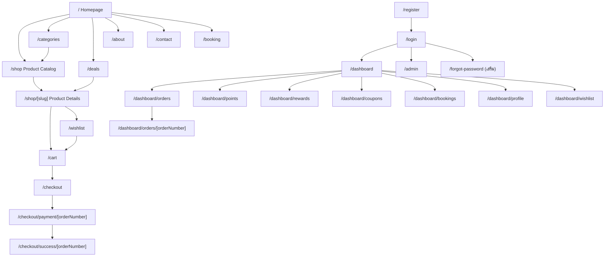

# GEARAWAI — UI/UX Design

> | รายการ | รายละเอียด |
> |---|---|
> | เอกสาร | 3 / 6 — GEARAWAI_UI_UX_DESIGN.md |
> | Revision | **Rev.1 (11 พ.ย. 2026)** — ปรับตาม D-02, D-04, D-08, D-09 และ R-03, R-04, R-05, R-09, R-14, R-15, R-24, R-26, R-27, R-30 |
> | สถานะ | Draft — Wireframe ระดับโครงสร้าง (ยังไม่ใช่ภาพ Mockup) |
> | อ้างอิง | SPEC หัวข้อ 2, 4, 6, 7, 8 · SYSTEM_ANALYSIS (รหัส Sxx-Fyy) · DATABASE_DESIGN (ชื่อตาราง) |
> | Design Reference | Dribbble "Gearnix" (ตาม SPEC) — **ใช้เป็นแรงบันดาลใจด้านบรรยากาศ ไม่คัดลอก** · ภาพ Mockup GEARAWAI ที่ SPEC อ้างถึง **ไม่มีใน Project** (M15) |

---

## สารบัญ

1. [Design System](#1-design-system)
2. [Global Layout (Header / Footer / Navigation)](#2-global-layout)
3. [Sitemap และ Routes](#3-sitemap-และ-routes)
4. [Homepage](#4-homepage)
5. [About Us](#5-about-us)
6. [Product Catalog](#6-product-catalog)
7. [Product Details](#7-product-details)
8. [Shopping Cart](#8-shopping-cart)
9. [Wishlist](#9-wishlist)
10. [Login / Register](#10-login--register)
11. [Member Dashboard](#11-member-dashboard)
12. [Admin Dashboard](#12-admin-dashboard)
13. [Contact Us](#13-contact-us)
14. [หน้าเสริมที่จำเป็นต่อ 20 ระบบ](#14-หน้าเสริมที่จำเป็นต่อ-20-ระบบ)
15. [UX Patterns และ States](#15-ux-patterns-และ-states)
16. [Accessibility](#16-accessibility)

---

## 1. Design System

### 1.1 Color Tokens

สีแบรนด์ 4 สีมาจาก SPEC · สีพื้นหลัง/ข้อความ SPEC ระบุแค่ "Dark Navy / Deep Blue" และ "White / Light Gray" → ค่า HEX ด้านล่างที่ติด *(เสนอ)* เป็นค่าที่เลือกให้เข้ากับแบรนด์ แก้ได้

| Token | HEX | ที่มา | การใช้งาน |
|---|---|---|---|
| `brand-primary` | `#1F06AC` | SPEC | Gradient, พื้นหลัง Section เด่น, Sidebar Active |
| `brand-secondary` | `#0F42C0` | SPEC | Gradient, ปุ่มรอง (พื้น), ขอบ Card |
| `brand-accent` | `#5882E8` | SPEC | ลิงก์, ไอคอน, ขอบ Hover, ตัวเลขสถิติ |
| `brand-lime` | `#E3EF4F` | SPEC | **ปุ่มหลัก (CTA)**, Badge ลดราคา, Focus Ring, ไฮไลต์ |
| `bg-base` | `#0A0B1E` | *(เสนอ)* | พื้นหลังหน้า |
| `bg-surface` | `#12143A` | *(เสนอ)* | Card, Header, Modal |
| `bg-elevated` | `#1A1D4D` | *(เสนอ)* | Dropdown, Hover ของแถวตาราง |
| `border-subtle` | `#2A2F6B` | *(เสนอ)* | เส้นแบ่ง, ขอบ Input |
| `text-primary` | `#FFFFFF` | SPEC (White) | หัวข้อ, ข้อความหลัก |
| `text-secondary` | `#C9CDE8` | *(เสนอ)* Light Gray | ข้อความรอง |
| `text-muted` | `#8B93C9` | *(เสนอ)* | Placeholder, คำอธิบายเล็ก |
| `status-success` | `#34D399` | *(เสนอ)* | สำเร็จ, มีสินค้า |
| `status-warning` | `#FBBF24` | *(เสนอ)* | สต็อกน้อย, รอตรวจสอบ |
| `status-danger` | `#F87171` | *(เสนอ)* | Error, สินค้าหมด, ยกเลิก |

**Gradient หลัก:** `linear-gradient(135deg, #1F06AC 0%, #0F42C0 55%, #5882E8 100%)`

**Neon Glow (ใช้แบบพอดี):** `box-shadow: 0 0 0 1px #5882E8, 0 0 16px rgba(88,130,232,.35)` — ใช้เฉพาะตอน Hover ของ Card และปุ่ม CTA

#### ผลตรวจ Contrast (คำนวณตามสูตร WCAG 2.1)

| ข้อความ / พื้นหลัง | Ratio | ผล | ข้อกำหนดการใช้ |
|---|---|---|---|
| `#FFFFFF` บน `#0A0B1E` | 19.45 | ✅ AAA | ข้อความทั่วไป |
| `#C9CDE8` บน `#12143A` | 11.27 | ✅ AAA | ข้อความรอง |
| `#E3EF4F` บน `#0A0B1E` | 15.49 | ✅ AAA | ข้อความเน้น / ราคา |
| `#0A0B1E` บน `#E3EF4F` | 15.49 | ✅ AAA | **ตัวอักษรบนปุ่ม Lime ต้องเป็นสีเข้ม ห้ามใช้สีขาว** |
| `#5882E8` บน `#12143A` | 4.86 | ✅ AA | ลิงก์ ข้อความทั่วไปได้ |
| `#FFFFFF` บน `#0F42C0` | 8.20 | ✅ AAA | ข้อความบนปุ่มรอง |
| `#FFFFFF` บน `#1F06AC` | 12.50 | ✅ AAA | ข้อความบน Section สีม่วง |
| `#FFFFFF` บน `#5882E8` | 3.64 | ⚠️ AA Large เท่านั้น | ใช้กับตัวอักษร ≥ 18.66px ตัวหนา หรือไอคอน |
| `#0F42C0` บน `#0A0B1E` | 2.37 | ❌ | **ห้ามใช้เป็นสีตัวอักษร** บนพื้นเข้ม |
| `#1F06AC` บน `#0A0B1E` | 1.56 | ❌ | **ห้ามใช้เป็นสีตัวอักษร** บนพื้นเข้ม |

### 1.2 Tailwind Config (แนวทาง)

```ts
// tailwind.config.ts (บางส่วน) — ต้องตรวจไฟล์เดิมในโปรเจกต์ก่อนแก้ (Tailwind v3 vs v4 ตั้งค่าต่างกัน)
theme: {
  screens: { sm: '640px', md: '768px', lg: '1024px', xl: '1280px', desk: '1440px' },
  extend: {
    colors: {
      brand: { primary: '#1F06AC', secondary: '#0F42C0', accent: '#5882E8', lime: '#E3EF4F' },
      base: '#0A0B1E', surface: '#12143A', elevated: '#1A1D4D', line: '#2A2F6B',
      ink: { DEFAULT: '#FFFFFF', soft: '#C9CDE8', muted: '#8B93C9' },
    },
    borderRadius: { card: '12px', btn: '8px' },
    maxWidth: { container: '1440px' },
  },
}
```

### 1.3 Typography *(เสนอ — SPEC ไม่ได้กำหนด M17)*

| ระดับ | ฟอนต์ (เสนอ) | ขนาด Desktop / Mobile | น้ำหนัก |
|---|---|---|---|
| Display (Hero) | `Rajdhani` หรือ `Chakra Petch` (มีอักษรไทย) | 64 / 36 px | 700 |
| H1 | `Chakra Petch` | 40 / 28 px | 700 |
| H2 | `Chakra Petch` | 32 / 24 px | 600 |
| H3 | `Chakra Petch` | 22 / 20 px | 600 |
| Body | `IBM Plex Sans Thai` หรือ `Noto Sans Thai` | 16 / 15 px | 400 |
| Small / Caption | `IBM Plex Sans Thai` | 13 / 12 px | 400 |
| Price | `Chakra Petch` (ตัวเลขชัด) | 20 / 18 px | 700 |

> โหลดผ่าน `next/font/google` · หัวข้อภาษาอังกฤษ เช่น "LEVEL UP YOUR GEAR" ใช้ตัวพิมพ์ใหญ่ + `letter-spacing: 0.04em`

### 1.4 Spacing / Grid

- Base unit 4px · ระยะ Section: Desktop 96px / Tablet 64px / Mobile 48px
- Container: `max-w-[1440px] mx-auto px-6 md:px-8 desk:px-12`
- Grid: 12 คอลัมน์ (Desktop), Gutter 24px / Mobile 16px

### 1.5 Breakpoints (ตาม SPEC หัวข้อ 7)

| อุปกรณ์ | ช่วงกว้าง | Tailwind Prefix | Navigation |
|---|---|---|---|
| Mobile | < 768px | (default) | Hamburger → Drawer ซ้าย + Bottom Bar (ไม่บังคับ) |
| Tablet | 768–1023px | `md:` | Hamburger → Drawer, Search เต็มแถวใต้ Header |
| Laptop | 1024–1439px | `lg:` | เมนูเต็ม, Search ย่อ |
| Desktop | ≥ 1440px | `desk:` | เมนูเต็ม + Search 400×44 |

### 1.6 Core Components

| Component | ขนาด / สเปก (จาก SPEC เมื่อมี) | Variants / States |
|---|---|---|
| `Button` | สูง 48px (Form/CTA), 40px (ทั่วไป), 32×32 (Qty) | `primary` (Lime พื้น, ตัวอักษรเข้ม) · `secondary` (`#0F42C0` พื้น) · `outline` (ขอบ `#5882E8`) · `ghost` · `danger` · States: hover/focus/disabled/loading |
| `Input` / `Select` | สูง 48px, Textarea สูง 160px | default / focus (Ring Lime 2px) / error (ขอบแดง + ข้อความใต้ช่อง) / disabled |
| `ProductCard` | ~240×320 (Wishlist/Homepage) · **หน้า Shop ที่ 1440px + Sidebar กว้างจริง ~197px** (ขั้นต่ำ 180px — R-26) · ภาพ 160×160 `object-fit: contain` | ป้าย SALE / NEW / Low Stock / Out of Stock · Hover: ยกขึ้น 4px + Glow ขอบน้ำเงิน |
| `Badge` | สูง 24px | sale (Lime), status (success/warning/danger/info) |
| `Breadcrumb` | | `Home / …` |
| `SearchBar` | 400×44 (Desktop), ไอคอน 24×24 | มี Clear (×), Enter เพื่อค้นหา |
| `FilterSidebar` | กว้าง 240px, Checkbox 18×18 | Mobile: Bottom Sheet/Drawer |
| `SortDropdown` | 160×40 | |
| `QuantitySelector` | ปุ่ม 32×32 | ปิดปุ่ม − เมื่อ = 1, ปิดปุ่ม + เมื่อ = สต็อก |
| `Modal` / `ConfirmDialog` | กว้างสูงสุด 420px (ยืนยัน) | ปิดด้วย Esc, Focus Trap |
| `Toast` | มุมขวาบน (Desktop) / ล่างกลาง (Mobile) | success / error / info, หายเองใน 4 วินาที |
| `EmptyState` | ไอคอน 64×64 + ข้อความ + ปุ่ม | |
| `Skeleton` | ตามรูปทรง Component | Loading |
| `Pagination` | | ปุ่มก่อนหน้า/ถัดไป + หมายเลขหน้า |
| `DemoBanner` | แถบเต็มความกว้าง สีเหลืองเตือน | ใช้ในหน้า Payment ทุกหน้า |
| `StatCard` | 220×120 | ใช้ใน Member/Admin Dashboard |

### 1.7 Icons (Lucide)

| ตำแหน่ง | Icon |
|---|---|
| Search | `Search` |
| Wishlist | `Heart` (เติมสีเมื่ออยู่ใน Wishlist) |
| Cart | `ShoppingCart` |
| Account | `UserRound` |
| Menu / Close | `Menu` / `X` |
| Categories | `MousePointer2`, `Keyboard`, `Headphones`, `Square`, `Armchair`, `Gauge`, `Video`, `Cable` *(เลือกใหม่ได้)* |
| Points / Reward / Birthday | `Coins` / `Gift` / `Cake` |
| Booking | `CalendarClock` |
| Admin | `LayoutDashboard`, `Package`, `Tags`, `Boxes`, `ReceiptText`, `CreditCard`, `Users`, `Megaphone`, `Ticket`, `Image`, `BarChart3`, `Mail`, `Settings` |

---

## 2. Global Layout

### 2.1 Header (ทุกหน้า Frontend)

```
Desktop (≥1024px)
┌──────────────────────────────────────────────────────────────────────────────┐
│ [LOGO GEARAWAI]  Home  Shop  Categories▾  Deals  About Us  Contact Us        │
│                                   [🔍 Search products, brands...  ] ♡(2) 🛒(3) 👤▾ │
└──────────────────────────────────────────────────────────────────────────────┘
Mobile (<768px)
┌────────────────────────────────────┐
│ ☰   [LOGO]                 🔍  🛒(3) │
└────────────────────────────────────┘
```

| ส่วน | ตำแหน่ง | การทำงาน | ลิงก์ |
|---|---|---|---|
| โลโก้ (180×60) | ซ้าย | กลับหน้าแรก | `/` |
| เมนูหลัก | กลาง-ซ้าย | Active state ขีดเส้นใต้ Lime | `/`, `/shop`, `/categories`, `/deals`, `/about`, `/contact` |
| Categories ▾ | ในเมนู | Mega-menu แสดง 8 หมวดหมู่ | `/shop?category={slug}` |
| Search | ขวา | Enter/คลิก → ค้นหา | `/shop?q={คำค้น}` |
| ♡ Wishlist + Badge | ขวา | Guest → Login | `/wishlist` |
| 🛒 Cart + Badge | ขวา | แสดงจำนวนชิ้น (S07-F06) | `/cart` |
| 👤 Account ▾ | ขวาสุด | Guest: Login/Register · Member: Dashboard/Orders/Logout · Admin: + "Admin Panel" | `/login`, `/dashboard`, `/admin` |

**Sticky Header:** ติดด้านบนเมื่อเลื่อน และเปลี่ยนพื้นเป็น `bg-surface/90` + `backdrop-blur`

### 2.2 Mobile Drawer

เปิดจากปุ่ม ☰ ด้านซ้าย กว้าง 85% (สูงสุด 360px): โลโก้ + ปุ่มปิด · ช่องค้นหา · เมนูหลัก · รายการหมวดหมู่ (Accordion) · ปุ่ม Login/Register หรือข้อมูลผู้ใช้ · ปิดด้วยการแตะพื้นหลัง/ปุ่ม X/Esc

### 2.3 Footer

| คอลัมน์ | เนื้อหา |
|---|---|
| 1 | โลโก้ + LEVEL UP YOUR GEAR + คำอธิบายร้านสั้น ๆ |
| 2 | Shop: หมวดหมู่ทั้ง 8 |
| 3 | Customer: Account, Orders, Wishlist, Booking, Rewards |
| 4 | Contact: เบอร์/อีเมล (จาก `site_settings.store_contact` — ตัวอย่าง) + Social Icons |
| แถวล่าง | © GEARAWAI — โครงงานเพื่อการศึกษา · ข้อความ "ระบบชำระเงินเป็นระบบจำลอง" |

Responsive: Desktop 4 คอลัมน์ · Tablet 2×2 · Mobile 1 คอลัมน์แบบ Accordion

---

## 3. Sitemap และ Routes



| Route | หน้า | สิทธิ์ | ระบบ |
|---|---|---|---|
| `/` | Homepage | ทุกคน | S01 |
| `/about` | About Us | ทุกคน | S02 |
| `/shop` | Product Catalog + Search & Filter | ทุกคน | S03, S04 |
| `/categories` | รวมหมวดหมู่ | ทุกคน | S03 |
| `/shop/[slug]` | Product Details | ทุกคน | S03 |
| `/deals` | โปรโมชั่น | ทุกคน | S19 |
| `/cart` | Shopping Cart | Member | S07 |
| `/wishlist` | Wishlist | Member | S06 |
| `/checkout` | ข้อมูลจัดส่ง + คูปอง | Member | S09, S11 |
| `/checkout/payment/[orderNumber]` | เลือกช่องทาง/แจ้งชำระ (Demo) | Member (เจ้าของ) | S09 |
| `/checkout/success/[orderNumber]` | ยืนยันการส่งข้อมูล | Member (เจ้าของ) | S09 |
| `/booking` | จองบริการ | ดู: ทุกคน / จอง: Member | S08 |
| `/login`, `/register` | เข้าสู่ระบบ / สมัคร | Guest | S05 |
| `/forgot-password` | ลืมรหัสผ่าน *(ฟังก์ชันเสริม M11)* | Guest | S05 |
| `/dashboard/*` | Member Dashboard | Member | S14, S10, S11, S12, S08, S06 |
| `/contact` | Contact Us + Form | ทุกคน | S13, S20 |
| `/admin/*` | Admin Dashboard | Admin | S15–S17, S19 |
| `/403`, `not-found` | ไม่มีสิทธิ์ / ไม่พบหน้า | ทุกคน | S05 |

---

## 4. Homepage

**Route:** `/` · **ระบบ:** S01 · **ข้อมูล:** `site_settings`, `categories`, `v_product_catalog`, `v_active_promotions`

### 4.1 Wireframe (Desktop)

```
┌────────────────────────── HEADER (sticky) ──────────────────────────┐
├─────────────────────────────────────────────────────────────────────┤
│ HERO BANNER 1920×700 (gradient + ภาพสินค้า)                          │
│   LEVEL UP YOUR GEAR                                                 │
│   Upgrade your setup with premium gaming gear and IT accessories.    │
│   [ SHOP NOW ]  (Lime)        [ View Deals ] (outline)               │
├─────────────────────────────────────────────────────────────────────┤
│ STORE INFO STRIP: [📋 ข้อมูลสินค้าครบ] [🔍 ค้นหาง่าย] [🎁 สะสมคะแนน] [🛠 บริการ]* │
├─────────────────────────────────────────────────────────────────────┤
│ POPULAR CATEGORIES                                      View all →   │
│ [Mouse][Keyboard][Headset][Mouse Pad][Chair][Wheel][Stream][Access.] │
├─────────────────────────────────────────────────────────────────────┤
│ FEATURED PRODUCTS                                       View all →   │
│ [Card][Card][Card][Card][Card]                                       │
├─────────────────────────────────────────────────────────────────────┤
│ PROMOTIONS  [Promo Banner 1200×600]   [Promo Card][Promo Card]       │
├─────────────────────────────────────────────────────────────────────┤
│ WHY CHOOSE GEARAWAI  (5 จุดเด่น — ไอคอน + ข้อความ)                    │
├─────────────────────────────────────────────────────────────────────┤
│ CTA: สมัครสมาชิกเพื่อสะสมคะแนน [ Register ]  (ซ่อนเมื่อ Login แล้ว)     │
├────────────────────────────── FOOTER ───────────────────────────────┤
```

> **ราคาทุกจุดในหน้าร้าน** แสดงจาก `effective_price` ของ View/RPC เท่านั้น — Frontend ไม่คำนวณส่วนลดเอง (R-12)
>
> *Store Info Strip: ใช้ข้อความที่ตรงกับจุดเด่นใน SPEC และไม่กล่าวอ้างเกินจริง — หลีกเลี่ยงคำว่า "สินค้าแท้ 100%" หรือ "ส่งฟรีทั่วประเทศ" จนกว่าร้านจะยืนยันได้

### 4.2 ส่วนประกอบ

| ลำดับ | Section | ตำแหน่ง | ข้อมูล | ระบบ |
|---|---|---|---|---|
| 1 | Header | บนสุด | — | S01-F01 |
| 2 | Hero Banner | ใต้ Header, เต็มความกว้าง | `site_settings.hero_banner` | S01-F02 |
| 3 | Store Info Strip | ใต้ Hero | ข้อความคงที่ / `site_settings` | S01-F03 |
| 4 | Popular Categories | Section 2 | `categories` (8 รายการ, ภาพ 600×600) | S01-F04 |
| 5 | Featured Products | Section 3 | `v_product_catalog` where `is_featured` (สูงสุด 10) | S01-F05 |
| 6 | Promotions | Section 4 | `v_active_promotions` where `show_on_homepage` | S01-F06 |
| 7 | Why Choose GEARAWAI | Section 5 | `site_settings.about_content.highlights` | S01-F07 |
| 8 | Register CTA | ก่อน Footer | แสดงเฉพาะ Guest | S05 |
| 9 | Footer | ล่างสุด | — | S01-F08 |

### 4.3 ปุ่มและการเชื่อมโยง

| ปุ่ม / องค์ประกอบ | การทำงาน | ไปที่ |
|---|---|---|
| SHOP NOW | ลิงก์ | `/shop` |
| View Deals | ลิงก์ | `/deals` |
| การ์ดหมวดหมู่ | ลิงก์พร้อม Filter | `/shop?category={slug}` |
| View all (Categories) | ลิงก์ | `/categories` |
| Product Card → ภาพ/ชื่อ/View Details | ลิงก์ | `/shop/{slug}` |
| Product Card → Add to Cart | เพิ่ม 1 ชิ้น + Toast + อัปเดต Badge (Guest → `/login?redirect=…`) | — |
| Product Card → ♡ | Toggle Wishlist (Guest → Login) | — |
| Promo Banner/Card | ลิงก์ | `/deals#{promotion-slug}` |
| Register | ลิงก์ | `/register` |

### 4.4 Responsive

| ส่วน | Desktop ≥1440 | Laptop 1024–1439 | Tablet 768–1023 | Mobile <768 |
|---|---|---|---|---|
| Hero | ภาพ 1920×700, ข้อความชิดซ้าย | สูง ~560px | ภาพ 1200×600 | ภาพ 750×1000, ข้อความกึ่งกลาง, ปุ่มเต็มความกว้าง |
| Categories | 8 คอลัมน์ | 4×2 | 4×2 | เลื่อนแนวนอน (Scroll Snap) 2.5 การ์ด |
| Featured | 5 คอลัมน์ | 4 คอลัมน์ | 3 คอลัมน์ | 2 คอลัมน์ |
| Promotions | Banner + 2 Card เรียงข้าง | Banner เต็ม + Card 2 คอลัมน์ | เหมือน Laptop | ซ้อนแนวตั้ง, Banner 750×1000 |
| Why Choose | 5 คอลัมน์ | 5 คอลัมน์ | 3+2 | 1 คอลัมน์ |

---

## 5. About Us

**Route:** `/about` · **ระบบ:** S02 · **ข้อมูล:** `site_settings.about_content`, `team_members`, Gallery จาก RPC `get_public_gallery()` (R-09)

### 5.1 Wireframe (Desktop)

```
┌ HEADER ─────────────────────────────────────────────────────────────┐
├ PAGE HEADER (gradient สูง 240px) ───────────────────────────────────┤
│  About GEARAWAI                                                      │
│  Home / About Us                                                     │
├ STORE HISTORY ──────────────────────────────────────────────────────┤
│ [ภาพ 1200×800]          │  ประวัติร้าน (ข้อความจาก SPEC)            │
├ STORE HIGHLIGHTS (5 การ์ด) ─────────────────────────────────────────┤
│ [หมวดหมู่ชัด][ข้อมูลครบ][ค้นหาง่าย][ตะกร้าสินค้า][ระบบหลังบ้าน]         │
├ TEAM MEMBERS ───────────────────────────────────────────────────────┤
│ [รูป 600×600 / ชื่อ / ตำแหน่ง / หน้าที่] × n   (ข้อมูลตัวอย่าง)       │
├ STORE GALLERY ──────────────────────────────────────────────────────┤
│ [1200×800][ ][ ]  (คลิกเปิด Lightbox)                                 │
├ CALL TO ACTION ─────────────────────────────────────────────────────┤
│  พร้อมอัปเกรดเกียร์ของคุณแล้วหรือยัง?  [ SHOP NOW ] [ Contact Us ]     │
└ FOOTER ─────────────────────────────────────────────────────────────┘
```

### 5.2 ปุ่มและการเชื่อมโยง

| องค์ประกอบ | การทำงาน | ไปที่ |
|---|---|---|
| Breadcrumb "Home" | ลิงก์ | `/` |
| ภาพ Gallery | เปิด Lightbox (ปิดด้วย Esc/X, ลูกศรซ้าย/ขวา) | — |
| SHOP NOW | ลิงก์ | `/shop` |
| Contact Us | ลิงก์ | `/contact` |

**ข้อกำหนดข้อมูล:** Team Members แสดงป้ายเล็ก "ข้อมูลตัวอย่าง" เมื่อ `is_demo = true` · ถ้าไม่มีภาพ Gallery ให้ซ่อน Section ทั้งหมด (ไม่แสดงกรอบว่าง)

### 5.3 Responsive

| ส่วน | Desktop | Laptop | Tablet | Mobile |
|---|---|---|---|---|
| History | ภาพซ้าย/ข้อความขวา (6:6) | 5:7 | ภาพบน/ข้อความล่าง | ภาพบน/ข้อความล่าง |
| Highlights | 5 คอลัมน์ | 5 | 3+2 | 1 คอลัมน์ |
| Team | 4 คอลัมน์ | 4 | 2 | 1 (หรือเลื่อนแนวนอน) |
| Gallery | 3 คอลัมน์ | 3 | 2 | 1 |

---

## 6. Product Catalog

**Route:** `/shop` (+ `/categories`) · **ระบบ:** S03, S04 · **ข้อมูล:** `v_product_catalog`, `categories`, `brands`

### 6.1 Wireframe (Desktop)

```
┌ HEADER ─────────────────────────────────────────────────────────────┐
├ CATALOG HEADER: "Shop"  ·  Home / Shop / Gaming Mouse ──────────────┤
│ [🔍 Search 400×44            ]          แสดง 1–20 จาก 20  [Sort ▾ 160×40]│
├──────────────┬──────────────────────────────────────────────────────┤
│ FILTER 240px │ Active filters: [Razer ×] [฿0–5,000 ×]  ล้างทั้งหมด    │
│ ▸ Category   │ ┌─────┐┌─────┐┌─────┐┌─────┐┌─────┐                    │
│   ☐ Mouse(5) │ │Card ││Card ││Card ││Card ││Card │  ← 5 คอลัมน์        │
│   ☐ Keyb.(5) │ └─────┘└─────┘└─────┘└─────┘└─────┘                    │
│ ▸ Brand      │ ┌─────┐ ...                                          │
│   ☐ Razer    │                                                      │
│ ▸ Price      │                                                      │
│   [min][max] │                                                      │
│ ▸ Availability│              [ ‹ 1 2 3 › ]  Pagination              │
│   ☐ In stock │                                                      │
│ [Apply][Reset]│                                                     │
└──────────────┴──────────────────────────────────────────────────────┘
```

### 6.2 Product Card (240×320)

```
┌──────────────────────────┐
│ [SALE -9%]           [♡] │  ← Badge มุมซ้ายบน / Wishlist มุมขวาบน
│      [ภาพ 160×160]       │
│ RAZER                    │  ← แบรนด์ (text-muted, ตัวพิมพ์ใหญ่)
│ DeathAdder V3 Pro        │  ← ชื่อ (2 บรรทัด ตัด …)
│ ฿4,990  ̶฿̶5̶,̶4̶9̶0̶          │  ← effective_price (Lime) + ราคาเดิมขีดฆ่า
│ ● มีสินค้า               │  ← สถานะสต็อก
│ [🛒 Add to Cart] [View]  │
└──────────────────────────┘
```

### 6.3 ส่วนประกอบและฟังก์ชัน

| องค์ประกอบ | ตำแหน่ง | การทำงาน | ระบบ |
|---|---|---|---|
| Breadcrumb | ใต้ Header | `Home / Shop / {หมวดหมู่ที่เลือก}` | S03-F01 |
| Search Bar | บนซ้ายของ Grid | ค้นจากชื่อสินค้า + แบรนด์ · Debounce 300ms · อัปเดต `?q=` | S04-F01, F02 |
| Result Count | บนขวา | "แสดง X–Y จาก Z รายการ" | — |
| Sort Dropdown | บนขวา | Popularity / Price ↑ / Price ↓ / Newest / Name A–Z → `?sort=` | S04-F07–F10 |
| Filter: Category | Sidebar | Checkbox หลายค่า + จำนวนสินค้า → `?category=a,b` | S04-F03 |
| Filter: Brand | Sidebar | Checkbox หลายค่า → `?brand=` | S04-F04 |
| Filter: Price | Sidebar | Min/Max (ตัวเลข ≥ 0, Min ≤ Max) → `?min=&max=` | S04-F05 |
| Filter: Availability | Sidebar | "มีสินค้า" / "สินค้าหมด" → `?stock=in` | S04-F06 |
| Active Filter Chips | เหนือ Grid | กด × ลบทีละเงื่อนไข / "ล้างทั้งหมด" | S04-F12 |
| Product Grid | กลาง | Product Card | S03-F02, F03 |
| Pagination | ใต้ Grid | 20 รายการ/หน้า → `?page=` | S03-F07 |
| Empty State | แทน Grid | "ไม่พบสินค้าที่ตรงกับเงื่อนไข" + [ล้างตัวกรอง] | S04-F11 |

### 6.4 ปุ่มและการเชื่อมโยง

| ปุ่ม | การทำงาน | ผลลัพธ์ / ไปที่ |
|---|---|---|
| Add to Cart | เพิ่ม 1 ชิ้น (ตรวจสต็อก) | Toast "เพิ่มลงตะกร้าแล้ว" + Badge · สินค้าหมด → ปุ่ม Disabled "สินค้าหมด" · Guest → `/login?redirect=/shop…` |
| ♡ Wishlist | Toggle | Toast + หัวใจเติมสี · Guest → Login |
| View / ภาพ / ชื่อ | ลิงก์ | `/shop/{slug}` |
| Apply / Reset (Mobile) | ปิด Drawer + ใช้ตัวกรอง / ล้าง | — |

### 6.5 หน้า `/categories`

Grid การ์ดหมวดหมู่ 8 รายการ (ภาพ 600×600, ชื่อ, จำนวนสินค้า) → คลิกไป `/shop?category={slug}` · หมวดที่ยังไม่มีสินค้า (เช่น Computer Accessories — M16) แสดงป้าย "เร็ว ๆ นี้" และยังคลิกได้ (แสดง Empty State)

### 6.6 Responsive

| ส่วน | Desktop ≥1440 | Laptop | Tablet | Mobile |
|---|---|---|---|---|
| Filter | Sidebar 240px ซ้าย | Sidebar 240px | ปุ่ม "ตัวกรอง (n)" → Drawer ซ้าย | ปุ่ม "ตัวกรอง (n)" → Bottom Sheet เต็มจอ |
| Grid | **5** คอลัมน์ (การ์ด ~197px: Container 1440 − padding 96 − Sidebar 240 − gap) | 3–4 คอลัมน์ | 2–3 คอลัมน์ | 1–2 คอลัมน์ (≥ 375px ใช้ 2) |
| Search + Sort | แถวเดียวกัน | แถวเดียวกัน | Search เต็มแถว / Sort + ปุ่มกรองแถวถัดไป | เหมือน Tablet |
| Card ปุ่ม | Add to Cart + View | เหมือน Desktop | เหมือน Desktop | ปุ่ม Add to Cart เป็นไอคอน, ทั้ง Card คลิกได้ |

---

## 7. Product Details

**Route:** `/shop/[slug]` · **ระบบ:** S03-F05, F06 · **ข้อมูล:** `v_product_catalog`, `product_images`

### 7.1 Wireframe (Desktop)

```
┌ HEADER ─────────────────────────────────────────────────────────────┐
│ Home / Shop / Gaming Mouse / Razer DeathAdder V3 Pro                 │
├──────────────────────────────┬──────────────────────────────────────┤
│ [ภาพหลัก 800×800 → แสดง ~520] │ RAZER · Gaming Mouse                 │
│                              │ Razer DeathAdder V3 Pro              │
│ [thumb][thumb][thumb][thumb] │ SKU: GA-MS-001                       │
│                              │ ฿4,990  ̶฿̶5̶,̶4̶9̶0̶  [SALE -9%]          │
│                              │ ● มีสินค้า (เหลือ 12 ชิ้น)             │
│                              │ คำอธิบายสั้น                          │
│                              │ จำนวน [ − ][ 1 ][ + ]                 │
│                              │ [ 🛒 ADD TO CART ] (Lime)  [ ♡ ]      │
│                              │ [ BUY NOW ] (outline)                 │
│                              │ 🎁 ได้ ~49 คะแนนเมื่อคำสั่งซื้อสำเร็จ    │
├──────────────────────────────┴──────────────────────────────────────┤
│ TABS: [Description] [Specifications]                                 │
│  Specifications: ตาราง Key | Value (จาก jsonb)                        │
├─────────────────────────────────────────────────────────────────────┤
│ RELATED PRODUCTS  [Card][Card][Card][Card][Card]                     │
└ FOOTER ─────────────────────────────────────────────────────────────┘
```

### 7.2 ปุ่มและฟังก์ชัน

| ปุ่ม / องค์ประกอบ | การทำงาน | ผลลัพธ์ |
|---|---|---|
| Thumbnail | เปลี่ยนภาพหลัก | — |
| ภาพหลัก | เปิด Lightbox/Zoom | — |
| − / + | ปรับจำนวน 1 … `stock_quantity` | ปุ่มถูก Disable ที่ขอบเขต |
| ADD TO CART | เพิ่มตามจำนวนที่เลือก | Toast + Badge · ถ้ารวมกับในตะกร้าแล้วเกินสต็อก → Error "สต็อกไม่พอ" |
| BUY NOW | เพิ่มลงตะกร้าแล้วไป | `/cart` |
| ♡ | Toggle Wishlist | Toast |
| แท็บ Description / Specifications | สลับเนื้อหา | — |
| Breadcrumb หมวดหมู่ | ลิงก์ | `/shop?category={slug}` |
| Related Product | ลิงก์ | `/shop/{slug}` |

**กรณีพิเศษ:** สินค้าหมด → ปุ่ม ADD TO CART / BUY NOW Disabled + ข้อความ "สินค้าหมดชั่วคราว" · slug ไม่ถูกต้องหรือ `inactive` → หน้า 404 · ข้อความคะแนนคำนวณจาก `site_settings.points_rule` (แสดงเฉพาะ "~" เพราะได้คะแนนจากยอดรวมคำสั่งซื้อ)

### 7.3 Responsive

| ส่วน | Desktop / Laptop | Tablet | Mobile |
|---|---|---|---|
| Layout | 2 คอลัมน์ (ภาพ 6 : ข้อมูล 6) | 2 คอลัมน์ (5:7) | 1 คอลัมน์: ภาพ (Swipe Carousel + จุด) → ข้อมูล |
| Thumbnails | แถวใต้ภาพ | แถวใต้ภาพ | จุด Indicator |
| ปุ่มซื้อ | ในคอลัมน์ขวา | ในคอลัมน์ขวา | **Sticky Bottom Bar**: ราคา + [Add to Cart] + [♡] |
| Tabs | Tabs | Tabs | Accordion |
| Related | 5 คอลัมน์ (Laptop 4) | 3 | เลื่อนแนวนอน 2 การ์ด |

---

## 8. Shopping Cart

**Route:** `/cart` · **สิทธิ์:** Member · **ระบบ:** S07 · **ข้อมูล:** RPC `get_my_cart()` (รวมสินค้าที่ถูกปิดขาย พร้อม `product_status`, `is_purchasable` — R-04) · แก้จำนวน/ลบ ผ่านตาราง `cart_items`

### 8.1 Wireframe (Desktop)

```
┌ HEADER ─────────────────────────────────────────────────────────────┐
│ Shopping Cart (3 ชิ้น)                                                │
├─────────────────────────────────────────────┬───────────────────────┤
│ ROW 140px                                   │ ORDER SUMMARY (360px) │
│ [img120] Razer DeathAdder V3 Pro            │ Subtotal     ฿22,970  │
│          ฿4,990   [−][1][+]   ฿4,990   [🗑]  │ Shipping     ฿0*      │
│ ─────────────────────────────────────────── │ ─────────────────     │
│ [img120] Logitech G Pro X 2 Lightspeed      │ Total        ฿22,970  │
│     ฿8,990 ⚠ เหลือ 3 ชิ้น [−][2][+] ฿17,980 [🗑]│ *คำนวณจริงที่ Checkout │
│ ─────────────────────────────────────────── │ [ CHECKOUT ] (Lime 48)│
│ ← Continue Shopping                         │ ⓘ มีคูปอง? ใส่ได้ที่ Checkout│
└─────────────────────────────────────────────┴───────────────────────┘
```

### 8.2 ปุ่มและฟังก์ชัน

| ปุ่ม | การทำงาน | ระบบ |
|---|---|---|
| − / + (32×32) | อัปเดต `cart_items.quantity` ทันที (Optimistic UI + Rollback เมื่อ Error) · ขั้นต่ำ 1 · สูงสุด = สต็อก | S07-F02, F05 |
| 🗑 Remove | ConfirmDialog "ลบสินค้านี้ออกจากตะกร้า?" → ลบ | S07-F03 |
| ชื่อ/ภาพสินค้า | ลิงก์ `/shop/{slug}` | — |
| CHECKOUT (สูง 48px) | ตรวจสต็อกทุกรายการอีกครั้ง → ผ่าน: `/checkout` · ไม่ผ่าน: ไฮไลต์แถวที่มีปัญหา + Disable ปุ่ม | S07-F05 |
| Continue Shopping | ลิงก์ | `/shop` |

**การคำนวณ:** Subtotal แถว = `effective_price × quantity` · Total ในหน้านี้ = ผลรวม Subtotal (ค่าส่ง/คูปองคำนวณจริงที่ Checkout ตาม SYSTEM_ANALYSIS 6.2)

**States:** ตะกร้าว่าง → EmptyState (ไอคอน `ShoppingCart`) "ยังไม่มีสินค้าในตะกร้า" + [เลือกซื้อสินค้า] · สินค้าถูกปิดขาย → แถวสีจาง + ป้าย "ไม่พร้อมจำหน่าย" + ต้องลบก่อน Checkout

### 8.3 Responsive

| ส่วน | Desktop / Laptop | Tablet | Mobile |
|---|---|---|---|
| Layout | 2 คอลัมน์ (รายการ + Summary 360px Sticky) | Summary อยู่ใต้รายการ | Summary ใต้รายการ + **Sticky Bottom Bar** (Total + CHECKOUT) |
| แถวสินค้า | แนวนอน 1 บรรทัด | แนวนอน | ภาพ 80×80 ซ้าย, ชื่อ/ราคา/Qty ซ้อนขวา, ปุ่มลบมุมขวาบน |

---

## 9. Wishlist

**Route:** `/wishlist` (ใช้ Component เดียวกับ `/dashboard/wishlist`) · **สิทธิ์:** Member · **ระบบ:** S06 · **ข้อมูล:** RPC `get_my_wishlist()` — สินค้าที่ถูกปิดขายแสดงป้าย "ไม่พร้อมจำหน่าย" และปิดปุ่ม Move to Cart (R-04)

### 9.1 Wireframe (Desktop)

```
┌ HEADER ─────────────────────────────────────────────────────────────┐
│ My Wishlist (4)                                     [ Move all to Cart ]*│
├─────────────────────────────────────────────────────────────────────┤
│ ┌──────────┐┌──────────┐┌──────────┐┌──────────┐                     │
│ │      [×] ││          ││          ││          │  Card 240×320       │
│ │ [img160] ││          ││          ││          │                     │
│ │ ชื่อ      ││          ││          ││          │                     │
│ │ ฿ราคา    ││          ││          ││          │                     │
│ │ ● สต็อก   ││          ││          ││          │                     │
│ │[Move to Cart]│       ││          ││          │                     │
│ └──────────┘└──────────┘└──────────┘└──────────┘                     │
└─────────────────────────────────────────────────────────────────────┘
* ปุ่ม Move all เป็นข้อเสนอเพิ่ม — ไม่บังคับ
```

### 9.2 ปุ่มและฟังก์ชัน

| ปุ่ม | การทำงาน | ระบบ |
|---|---|---|
| × / ♡ (24×24) | ลบออกจาก Wishlist (ไม่ต้องยืนยัน + Toast มีปุ่ม "เลิกทำ") | S06-F02 |
| ภาพ / ชื่อ | ลิงก์ `/shop/{slug}` | S06-F04 |
| Move to Cart | เพิ่มลงตะกร้า 1 ชิ้น → ลบจาก Wishlist → Toast · สินค้าหมด: Disabled "สินค้าหมด" | S06-F05 |

**States:** ว่าง → EmptyState (ไอคอน `Heart`) "ยังไม่มีรายการโปรด" + [เลือกดูสินค้า] → `/shop`

### 9.3 Responsive

Desktop 5 คอลัมน์ · Laptop 4 · Tablet 3 · Mobile 2 คอลัมน์ (ปุ่ม Move to Cart เป็นไอคอน + ข้อความสั้น)

---

## 10. Login / Register

**Routes:** `/login`, `/register` · **สิทธิ์:** Guest (ถ้า Login แล้วให้ Redirect ไป `/dashboard`) · **ระบบ:** S05

### 10.1 Wireframe

```
Desktop (≥1024px) — Split Layout
┌───────────────────────────────┬─────────────────────────────────────┐
│ ภาพ/Gradient แบรนด์            │      ┌───── LOGIN 420×500 ─────┐     │
│ LEVEL UP YOUR GEAR            │      │ Welcome back             │     │
│ สะสมคะแนน · สิทธิพิเศษวันเกิด  │      │ Email     [__________]   │     │
│                               │      │ Password  [________ 👁]   │     │
│                               │      │ Forgot password?*        │     │
│                               │      │ [ LOGIN ] (Lime 48px)    │     │
│                               │      │ ยังไม่มีบัญชี? Register    │     │
│                               │      └──────────────────────────┘     │
└───────────────────────────────┴─────────────────────────────────────┘
* ฟังก์ชันเสริม (M11)

REGISTER 420×600
│ Create account                │
│ ชื่อ-นามสกุล  [__________]       │
│ อีเมล        [__________]       │
│ รหัสผ่าน     [________ 👁]       │  ← แถบความแข็งแรงรหัสผ่าน
│ ยืนยันรหัสผ่าน [________ 👁]      │
│ วันเกิด (ไม่บังคับ) [📅]          │  ← "กรอกเพื่อรับสิทธิ์วันเกิด" (D-08)
│ ☐ ยอมรับเงื่อนไขการใช้งาน*        │
│ [ CREATE ACCOUNT ]            │
│ มีบัญชีแล้ว? Login              │
```

### 10.2 Validation

| ช่อง | กฎ | ข้อความ Error (ตัวอย่าง) |
|---|---|---|
| ชื่อ-นามสกุล | ห้ามว่าง, 2–100 ตัวอักษร | "กรุณากรอกชื่อ-นามสกุล" |
| อีเมล | รูปแบบอีเมล | "รูปแบบอีเมลไม่ถูกต้อง" |
| รหัสผ่าน | ≥ 8 ตัวอักษร มีตัวอักษรและตัวเลข *(เสนอ M11)* | "รหัสผ่านต้องมีอย่างน้อย 8 ตัวอักษร…" |
| ยืนยันรหัสผ่าน | ตรงกับรหัสผ่าน | "รหัสผ่านไม่ตรงกัน" |
| วันเกิด | **ไม่บังคับ (D-08)** · ถ้ากรอก: ไม่เป็นวันในอนาคต (เวลาไทย), หลังปี 1900 · ส่งเป็น `YYYY-MM-DD` | "วันเกิดไม่ถูกต้อง" |
| Login ผิด | — | "อีเมลหรือรหัสผ่านไม่ถูกต้อง" (ไม่บอกว่าผิดช่องไหน) |
| อีเมลซ้ำ | — | "อีเมลนี้ถูกใช้สมัครแล้ว" |

### 10.3 ปุ่มและการเชื่อมโยง

| ปุ่ม | การทำงาน | ผลลัพธ์ |
|---|---|---|
| 👁 | แสดง/ซ่อนรหัสผ่าน | — |
| LOGIN | `supabase.auth.signInWithPassword` · Loading state | Member → `?redirect` หรือ `/dashboard` · Admin → `/admin` |
| CREATE ACCOUNT | Server Action ตรวจข้อมูล → `supabase.auth.signUp` พร้อม `options.data = {full_name, birth_date}` (ไม่ส่ง role) | **ปิด Email Confirmation (D-02)** → สมัครแล้วเข้าสู่ระบบทันที → Toast + `/dashboard` |
| Register / Login (ลิงก์) | สลับหน้า | `/register` ↔ `/login` |
| Forgot password? | *(เสริม — ซ่อนไว้จนกว่าจะตั้ง Custom SMTP เพราะต้องส่งอีเมล)* | `/forgot-password` |

### 10.4 Responsive

| Desktop / Laptop | Tablet | Mobile |
|---|---|---|
| Split: ภาพซ้าย 50% / ฟอร์มขวา | ซ่อนภาพ, ฟอร์มกึ่งกลางบนพื้น Gradient | ฟอร์มเต็มความกว้าง (padding 16px), ช่องสูง 48px, ปุ่มเต็มความกว้าง |

---

## 11. Member Dashboard

**Route:** `/dashboard/*` · **สิทธิ์:** Member · **ระบบ:** S14 (+ S06, S08, S10, S11, S12)

### 11.1 Wireframe — Overview (Desktop)

```
┌ HEADER ─────────────────────────────────────────────────────────────┐
├──────────── SIDEBAR 240px ──┬───────────────────────────────────────┤
│ [Avatar 100×100]            │ สวัสดี, {ชื่อ}                          │
│ {ชื่อสมาชิก}                 │ ┌StatCard 220×120┐┌──────┐┌──────┐┌──────┐│
│ Member since 2026           │ │คำสั่งซื้อ  5    ││คะแนน ││Wishlist││การจอง││
│ ─────────────               │ └────────────────┘└──────┘└──────┘└──────┘│
│ ▣ Overview                  │ 🎂 BIRTHDAY CARD 360×220 (เฉพาะเดือนเกิด) │
│ 📦 My Orders                │   [ รับสิทธิ์วันเกิด ]                    │
│ 🪙 Points                   │ POINTS: 1,250 pts ▓▓▓▓▓░░ (12px)        │
│ 🎁 Rewards                  │   อีก 250 คะแนนถึงรางวัลถัดไป            │
│ 🎟 Coupons                  │ RECENT ORDERS                           │
│ 📅 Bookings                 │ [img80] GA-20261111-0001  ฿4,990 [รอชำระ]│
│ ♡ Wishlist                  │ [img80] …                    View all → │
│ 👤 Profile                  │                                         │
│ ⎋ Logout                    │                                         │
└─────────────────────────────┴───────────────────────────────────────┘
```

### 11.2 หน้าย่อยและฟังก์ชัน

| เมนู | Route | ส่วนประกอบหลัก | ปุ่ม / การทำงาน | ระบบ |
|---|---|---|---|---|
| Overview | `/dashboard` | StatCards, Birthday Card, Points Progress, Recent Orders | ลิงก์ไปแต่ละหน้า | S14-F01 |
| My Orders | `/dashboard/orders` | ตาราง/การ์ด: เลขคำสั่งซื้อ, วันที่, ยอด, สถานะ Order, สถานะชำระ · กรองตามสถานะ | [ดูรายละเอียด] | S14-F03, F04 |
| Order Detail | `/dashboard/orders/[orderNumber]` | Timeline สถานะ (6.1), รายการสินค้า, ที่อยู่, สรุปยอด, ข้อมูลแจ้งชำระ | [แจ้งชำระเงิน] (ถ้า `pending_payment`) → `/checkout/payment/…` · [ยกเลิกคำสั่งซื้อ] (ถ้า `pending_payment`, มี Confirm) | S14-F10, S09 |
| Points | `/dashboard/points` | กล่องคะแนน 320×160 + ไอคอน 64×64, เงื่อนไขการสะสม, ตารางประวัติ (วันที่, ประเภท, +/−, คงเหลือ, อ้างอิง) | Filter ประเภท, Pagination | S10 |
| Rewards | `/dashboard/rewards` | Reward Card 240×320 (ภาพ, ชื่อ, คะแนน 32×32 icon, คงเหลือ) + แท็บ "ประวัติการแลก" | [แลกรางวัล] 140×40 → ConfirmDialog 420×300 "ใช้ X คะแนน คงเหลือ Y" → ยืนยัน · ปุ่ม Disabled เมื่อคะแนนไม่พอ/รางวัลหมด | S12 |
| Coupons | `/dashboard/coupons` | การ์ดสิทธิพิเศษ 360×220 + ไอคอนของขวัญ 64×64, รหัสคูปอง 240×48, **มูลค่าส่วนลด (อ่านจากคูปองแม่แบบของตน — R-05)**, วันหมดอายุ (เวลาไทย), สถานะ (ใช้ได้/ใช้แล้ว/หมดอายุ) · ยังไม่มีวันเกิด → ข้อความ "เพิ่มวันเกิดเพื่อรับสิทธิ์" + ลิงก์ไป Profile | [รับสิทธิ์วันเกิด] (`claim_birthday_coupon`) · [คัดลอกรหัส] · [ใช้ตอนนี้] → `/cart` | S11 |
| Bookings | `/dashboard/bookings` | รายการจอง: เลขที่, บริการ, วัน/เวลา, สถานะ | [จองบริการใหม่] → `/booking` · [ยกเลิก] (เมื่อ `pending`, ConfirmDialog → `cancel_booking`) | S08-F07 |
| Wishlist | `/dashboard/wishlist` | Component เดียวกับหน้า 9 | ตามหน้า 9 | S06 |
| Profile | `/dashboard/profile` | ฟอร์ม: รูปโปรไฟล์ (อัปโหลด), ชื่อ, อีเมล (อ่านอย่างเดียว), เบอร์โทร, ที่อยู่ · ส่วนแยก "วันเกิด": ตั้งครั้งแรกได้ / แก้ได้อีก 1 ครั้ง (แสดงคำเตือนก่อนบันทึก) | [บันทึกข้อมูล] → update `profiles` · [บันทึกวันเกิด] → `set_my_birth_date` · Error `BIRTH_DATE_LOCKED` → "แก้ไขวันเกิดครบสิทธิ์แล้ว กรุณาติดต่อร้าน" | S14-F02 |
| Logout | — | — | ConfirmDialog → `signOut()` → `/` | S14-F09 |

**ป้ายสถานะ Order (Badge)**

| สถานะ | ข้อความไทย | สี |
|---|---|---|
| `pending_payment` | รอชำระเงิน | warning |
| `payment_submitted` | รอตรวจสอบการชำระ | info (`#5882E8`) |
| `paid` | ชำระแล้ว / กำลังเตรียมจัดส่ง | success |
| `shipped` | จัดส่งแล้ว | info |
| `completed` | สำเร็จ | success (Lime outline) |
| `cancelled` | ยกเลิก | danger |

### 11.3 Responsive

| Desktop / Laptop | Tablet | Mobile |
|---|---|---|
| Sidebar 240px ซ้าย + เนื้อหา · StatCard 4 คอลัมน์ (Laptop 2×2) | Sidebar ย่อเหลือไอคอน (72px) + Tooltip · StatCard 2×2 | Sidebar → แถบเมนูเลื่อนแนวนอนใต้ Header (Tabs) · StatCard 2×2 · ตาราง Orders → การ์ดซ้อนแนวตั้ง |

---

## 12. Admin Dashboard

**Route:** `/admin/*` · **สิทธิ์:** Admin · **ระบบ:** S15 (รายละเอียดเมนูทั้งหมดอยู่ใน **GEARAWAI_ADMIN_DESIGN.md**)

### 12.1 Wireframe — Overview (Desktop)

```
┌ ADMIN HEADER 64px: [☰] GEARAWAI Admin    🔍  🔔(3 new msgs)  [Admin ▾] [View Store ↗] ┐
├──── SIDEBAR 240px ─────┬──────────────────────────────────────────────────────────┤
│ ▣ Dashboard            │ Dashboard Overview          [Date: Last 30 days ▾]       │
│ CATALOG                │ ┌Total Sales┐┌Total Orders┐┌Total Customers┐┌Total Products┐│
│  Products              │ │ ฿0.00     ││ 0          ││ 0             ││ 20           ││
│  Categories            │ └───────────┘└────────────┘└───────────────┘└──────────────┘│
│  Brands                │ ┌ Sales Overview 600×300 ─────────┐┌ Top Categories 300×300┐│
│  Stock                 │ │ (Line/Bar chart)                ││ (Donut)              ││
│  Images                │ └─────────────────────────────────┘└──────────────────────┘│
│ SALES                  │ ┌ Recent Orders ──────────────────────────────────────────┐│
│  Orders                │ │ Order#  Customer  Total  Status  Payment  Date  [View]  ││
│  Payments              │ └─────────────────────────────────────────────────────────┘│
│ CUSTOMERS              │ ┌ Alerts ───────────────────┐┌ Pending Tasks ───────────┐  │
│  Customers             │ │ ⚠ สต็อกเหลือน้อย 3 รายการ  ││ แจ้งชำระรอตรวจ 2          │  │
│  Points · Rewards      │ └───────────────────────────┘│ การจองรอยืนยัน 1          │  │
│ MARKETING              │                              │ ข้อความใหม่ 3             │  │
│  Promotions · Coupons  │                              └──────────────────────────┘  │
│ SERVICES               │                                                          │
│  Services · Bookings   │                                                          │
│ INSIGHTS: Reports      │                                                          │
│ CONTENT: Messages      │                                                          │
│  Settings              │                                                          │
└────────────────────────┴──────────────────────────────────────────────────────────┘
```

> ตัวเลขทั้งหมดดึงจาก `admin_dashboard_stats()` — เมื่อยังไม่มีข้อมูลต้องแสดง `0` / Empty State **ห้ามใส่ตัวเลขสมมติ** (SPEC ระบบที่ 15)

### 12.2 ปุ่มและการเชื่อมโยงหลัก

| องค์ประกอบ | ไปที่ |
|---|---|
| StatCard Total Orders | `/admin/orders` |
| StatCard Total Customers | `/admin/customers` |
| StatCard Total Products | `/admin/products` |
| Recent Orders → View | `/admin/orders/[id]` |
| Alerts สต็อกน้อย | `/admin/stock?filter=low` |
| Pending Tasks | `/admin/payments?status=submitted`, `/admin/bookings?status=pending`, `/admin/messages?status=new` |
| View Store ↗ | `/` (แท็บใหม่) |
| Admin ▾ → Logout | `signOut()` → `/login` |

### 12.3 Responsive

| Desktop | Laptop | Tablet | Mobile |
|---|---|---|---|
| Sidebar 240px คงที่ · StatCard 4 คอลัมน์ · Chart 2:1 | Sidebar 240px · StatCard 2×2 · Chart ซ้อนแนวตั้ง | Sidebar ยุบเป็นไอคอน 72px · ตารางเลื่อนแนวนอนได้ | Sidebar → Drawer (☰) · StatCard 2×2 · ตาราง → การ์ด · ฟอร์มเต็มความกว้าง |

> Admin ส่วนใหญ่ใช้บน Desktop แต่ต้องใช้งานบน Mobile ได้โดยไม่มี Horizontal Overflow ของหน้า (ตารางเลื่อนภายในกรอบตัวเองได้)

---

## 13. Contact Us

**Route:** `/contact` · **ระบบ:** S13 + S20 · **ข้อมูล:** `site_settings.store_contact`, `social_links` · **บันทึก:** `contact_messages`

### 13.1 Wireframe (Desktop)

```
┌ HEADER ─────────────────────────────────────────────────────────────┐
├ BANNER 1920×300: Contact Us · Home / Contact Us ─────────────────────┤
├────────────────────────────────┬────────────────────────────────────┤
│ CONTACT INFO (กล่อง 400×250)     │ CONTACT FORM (600×550)               │
│ [Logo 180×60]                  │ Name     [______________] 48px      │
│ 📞 000-000-0000  (tel:)        │ Email    [______________] 48px      │
│ ✉ contact@example.com (mailto:)│ Subject  [______________] 48px      │
│ 📍 (ซ่อนถ้าไม่มีที่อยู่จริง)       │ Message  [              ] 160px     │
│ [f][ig][tt][yt] 32×32          │          [              ]           │
│ ⓘ ข้อมูลตัวอย่าง                 │ 0/2000                              │
│                                │ [ SEND MESSAGE ] 160×48 (Lime)      │
├────────────────────────────────┴────────────────────────────────────┤
│ MAP 600×400 (แสดงเฉพาะเมื่อมี map_embed_url)                          │
└ FOOTER ─────────────────────────────────────────────────────────────┘
```

### 13.2 ปุ่มและฟังก์ชัน

| องค์ประกอบ | การทำงาน | ระบบ |
|---|---|---|
| เบอร์โทร | `tel:` | S13-F02 |
| อีเมล | `mailto:` | S13-F03 |
| Social Icons | เปิดแท็บใหม่ (`rel="noopener noreferrer"`) · ซ่อนไอคอนที่ไม่มีลิงก์ | S13-F04 |
| แผนที่ | iframe Google Maps (Lazy load) | S13-F05 |
| SEND MESSAGE | Validate → Server Action (ตรวจ Honeypot field ที่ซ่อนไว้) → RPC `submit_contact_message` → ปุ่ม Loading/Disabled ระหว่างส่ง · `RATE_LIMITED` → "ส่งข้อความบ่อยเกินไป กรุณารอสักครู่" | S20-F02, F03, F06 |
| กล่องแจ้งผล 360×100 | Success: "ส่งข้อความเรียบร้อยแล้ว ทีมงานจะติดต่อกลับ" + ล้างฟอร์ม · Error: "ส่งไม่สำเร็จ กรุณาลองใหม่" (คงข้อมูลที่กรอกไว้) | S20-F04 |

**Member:** ช่อง Name/Email เติมอัตโนมัติจาก Profile (แก้ไขได้)

### 13.3 Responsive

| Desktop / Laptop | Tablet | Mobile |
|---|---|---|
| 2 คอลัมน์ (ข้อมูล 5 : ฟอร์ม 7) | 2 คอลัมน์ (ข้อมูลแคบลง) หรือซ้อน | ซ้อน: ข้อมูลติดต่อ → ฟอร์ม (เต็มความกว้าง) → แผนที่ (สูง 280px) |

---

## 14. หน้าเสริมที่จำเป็นต่อ 20 ระบบ

> ไม่อยู่ใน 10 หน้าที่ขอ แต่จำเป็นต่อ S08, S09, S19 — ออกแบบแบบย่อเพื่อให้เอกสารสอดคล้องกับ SYSTEM_ANALYSIS

### 14.1 Checkout — `/checkout` (S09, S11)

```
┌ DEMO BANNER: ⚠ ระบบชำระเงินจำลองเพื่อการศึกษา — ไม่มีการตัดเงินจริง ┐
├ STEPPER: ① ข้อมูลจัดส่ง ─ ② ชำระเงิน ─ ③ เสร็จสิ้น ────────────────────┤
│ SHIPPING (กล่อง 600×500)          │ ORDER SUMMARY                   │
│ ชื่อผู้รับ   [__________]          │ [img] ชื่อ ×1      ฿4,990       │
│ เบอร์โทร   [__________]          │ Subtotal          ฿4,990       │
│ ที่อยู่      [            ]        │ Coupon [_______][Apply]        │
│ ☐ ใช้ที่อยู่จากโปรไฟล์                │ Discount          −฿0          │
│ หมายเหตุ   [__________]          │ Shipping          ฿0           │
│                                 │ Total             ฿4,990       │
│                                 │ [ PLACE ORDER ] (Lime)         │
```

| ปุ่ม | การทำงาน |
|---|---|
| Apply (Coupon) | `validate_coupon()` → แสดงส่วนลด/เหตุผลที่ใช้ไม่ได้ (แปลรหัสตามหัวข้อ 15.1) |
| Shipping | แสดง "ส่งฟรีเมื่อซื้อครบ ฿1,000 (คิดจากยอดก่อนหักคูปอง)" — D-04 |
| PLACE ORDER | `place_order()` → สำเร็จ: `/checkout/payment/{orderNumber}` · สต็อกไม่พอ: แจ้งรายการที่มีปัญหา + ลิงก์กลับ `/cart` |

### 14.2 Payment — `/checkout/payment/[orderNumber]` (S09)

กล่องเลือกช่องทาง 600×300: การ์ด **PromptPay (Demo)** / **โอนผ่านธนาคาร (Demo)** (โลโก้ 48×48 — ใช้ไอคอนทั่วไป ไม่ใช้โลโก้ธนาคารจริง) → แสดง QR ตัวอย่าง 250×250 ที่มีลายน้ำ "DEMO" หรือข้อมูลบัญชีตัวอย่าง `XXX-X-XXXXX-X` → อัปโหลดสลิป (ไม่บังคับ) → [ยืนยันการแจ้งชำระ] 48px → `submit_payment()` → `/checkout/success/{orderNumber}`

### 14.3 Success — `/checkout/success/[orderNumber]`

ข้อความ **"ส่งข้อมูลการแจ้งชำระเรียบร้อย รอผู้ดูแลตรวจสอบ"** (ห้ามใช้ "ชำระเงินสำเร็จ") + เลขคำสั่งซื้อ + ปุ่ม [ดูคำสั่งซื้อ] → `/dashboard/orders/{orderNumber}` · [เลือกซื้อต่อ] → `/shop`

### 14.4 Booking — `/booking` (S08)

```
┌ กล่องจองบริการ 700×600 ──────────────────────────────────────────┐
│ ① เลือกบริการ: [ภาพ 600×400 → การ์ดย่อ] ชื่อ / ราคา / ระยะเวลา        │
│ ② เลือกวัน: [ปฏิทิน 320×300]   ③ เลือกเวลา: [10:00][13:00][15:00] │
│                                     (160×44, ช่องที่เต็มแล้ว Disabled) │
│ ④ ข้อมูลผู้จอง: ชื่อ / เบอร์ / อีเมล / หมายเหตุ (เติมจาก Profile)      │
│                         [ ยืนยันการจอง ] 180×48 (Lime)              │
└──────────────────────────────────────────────────────────────────┘
```

ช่องเวลาที่ถูกจองแล้วอ่านจาก `get_booked_slots(service, date)` ซึ่งคืนเฉพาะเวลา (R-03) · ยืนยันผ่าน `create_booking()` · `SLOT_TAKEN` → "ช่วงเวลานี้เพิ่งถูกจอง กรุณาเลือกเวลาอื่น" และโหลดช่องว่างใหม่ · Guest เห็นรายการบริการและช่องว่างได้ แต่กด "ยืนยันการจอง" → `/login?redirect=/booking` · สำเร็จ → Toast + `/dashboard/bookings` · Mobile: ขั้นตอน ①–④ เป็น Stepper ทีละหน้าจอ

### 14.5 Deals — `/deals` (S19)

แบ่ง 2 ส่วน (R-27): **① โปรโมชั่น** — รายการจาก `v_active_promotions`: Banner (1200×600 / Mobile 750×1000) + Promotion Card 320×220 (ชื่อ, ส่วนลด, วันสิ้นสุด + Countdown) + Grid สินค้าที่เข้าร่วม · **② สินค้าลดราคา** — สินค้าที่ `effective_price < price` (รวมสินค้าที่มี `sale_price`) · ไม่มีทั้งสองส่วน → EmptyState "ยังไม่มีโปรโมชั่นในขณะนี้"

### 14.6 403 / 404

| หน้า | ข้อความ | ปุ่ม |
|---|---|---|
| 403 | "คุณไม่มีสิทธิ์เข้าถึงหน้านี้" | [กลับหน้าแรก] |
| 404 | "ไม่พบหน้าที่คุณต้องการ" | [กลับหน้าแรก] [ไปที่ร้านค้า] |

---

## 15. UX Patterns และ States

ตาม SPEC หัวข้อ 8

| Pattern | ใช้เมื่อ | รายละเอียด |
|---|---|---|
| Loading State | โหลดข้อมูล / ส่งฟอร์ม | Skeleton สำหรับรายการ · Spinner ในปุ่ม + Disabled |
| Empty State | ไม่มีข้อมูล | ไอคอน + ข้อความ + ปุ่มนำทาง |
| Error State | โหลดล้มเหลว | ข้อความ + [ลองใหม่] · ไม่แสดง Error ดิบจากฐานข้อมูลให้ผู้ใช้เห็น |
| Success Notification | บันทึกสำเร็จ | Toast success |
| Confirmation Dialog | ลบ / ยกเลิก / แลกรางวัล / ออกจากระบบ | ปุ่มยืนยันเป็นสี danger สำหรับการลบ |
| Form Validation | ทุกฟอร์ม | ตรวจตอน Blur + ตอน Submit · ข้อความใต้ช่อง · Focus ไปช่องแรกที่ผิด |
| Pagination | รายการ > 20 | ทั้ง Frontend และ Admin |
| Toast | แจ้งผลการกระทำ | สูงสุด 3 อันซ้อนกัน |
| Optimistic UI | Wishlist toggle, Cart qty | Rollback + Toast error เมื่อล้มเหลว |
| Redirect after Login | Guest กดฟังก์ชันที่ต้อง Login | `/login?redirect={path}` |
| ภาษา | ทั้งเว็บ | เมนู/ปุ่มหลักภาษาอังกฤษ (แบรนด์ Gaming) + คำอธิบาย/ข้อความแจ้งเตือนภาษาไทย |
| เวลา | ทุกหน้า | แสดงวันเวลาเป็นเวลาไทย (`Asia/Bangkok`) · ส่งค่าวันที่ให้ฐานข้อมูลเป็น `YYYY-MM-DD` หรือ ISO พร้อม `+07:00` (R-06) |

### 15.1 การแปลรหัส Error จากฐานข้อมูลเป็นข้อความไทย

ฐานข้อมูลส่งรหัสคงที่ (DATABASE_DESIGN §5.6) — Frontend แปลเป็นข้อความ ห้ามแสดงข้อความ Error ดิบ

| รหัส | ข้อความที่แสดง |
|---|---|
| `NOT_AUTHENTICATED` | กรุณาเข้าสู่ระบบ (พาไป `/login?redirect=…`) |
| `ACCOUNT_SUSPENDED` | บัญชีของคุณถูกระงับชั่วคราว กรุณาติดต่อร้าน |
| `CART_EMPTY` | ตะกร้าสินค้าว่าง |
| `OUT_OF_STOCK:<SKU>` | สินค้า <ชื่อ> มีไม่พอหรือไม่พร้อมจำหน่าย (ไฮไลต์แถวในตะกร้า) |
| `COUPON_INVALID_CODE` / `INVALID_CODE` | รหัสคูปองไม่ถูกต้อง |
| `COUPON_EXPIRED`, `COUPON_NOT_STARTED`, `COUPON_INACTIVE` | คูปองนี้ไม่อยู่ในช่วงใช้งาน |
| `COUPON_BELOW_MIN_ORDER` | ยอดสั่งซื้อไม่ถึงขั้นต่ำของคูปอง |
| `COUPON_PER_USER_LIMIT_REACHED`, `COUPON_ALREADY_USED`, `COUPON_USAGE_LIMIT_REACHED` | คุณใช้คูปองนี้ครบสิทธิ์แล้ว / คูปองถูกใช้ครบจำนวนแล้ว |
| `INSUFFICIENT_POINTS` | คะแนนสะสมไม่พอ |
| `REWARD_OUT_OF_STOCK`, `REWARD_UNAVAILABLE` | ของรางวัลหมดหรือปิดให้แลกชั่วคราว |
| `NOT_BIRTHDAY_MONTH`, `BIRTH_DATE_REQUIRED`, `ALREADY_CLAIMED` | ยังไม่ถึงเดือนเกิด / กรุณาเพิ่มวันเกิด / รับสิทธิ์ปีนี้แล้ว |
| `BIRTH_DATE_LOCKED`, `INVALID_BIRTH_DATE` | แก้ไขวันเกิดครบสิทธิ์แล้ว กรุณาติดต่อร้าน / วันเกิดไม่ถูกต้อง |
| `SLOT_TAKEN`, `SLOT_IN_PAST`, `DATE_IN_PAST`, `DATE_TOO_FAR`, `CLOSED_DAY`, `INVALID_TIME_SLOT` | ช่วงเวลานี้จองไม่ได้ กรุณาเลือกใหม่ (ระบุสาเหตุ) |
| `BOOKING_NOT_CANCELLABLE`, `INVALID_ORDER_STATUS` | รายการนี้ยกเลิกไม่ได้ในสถานะปัจจุบัน |
| `RATE_LIMITED` | ส่งข้อความบ่อยเกินไป กรุณารอสักครู่ |
| `FORBIDDEN` / `permission denied` | คุณไม่มีสิทธิ์ทำรายการนี้ |
| อื่น ๆ | เกิดข้อผิดพลาด กรุณาลองใหม่อีกครั้ง |

---

## 16. Accessibility

1. ทุกปุ่มที่เป็นไอคอนอย่างเดียวต้องมี `aria-label` (เช่น "เพิ่มในรายการโปรด")
2. Focus Ring สี Lime 2px มองเห็นชัดบนพื้นเข้ม — ห้ามใช้ `outline: none` โดยไม่มีตัวแทน
3. ใช้งานด้วย Keyboard ได้: Tab ผ่านเมนู/ฟอร์ม, Esc ปิด Modal/Drawer, Enter ส่งฟอร์ม
4. ทุกภาพมี `alt` (ภาพสินค้า = ชื่อสินค้า)
5. ไม่ใช้สีอย่างเดียวในการสื่อสถานะ — Badge ต้องมีข้อความด้วย
6. Touch Target ≥ 44×44px บน Mobile (ปุ่ม Qty 32×32 ให้เพิ่มพื้นที่กดรอบปุ่ม)
7. เคารพ `prefers-reduced-motion` — ปิด Glow Animation และ Hover lift
8. ไม่มี Horizontal Overflow ทุกหน้า (ทดสอบที่ 375px) — ตามข้อกำหนด SPEC หัวข้อ 7
